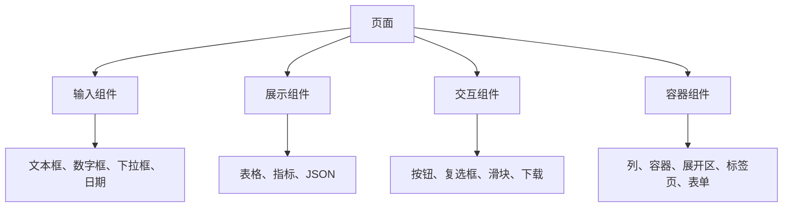

# 第 15 章 常用界面组件

上一章用几个组件跑通了一个页面，也说明了交互之后脚本怎样重跑、状态怎样保存。但组件远不止这几个，同一个页面需求往往有几种实现方式。

选对的前提，是先知道可选的范围，以及每种选择在什么条件下更合适。

## 本章要解决的问题

**Streamlit 有哪些常用组件？面对一个页面需求，怎样选对组件、用对参数？**

以一个带搜索、列表与新增按钮的管理页为例。同一个需求可以用不同组件实现：搜索可以做成输入框，也可以做成下拉框；列表可以做成可滚动的表，也可以做成静态的表。选错组件，页面仍能运行，但用户要多点几次，或者表格一长就难以阅读。

本章关心的是：面对一个页面需求，怎样判断哪里该用什么组件，以及组件的返回值与参数在什么时机起作用。

## 本章学习目标

读完第 15 章并完成实训后，应能：

1. 说出 Streamlit 组件的四类划分，并按页面需求选对类别。
2. 使用常用输入组件收集文本、数字、选项与日期，说明其返回值与重跑的关系。
3. 使用常用展示组件显示表格、指标与 JSON，并用 `column_config` 配置中文列名与显示格式。
4. 使用常用交互组件触发动作，说明 `st.button` 的返回值为什么只在点击当次有效。
5. 使用容器组件组织页面区域，并用 `st.form` 把多次输入攒成一次提交。
6. 在单位管理页实训中组合四类组件，用假数据完成列表、筛选与新增。

## 15.1 组件与页面

第 14 章用 `st.title`、`st.write`、`st.button` 跑通了页面。这三个调用已经展示了组件的工作方式：调用一次，页面上出现一个部件；调用的顺序就是部件从上到下的顺序。**组件**是框架提供的页面部件（定义见 14.3），一个页面由若干组件按顺序拼成。

Streamlit 的组件按用途分为四类。分类的作用不是背诵清单，而是拿到页面需求时先判断“用户要做什么”，再去找对应的类别：

| 类别 | 作用 | 代表组件 | 用户动作 |
| --- | --- | --- | --- |
| 输入组件 | 收集用户填写的值 | `st.text_input`、`st.number_input`、`st.selectbox`、`st.date_input` | 填、选 |
| 展示组件 | 把数据显示出来 | `st.dataframe`、`st.table`、`st.metric`、`st.json` | 看 |
| 交互组件 | 触发动作或改变条件 | `st.button`、`st.checkbox`、`st.slider`、`st.download_button` | 点、勾、拖 |
| 容器组件 | 组织页面区域 | `st.columns`、`st.container`、`st.expander`、`st.tabs`、`st.form` | 找、切换 |



*图 15-1：常用组件的四类分工*

**组件也有返回值**

输入与交互组件都有返回值：返回值就是用户当前填写的值或操作的结果。展示组件只负责显示，不返回用户数据；容器组件的返回值是容器对象，用于把组件放进去，不用于读取用户输入。因为第 14 章的重跑机制，输入与交互的返回值在每次重跑时重新读取；只在某一次重跑中成立的返回值（例如按钮），用法与普通值不同，15.4 会展开。

**选择组件的三步**

选择的顺序有三步：

1. **看用户动作**：要填值，找输入组件；要看数据，找展示组件；要触发一次动作，找交互组件；要分区，找容器组件。
2. **看数据形状**：列表用表格；单个关键数字用指标；结构化数据用 JSON；固定选项用下拉框。
3. **看数据量**：几十行以上用可滚动的 `st.dataframe`；三五行汇总用 `st.table`。

同一个需求通常有多个可选组件，选择标准是“让用户少一步、让状态不乱”，不是“功能最多”。每类掌握两三个常用组件即可，参数不必全记：在编辑器里输入 `st.` 查看补全，或查 Streamlit 官方文档的组件页；参数表按“用途、返回值、常用参数”三栏读即可。遇到不认识的组件，先看它返回什么，再看它触发重跑的时机。

本章不接后端，数据全部来自假数据；接口调用见第 16 章，页面级布局、多页面与导航见第 17 章，视觉优化见第 19 章。组件复用的做法见实训课后扩展。

## 15.2 输入组件

输入组件收集用户填写的值。每个输入组件都有返回值，返回值就是用户当前填写的内容；页面每次重跑时，返回值重新读取一次。常用输入组件如下：

| 组件 | 用途 | 关键参数 | 返回值 |
| --- | --- | --- | --- |
| `st.text_input` | 单行文本 | `placeholder`、`value`、`type="password"` | 字符串 |
| `st.text_area` | 多行文本 | `height`、`placeholder` | 字符串 |
| `st.number_input` | 数字 | `min_value`、`max_value`、`step`、`value` | 整数或浮点数 |
| `st.selectbox` | 单选下拉 | 选项列表、`index` | 选中的选项 |
| `st.multiselect` | 多选 | 选项列表、`default` | 选中项组成的列表 |
| `st.radio` | 单选按钮 | 选项列表、`index` | 选中的选项 |
| `st.date_input` | 日期 | `value`、`min_value`、`max_value` | 日期对象 |
| `st.file_uploader` | 上传文件 | `type` | 上传对象或 `None` |

**代码 15-1-1** · 示例代码（Python）

```python
full_name = st.text_input("单位名称", placeholder="输入关键字")
page_size = st.number_input("每页条数", min_value=5, max_value=50, value=10, step=5)
dept_code = st.selectbox("所属单位", ["D001", "D002"])
duty_date = st.date_input("执勤日期")
```

四个调用各返回一个值：`full_name` 是字符串，`page_size` 是数字，`dept_code` 是选中的单位编码，`duty_date` 是日期对象。单位编码可作为 `dept_code` 查询参数筛选人员列表，日期可与执勤记录的 `start_time` 比较，用于按日筛选。返回值都可以参与后面的过滤或显示。

输入组件自身的值由框架托管：用户在页面上填过的内容，重跑后仍在（见 14.4）。需要把值复制出来、跨页面共享或在按钮点击后继续使用时，才放进 `st.session_state`（见 14.5）。

**把多个输入包进表单**

输入组件还有一种组合用法：表单。不使用表单时，用户每改完一个输入（回车、移开焦点或改变选项），脚本就重跑一次。页面有多个输入时，用户每填一项都要等页面刷新一次，操作被打断，也容易在未填完时就触发查询。

**表单把填写与提交分开**

`st.form` 把多个输入包在一起，只在提交表单时重跑一次（Streamlit 官方文档）。它把“填写”和“提交”分成两个阶段：填写阶段页面不重跑，提交时一次性处理所有输入。提交按钮是主要入口；按 Streamlit 的默认行为，文本框内按回车也会提交表单。

**代码 15-1-2** · 示例代码（Python）

```python
with st.form("create_dept", clear_on_submit=True):
    dept_code = st.text_input("单位编码 *", placeholder="例如 1001")
    full_name = st.text_input("单位名称 *")
    address = st.text_input("地址")
    submitted = st.form_submit_button("提交")
```

`clear_on_submit=True` 让提交后自动清空输入，避免用户重复提交同一份数据；`submitted` 只在提交的那一次重跑中为真。表单本身也是一种容器，15.5 会说明容器的一般用法。

> 💡 **易错点**：把 `st.form_submit_button` 的返回值当成持续状态。它只在提交的那一次重跑中为真，下一次重跑就恢复为假；需要记住“用户提交过”时，要把结果写进 `st.session_state`。

## 15.3 展示组件

展示组件把数据显示出来，通常没有返回值。选择展示组件的依据是数据形状与数量，不是“哪个看起来更花哨”。常用展示组件如下：

| 组件 | 特点 | 适合 |
| --- | --- | --- |
| `st.write` | 通用展示，可显示文本、数字、表格等 | 说明文字、简单结果 |
| `st.dataframe` | 可排序、可滚动、可交互 | 数据列表 |
| `st.table` | 静态展示，全部铺开 | 少量汇总数据 |
| `st.metric` | 一个大数字加说明 | 关键指标 |
| `st.json` | 结构化展示 JSON | 调试接口返回 |
| `st.code` | 等宽字体展示代码 | 显示配置或命令 |

先准备一份假数据，后面的示例都使用它：

**代码 15-1-3** · 假数据（Python）

```python
import pandas as pd

departments = [
    {"dept_code": "1001", "full_name": "指挥中心", "address": "1 号楼"},
    {"dept_code": "1002", "full_name": "保障部", "address": "2 号楼"},
    {"dept_code": "1003", "full_name": "通信科", "address": "3 号楼"},
]

df = pd.DataFrame(departments)
```

**代码 15-1-4** · 示例代码（Python）

```python
st.dataframe(df, width="stretch", hide_index=True)
st.metric("单位总数", len(df), delta="本月新增 2 个")
st.json({"total": len(df), "items": departments})
```

**表格与指标各管什么**

`st.dataframe` 适合几十行以上的列表；`hide_index=True` 隐藏 Pandas 自带的行号；`width="stretch"` 让表格填满容器。`st.table` 会把所有行一次性铺开，只适合少量汇总数据；`st.metric` 用于突出一个关键数字；`st.json` 用于查看接口返回的原始结构。

**列显示配置**

表格的列显示可以单独配置。`column_config` 是一个字典：键是原字段名，值告诉 Streamlit“这一列怎么显示”（Streamlit 官方文档）。它把表格配置从数据逻辑里分离出来：数据照常传，显示格式单独配置。

| 配置 | 作用 |
| --- | --- |
| `st.column_config.TextColumn("中文名")` | 改表头，可设列宽 |
| `st.column_config.NumberColumn("中文名", format="%d")` | 设置数字格式 |
| `st.column_config.DateColumn("中文名", format="YYYY-MM-DD")` | 设置日期格式 |
| `st.column_config.CheckboxColumn("中文名")` | 把 0/1 显示为勾选框 |
| `None` | 隐藏该列 |

**代码 15-1-5** · 示例代码（Python）

```python
dept_config = {
    "dept_code": st.column_config.TextColumn("单位编码", width="small"),
    "full_name": st.column_config.TextColumn("单位名称"),
    "address": st.column_config.TextColumn("地址", width="large"),
}

st.dataframe(df, width="stretch", hide_index=True, column_config=dept_config)
```

三个要点：配置的键必须与字段名逐字一致；`width` 控制列宽（`small`、`medium`、`large`）；把某列配置成 `None` 可以隐藏它。

> 💡 **易错点**：表格显示英文列名，或日期显示成一串数字。`column_config` 的键必须和字段名逐字一致；日期列要先 `pd.to_datetime`，否则 `DateColumn`、`DatetimeColumn` 的格式不生效。

## 15.4 交互组件

交互组件触发动作或改变条件。它们的返回值与输入组件不同：有的只在触发的那一次重跑中成立，有的在每次重跑中都返回当前值。常用交互组件如下：

| 组件 | 用途 | 返回值 |
| --- | --- | --- |
| `st.button` | 触发一次动作 | 点击的那次重跑为真，其余为假 |
| `st.checkbox` | 勾选一个条件 | 当前是否勾选 |
| `st.toggle` | 开关一个条件 | 当前是否打开 |
| `st.slider` | 选择数值或范围 | 当前数值或区间 |
| `st.select_slider` | 从选项中选择一个 | 当前选项 |
| `st.download_button` | 下载数据 | 点击的那次重跑为真 |

**代码 15-1-6** · 示例代码（Python）

```python
if st.button("查询"):
    st.write("按关键字查询")

only_with_address = st.checkbox("只看有地址的单位")
top_n = st.slider("显示前 N 条", min_value=1, max_value=len(df), value=min(5, len(df)))

st.download_button(
    "导出 CSV",
    data=df.to_csv(index=False).encode("utf-8-sig"),
    file_name="departments.csv",
    mime="text/csv",
)
```

`st.button` 返回真只在点击触发的那一次重跑中成立，下一次重跑就恢复为假；因此“点击后执行的代码”必须放在 `if st.button(...):` 里面。`st.checkbox`、`st.toggle`、`st.slider` 返回当前值，值变化会触发重跑；它们的值在重跑后仍在，可以直接参与过滤。

`st.download_button` 在点击时返回真，同时浏览器开始下载；下载动作由组件完成，不需要在 `if` 里另写保存文件的代码。

> 💡 **易错点**：把按钮的返回值当成“用户点过”的长期状态。按钮只在点击当次为真；需要记住“用户点过”时，把结果写进 `st.session_state`，而不是依赖返回值。

## 15.5 容器与布局组件

容器组件不显示数据，也不收集值；它们负责把其他组件放进页面上的某个区域。页面由组件拼成，容器决定组件摆在哪里、怎样分组。常用容器组件如下：

| 组件 | 作用 | 典型用法 |
| --- | --- | --- |
| `st.columns` | 横向分栏 | 一行放筛选条件与查询按钮 |
| `st.container` | 分组容器 | 把相关组件包在一起 |
| `st.expander` | 可展开区域 | 高级筛选、说明文字 |
| `st.tabs` | 标签页切换 | 同一页面的多个视图 |
| `st.sidebar` | 侧边栏 | 全局筛选、页面入口 |
| `st.form` | 表单容器 | 把多次输入攒成一次提交（见 15.2） |

**代码 15-1-7** · 示例代码（Python）

```python
left, right = st.columns([2, 1])

with left:
    keyword = st.text_input("单位名称", placeholder="输入关键字")
with right:
    only_with_address = st.checkbox("只看有地址")

with st.expander("高级筛选"):
    selected = st.multiselect("单位", df["dept_code"].tolist())

tab_list, tab_summary = st.tabs(["单位列表", "汇总"])
with tab_list:
    st.dataframe(df, width="stretch", hide_index=True)
with tab_summary:
    st.metric("单位总数", len(df))
```

`st.columns` 按比例分栏：`[2, 1]` 表示左栏占两份、右栏占一份，只按比例划分，不能指定像素坐标（见 14.6）。`with` 块决定组件进入哪个容器；组件的调用顺序仍然是页面上的排列顺序。`st.expander` 适合把不常用的高级条件收起来；`st.tabs` 适合在同一个页面切换多个视图；`st.sidebar` 放全局筛选或页面入口。

页面级的区域规划、多页面组织与导航在第 17 章展开；本节只要求能把组件放进正确的容器。

> 💡 **易错点**：把 `st.columns` 当成像素布局。它只能按比例分栏，不能指定绝对宽度；列内再嵌套过多容器会让页面结构难以维护。

## 示范例题

两道示范例题分别练输入与展示。例 15-1 用表单把三个输入攒成一次提交；例 15-2 用表格与列配置把英文列名换成中文，并格式化时间列。

#### 例 15-1：用表单收集单位信息

**题目**：用 `st.form` 做一个新增单位表单，包含单位编码、单位名称、地址三个输入框和一个提交按钮；提交后显示输入值。

**解**：

**代码 15-2-1** · 示例代码（Python）

```python
with st.form("create_dept", clear_on_submit=True):
    col1, col2 = st.columns(2)
    with col1:
        dept_code = st.text_input("单位编码 *", placeholder="例如 1001")
    with col2:
        full_name = st.text_input("单位名称 *")
    address = st.text_input("地址")
    submitted = st.form_submit_button("提交")

if submitted:
    st.write(dept_code, full_name, address)
```

表单把三个输入攒成一次提交；`st.columns(2)` 把编码与名称并排放；`clear_on_submit=True` 在提交后清空；`submitted` 只在点击提交的那一次重跑中为真。

#### 例 15-2：用表格展示执勤记录并格式化时间列

**题目**：有三条执勤记录假数据（`id`、`personnel_certificate_number`、`workstation_id`、`start_time`、`status`），请用 `st.dataframe` 显示，隐藏行号、铺满宽度，把列名改成中文，并把 `start_time` 格式化为 `YYYY-MM-DD HH:mm`。

**解**：

**代码 15-2-2** · 示例代码（Python）

```python
records = pd.DataFrame([
    {"id": 1, "personnel_certificate_number": "P2025001", "workstation_id": "W01", "start_time": "2025-03-01 08:00", "status": "normal"},
    {"id": 2, "personnel_certificate_number": "P2025002", "workstation_id": "W02", "start_time": "2025-03-01 16:00", "status": "normal"},
    {"id": 3, "personnel_certificate_number": "P2025001", "workstation_id": "W01", "start_time": "2025-03-02 08:00", "status": "abnormal"},
])

record_config = {
    "id": st.column_config.NumberColumn("编号", width="small"),
    "personnel_certificate_number": st.column_config.TextColumn("人员证件号"),
    "workstation_id": st.column_config.TextColumn("哨位编号"),
    "start_time": st.column_config.DatetimeColumn("开始时间", format="YYYY-MM-DD HH:mm"),
    "status": st.column_config.TextColumn("状态"),
}

records["start_time"] = pd.to_datetime(records["start_time"])
st.dataframe(records, width="stretch", hide_index=True, column_config=record_config)
```

配置的键与字段名一一对应；时间列先转类型；`hide_index=True` 隐藏行号；`width="stretch"` 铺满容器。

## 独立习题

#### 习题 15-1

**题目**：说明下列组件或参数的作用，并指出各属于哪一类：`st.text_input` 的返回值、`st.form` 与 `st.form_submit_button`、`st.dataframe` 的 `hide_index`、`st.column_config.DateColumn`、`st.button` 的返回值、`st.columns`。

#### 习题 15-2

**题目**：某同学的表格出现三个问题：表头仍是英文；日期显示为 `1735689600000`；配置了地址列却看不到。请分别分析原因并给出修正方法。

#### 习题 15-3

**题目**：为“哨位管理”页面做组件选型：页面顶部是筛选区（哨位编号、是否启用），中间是哨位表格，右侧或下方是新增哨位表单。请列出页面区域与所用组件，写出表格、表单与筛选的关键代码，并说明为什么选这些组件，而不是同类中的其他组件。**不能照抄单位页的字段**：哨位有编号、名称、所属单位与启用状态，没有地址；新增表单要能选所属单位。

## ◆ 实训 15-1：单位管理页项目案例

### 一、任务目标与验收

| 目标 | 验收标志 |
| --- | --- |
| 四类组件齐全 | 输入、展示、交互、容器各至少用一个 |
| 表格可读 | 中文列名、列宽合理、行号隐藏 |
| 表单可用 | 提交前不触发重跑，提交后一次性处理 |
| 筛选可用 | 条件生效，空结果有提示 |
| 案例完整 | 指标、表格、搜索、新增在同一页面运行 |

### 二、课前准备

- 第 14 章的页面骨架
- 10–20 条单位假数据（`dept_code`、`full_name`、`address`）
- 组件速查表或 Streamlit 官方文档

### 三、操作步骤

1. **读需求、列组件清单**
   - 做什么：把页面分成指标区、筛选区、表格区、新增区
   - 操作：为每个区域写下所用组件与类别，凑齐输入、展示、交互、容器四类
   - 预期输出：一张“区域—组件—类别”清单
   - 做错会看到什么：清单里只有表格与按钮；补输入组件与容器组件
2. **搭输入区**
   - 做什么：搜索框与新增表单
   - 操作：搜索用 `st.text_input`；新增用 `st.form` 包住三个输入与 `st.form_submit_button`
   - 预期输出：填写过程中页面不重跑，提交后才处理
   - 做错会看到什么：每改一个输入就重跑；把输入放进 `st.form`
3. **搭展示区**
   - 做什么：指标卡与单位表格
   - 操作：`st.metric` 显示单位总数；`st.dataframe` 显示列表；`column_config` 配中文列名与列宽
   - 预期输出：列名可读、行号隐藏
   - 做错会看到什么：列名仍是英文；补 `column_config` 并核对字段名
4. **加交互与空态**
   - 做什么：让筛选条件生效
   - 操作：读取搜索框与复选框的值，先过滤再显示；结果为空时用 `st.info` 提示
   - 预期输出：条件变化后表格更新；空结果显示提示而不是空表
   - 做错会看到什么：空结果直接报错；补空态分支
5. **整合与自测**
   - 做什么：把四块拼成一个页面
   - 操作：新增的数据先放进 `st.session_state` 的假数据列表；按“空结果、超长文本、重复提交”三条路径各走一遍
   - 预期输出：三条路径都不报错，页面状态一致
   - 做错会看到什么：新增后表格不更新；确认新增写入了同一份数据并在重跑后读取

### 四、排错清单

| 现象 | 先查什么 |
| --- | --- |
| 输入框总被清空 | 输入是否放在 `st.form` 中，或表单是否设置了 `clear_on_submit` |
| 表单提交后没刷新 | 提交分支是否重新读取数据 |
| 按钮点击后代码每次都执行 | 执行代码是否放在 `if st.button(...)` 里 |
| 表头还是英文 | `column_config` 的键与字段名是否逐字一致 |
| 日期显示成一串数字 | 是否先 `pd.to_datetime` |
| 表格列顺序乱 | 是否显式指定列或配置 |
| 假数据与真接口字段不一致 | 先按接口契约造假数据，字段名逐字一致 |

### 五、提交与验收

提交页面脚本与假数据演示；验收按“组件选择”“表单与状态”“表格可读”“案例完整”四项判定。

### 六、课后扩展

- 把重复的表格或表单代码抽成函数（可选；同样的代码出现第二次再抽，抽完重跑确认输出不变）
- 用真接口替换假数据，记录字段差异（第 16 章）
- 换场景：用哨位、器材等实体重做一遍组件选型
- **复习任务**：回看第 14 章 14.4–14.5，对照本章 15.2–15.4，说明输入、展示、交互组件分别在什么时机触发重跑、哪些值需要放进 `session_state`

## 本章小结

**核心结论**：

1. **组件分四类**：输入组件收集值，展示组件显示数据，交互组件触发动作，容器组件组织区域；先按用户动作选类别，再按数据形状选组件。
2. **输入组件返回当前值**：组件自身的值由框架托管；`st.form` 把多次输入攒成一次提交，避免逐项重跑。
3. **展示组件按数据形状选**：列表用 `st.dataframe`，少量汇总用 `st.table`，关键数字用 `st.metric`，结构化数据用 `st.json`；`column_config` 负责中文表头与显示格式。
4. **交互组件的返回值分两种**：`st.button` 只在点击当次为真；`checkbox`、`toggle`、`slider` 返回当前值，变化即重跑。
5. **容器决定组件摆在哪里**：`columns` 按比例分栏，`container`、`expander`、`tabs`、`sidebar` 负责分组与切换；页面级布局与多页面在第 17 章。
6. **案例把四类组件组合起来**：单位管理页用指标、表格、筛选、表单构成一个可操作页面，假数据只用于界面验证。

把这章压缩成一句话：**页面由组件拼成：先按用户要做的动作选类别，再按数据形状选组件，最后用容器把区域摆清楚。**

组件的选择标准是让用户少一步、让状态不乱，而非功能多。

**自检**：回到章首的学习目标，逐条问自己做到了没有——

- [ ] 说出 Streamlit 组件的四类划分，并按页面需求选对类别。
- [ ] 使用常用输入组件收集文本、数字、选项与日期，说明其返回值与重跑的关系。
- [ ] 使用常用展示组件显示表格、指标与 JSON，并用 `column_config` 配置中文列名与显示格式。
- [ ] 使用常用交互组件触发动作，说明 `st.button` 的返回值为什么只在点击当次有效。
- [ ] 使用容器组件组织页面区域，并用 `st.form` 把多次输入攒成一次提交。
- [ ] 在单位管理页实训中组合四类组件，用假数据完成列表、筛选与新增。

