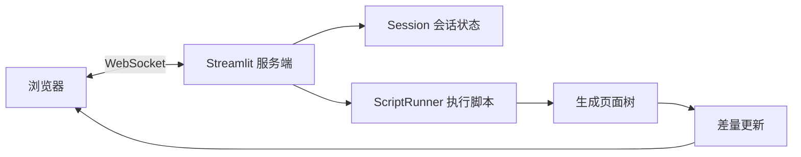

# 第 16 章 前端开发框架基础

> **节首信息条**｜对应课次 16 · 2 学时 · 理论讲授｜前置：第 4 章的 HTTP 与接口契约；第 10–15 章的后端接口；基本 Python 语法

写一个页面，上面只有一个按钮和一行数字，点一次让数字加 1。代码只要四行：先 `count = 0`，按钮按下就 `count += 1`，最后把 `count` 显示出来。怎么看都对。可真点下去，页面永远显示 1，从来不会变成 2。

更奇怪的是同一页上的输入框：你在里面打了名字，再点一次按钮，名字还好端端地留着。同样是一次点击，为什么有的东西会丢、有的不会丢？

这不是语法写错了，是你还不知道这个页面每次点击到底发生了什么。本章就围着这个「坏掉的计数器」走一圈：先看清页面由什么组成，再看一次点击背后是谁在算，最后说清状态该放在哪里。走完这一圈，那行修复代码你会自己写出来，也会明白本书为什么选 Streamlit、它又在哪里不够用。

## 本章学习目标

读完第 16 章，你应该能：

1. 说明前端在系统中的位置，以及 HTML、CSS、JavaScript 各自负责什么。
2. 解释 Streamlit 的“脚本重跑”事件模型，以及 session_state 为什么能跨重跑保存状态。
3. 用分区布局组织一个单页界面，并说出界面设计的四条基本原则。
4. 判断 Streamlit 适合与不适合的场景，并说明理由。
5. 读懂一个真实页面脚本，指出其中触发重跑与保存状态的位置。

## 前置知识卡

| # | 你需要已经会 | 不会就回看 |
| --- | --- | --- |
| 1 | 写过带变量和 `if` 的 Python 脚本，知道「一段代码从头执行一遍」是什么意思 | 附录 A《Python 基础》；本章 16.1.5 会用一次点击把它讲透 |
| 2 | 调过第 10–15 章的接口，见过 `{"items": [...], "total": 12}` 这样的返回 | 第 10 章 10.1；本章 16.1.1 会从这段 JSON 讲起 |
| 3 | 在浏览器里用过登录表单、按钮和表格，能指出页面上有哪些东西 | 属已有经验，无需回看；本章 16.1.2 用得到 |
| 4 | 看得懂 `st.title(...)` 这种「名字.方法(参数)」的写法 | 附录 A；不要求会写 `class` 或装饰器 |

本章不要求你会 HTML、CSS 或 JavaScript。16.1.2 只用一张表帮你认出三者的分工，能认出来就够；真正要动手写的是 Python。

> 卡住时先回看，不必从头重读。16.1.5 读不顺，多半是「脚本会被从头重跑」这件事还没落地，回到章首那个计数器再点一遍。

## 16.1 概念讲解

### 16.1.1 前端在系统里的位置

把第 10 章部门列表接口返回的东西，原样拿给值班老师看：

`{"items": [{"dept_code": "D01", "full_name": "综合办公室"}], "total": 12}`

他会问：我要点的按钮在哪儿？想按部门名称找，框在哪儿？这一串花括号是给程序读的，不是给人用的。**前端**就是把这串东西变成一张能看、能点、能填的页面；**后端**负责查出这 12 条数据、判断谁能查、按约定格式返回。

于是每次操作都走一个来回：你在页面上点「下一页」，前端把它变成一次 HTTP 请求发给后端；后端查完返回新的 `items`；前端再把新的 `items` 摆回表格里。所谓「前后端分离」，分开的是这两件事的职责，不一定要分开两台机器——本课程里它们常跑在同一台电脑上，也仍然一个管算、一个管显示。

前端因此要同时懂两件事：页面怎么组织（本章与第 17 章），接口怎么调用（第 19 章起联调时展开）。本章先只解决第一件。

### 16.1.2 HTML、CSS、JavaScript 各做什么

先看一个你一定见过的登录页：左上一行「值班数据统计系统」的标题，中间两个输入框，下面一个蓝色按钮，按钮是圆角、离输入框有一指宽的空隙。点下去，页面跳到部门列表。

把这一页拆开看，其实是三层，各管一件互不替代的事：

| 技术 | 管什么 | 刚才那个页面上对应什么 |
| --- | --- | --- |
| HTML | 结构：页面上有哪些东西、谁挨着谁 | 标题、两个输入框、按钮这几个「部件」本身 |
| CSS | 样式：这些东西长什么样 | 蓝色、圆角、字号、那一指宽的间距 |
| JavaScript | 交互：点了以后发生什么 | 点「登录」后跳到列表页 |

把蓝色改成红色，结构没变；把按钮从输入框下面挪到旁边，样式没变；点按钮没反应，前两层都对，坏的是第三层。三者分开写，改颜色时不会碰坏点击逻辑——这就是「既好维护又好扩展」的实际意思。

本书不会让你手写这三层。但认得出它们，才看得懂 16.1.3 里 Streamlit 替你做了什么，也才明白 16.1.9 说的「精细控制能力有限」具体少了哪一块。

### 16.1.3 Streamlit：用 Python 写界面

按上一节的方式做，一个部门列表页要写 HTML、写 CSS，再写 JavaScript 发请求、把返回的 `items` 拼成表格。第 10–15 章刚写完后端的你，得再学三门语言的写法，才能看见自己的数据。

Streamlit 换了个做法：这些部件你都用 Python 写。`st.title("部门管理")` 出标题，`st.text_input("部门名称")` 出输入框，`st.dataframe(df)` 出表格；HTML、CSS、JavaScript 由框架按这些调用生成。四行 Python 出一个页面，代价是你不能指定「按钮距左边 137 像素」，也做不了复杂动画。

这是一次明确的取舍：**用控制力换开发速度**。值班管理这类内部工具、后台、数据查询与统计展示，要的是把数据清楚摆出来、让同事能点能填，不是像素级排版；正好是这笔交换划算的场景。16.1.9 会把不划算的场景一起说清。

### 16.1.4 Streamlit 的架构

回到章首那个计数器。有个细节值得停一下：你点按钮，浏览器地址栏没变、页面也没有整页刷新，可数字却重新变成了 1。说明「重新算一遍」这件事不在浏览器里发生——浏览器只负责显示和把点击报上去，真正执行你的 Python 脚本的是另一头的服务端。

下面这张图就是这「两头」之间的通路。**第一遍只认两个角色**：左边的浏览器、右边跑脚本的服务端。中间几个名字这一遍眼熟即可，16.1.5 会用一个按钮点击把它们串成一条线。



*图 16-1：Streamlit 的运行架构*

图上这几个名字，各管一段，这一遍只要能对上「谁在做」：

- **WebSocket**：浏览器与服务端之间一条不断开的双向通道，点击由它送过去。
- **Session**：记住「现在是谁在看这个页面」，每个访问者一份。
- **ScriptRunner**：每次交互把你的 `.py` 从头执行一遍。
- **页面树**：这一次执行算出来的「页面上该有什么」。
- **差量更新**：只把页面树上变了的部分发回浏览器，所以你不会看到整页闪一下。

其中 Session 里有一块专门的地方叫 `st.session_state`。章首「输入框里的名字还在」和「计数器归零」，差别就在这里——16.1.6 会讲透。

### 16.1.5 事件模型：操作 → 重跑 → 更新

现在把一次点击摊开，看那个计数器到底坏在哪。

**现象**。点第一下，数字从 0 变成 1；点第二下，还是 1；点第十下，还是 1。代码明明写了 `count += 1`。

**先试几个笨办法**。把 `count = 0` 挪到 `if` 里面？那连 `count` 有没有定义都说不清。改成 `global`？脚本本来就只有一个文件，帮不上忙。写进文本文件再读回来？能行，但两个人同时打开页面会互相覆盖，而且每次点击都要读磁盘——为了一个计数器付出这些，明显不对。这几个办法都绕开了真正的问题：不是「怎么把值留住」，而是「它为什么会没」。

**命名**。Streamlit 不在点击时局部修改页面，而是把整个脚本**从头到尾重新执行一遍**，这叫重跑；这一次执行算出一张新的页面树，再和上一张比较，只把不同的部分发回浏览器，这叫差量更新（16.1.4 刚见过这两个词）。

**机制**。既然是「从头执行」，`count = 0` 每次点击都会被执行一次：先清零，再 `+= 1`，于是永远等于 1。这不是框架的缺陷，是它最核心的工作方式。一句话记住：**页面不是被修改的，而是被重新算了一遍**。

**边界**。那为什么输入框里的名字没丢？因为输入框的值不由你的普通变量保存，框架把这类组件的状态记在 Session 里，重跑时按记录还原。会丢的，是你自己写在脚本里的普通变量；不会丢的，是框架托管的状态和后面要讲的 `st.session_state`。章首那半页的疑问，到这里闭合。

这条规律还顺带解释两件常见的事：布局代码每次点击都重新执行，所以别在里面放耗时的查询；一次点击里写了两遍日志，多半也是因为页面被重跑了。

### 16.1.6 session_state：跨重跑保存状态

既然会丢的是脚本里的普通变量，修法就很自然：把值放到一个「不在脚本里、但脚本能读写」的地方。Streamlit 给的这个地方叫 `st.session_state`，它按访问者分开存放，重跑不会清空。

坏掉的版本：

**代码 16-1-2** · 示例代码（Python）

```python
count = 0
if st.button("点我 +1"):
    count += 1
st.write("当前计数：", count)
```

修好的版本，只多了开头两行：

**代码 16-1-4** · 示例代码（Python）

```python
if "count" not in st.session_state:
    st.session_state.count = 0

if st.button("点我 +1"):
    st.session_state.count += 1

st.write("当前计数：", st.session_state.count)
```

读这段抓住三点：`if "count" not in ...` 是**只在第一次**设初始值（重跑时这句判断为假，不会把计数清零）；`st.session_state.count` 既能像字典那样写成 `["count"]`，也能像属性那样写成 `.count`；除此之外，加减和显示的写法跟普通变量完全一样。

本章只要求你能解释「为什么第二种写法不会归零」。登录态、分页页码、筛选条件这些真实用法，会在第 18–20 章反复出现，到时候你会认得它。

### 16.1.7 单页布局：分区而不是定位

再看一个具体的别扭：你想把「系统状态」和「快速开始」两张卡片并排放，左边宽一点、右边窄一点。第一反应是找「距左边多少像素」的设置——Streamlit 里找不到，这不是你没翻到。

它用的是**分区**：你说明「这一行分成两列，宽度比 2:1」，以及「哪些内容装进哪一带」，具体像素由框架按窗口宽度算。概念就从这里落地：分区是你给比例与归属，定位是你给坐标；Streamlit 只提供前者。

常用的四个容器，看过 16.1.2 的登录页就能对上号：

| 容器 | 作用 | 页面上看到什么 |
| --- | --- | --- |
| `st.columns([2, 1])` | 横向分列，数字是宽度比例 | 左边一块占三分之二，右边一块占三分之一 |
| `st.container(border=True)` | 把一组内容装进一个框 | 带边框的卡片 |
| `st.sidebar` | 左侧边栏 | 页面左边那条窄栏 |
| `st.tabs` | 同一区域分页签 | 「部门」「人员」两个标签 |

**代码 16-1-6** · 示例代码（Python）

```python
import streamlit as st

st.set_page_config(page_title="值班数据统计系统", layout="wide")
st.title("🗂️ 值班数据统计系统")

left, right = st.columns([2, 1])

with left:
    with st.container(border=True):
        st.subheader("系统状态")
        st.write("后端服务正常")

with right:
    with st.container(border=True):
        st.subheader("快速开始")
        st.write("先看列表，再试新增")

with st.sidebar:
    st.caption("当前用户：admin")
```

把窗口拖窄，两列会自动堆叠成一列——这正是分区换来的好处，不用为窄屏再写一套坐标。代价是 16.1.3 说过的：不能像 CSS 那样指定像素位置。这是取舍，不是缺陷；第 18 章规划多页面区域时还会用到它。

### 16.1.8 界面设计原则

设想一个页面：首页一口气铺了十张表；「部门管理」的新增按钮在右上角，「人员管理」的却跑到左下角；有个按钮写着「确定」，点下去把记录删了；新增人员时先让你填十个暂时用不上的字段。

你大概一眼就觉得别扭。把这份别扭说清楚，就是下面四条：

| 原则 | 含义 | 刚才那个页面违反了什么 |
| --- | --- | --- |
| 简洁 | 一屏只放当前任务需要的东西 | 首页堆满十张表 |
| 一致 | 同类操作用同样的位置和样式 | 新增按钮一会儿在左、一会儿在右 |
| 可预测 | 点了会发生什么，用户能预期 | 按钮叫「确定」，却执行删除 |
| 以用户为中心 | 按用户的任务顺序组织页面 | 先让用户填十个无关字段 |

注意这四条不是美术要求，判断标准都是「用户会不会弄错、会不会多走一步」。第 18 章规划页面区域、第 21 章做仪表盘时，会拿它们当检查表用。

### 16.1.9 适用与局限

现在能说清 16.1.3 那笔交换的边界了。Streamlit 适合内部工具、管理后台、数据查询与统计展示、原型验证与课程项目：这些场景页面结构规整、用户量不大、要的是快速把数据摆出来。它不适合精细排版、复杂动画、高并发公网产品，对 SEO 也不友好——前者受限于「分区而不定位」，后者受限于「每次交互都重跑整个脚本」。

所以选框架的顺序是：先看场景，再动手写页面；不要写了一半才发现要像素级布局。本课程做的是值班数据统计这类内部工具，选它有理由，不只是因为它简单。

### 16.1.10 读一个真实页面

打开 `duty_frontend` 的登录页，按「结构—样式—交互」读三遍：第一遍只找部件（标题区、表单、两个输入框、提交按钮、承载卡片的容器），对应 16.1.2 的 HTML；第二遍看颜色、字号、间距，对应 CSS；第三遍点一次登录，看页面怎么变，对应 JavaScript 那一层，也顺带印证 16.1.5 的「重跑」。

读页面不是看热闹，是把组件、布局与事件对上号。读完再回到章首那个计数器：现在你应该能在页面上指出，哪一行触发了重跑、哪一个值被框架托管、哪一个值被清零。

## 16.2 示范例题

下面两道题都回到章首那个坏掉的计数器。例 16-1 把一次点击拆成三步，写完后再看一眼「每点一次都显示 1」，应该能自己说出原因；例 16-2 把 16.1.7 的分区布局落到纸上，做的时候留意「比例」和「坐标」的区别。

#### 例 16-1：解释一次按钮点击发生了什么【Bloom：理解】

**题目**：在 Streamlit 页面里点击一次按钮，脚本会发生什么？为什么页面不是被“局部修改”？请按“操作—重跑—更新”三步说明。

**解**：

1. **操作**：浏览器把点击事件通过 WebSocket 发给 Streamlit 服务端。
2. **重跑**：ScriptRunner 把脚本从头到尾重新执行一遍，重新生成页面树；普通变量重新初始化。
3. **更新**：Streamlit 比较新旧页面树，只把变化的部分发给浏览器，即差量更新。

所以页面不是被局部修改，而是被重新计算后对比出来的；这也是为什么跨重跑的状态要放进 `session_state`。

#### 例 16-2：写一个单页布局【Bloom：应用】

**题目**：用 Streamlit 写一个单页：页面标题为“值班数据统计系统”，宽布局；左侧两列放“系统状态”和“快速开始”两张卡片；侧边栏显示当前用户。

**解**：

**代码 16-2-1** · 示例代码（Python）

```python
import streamlit as st

st.set_page_config(page_title="值班数据统计系统", layout="wide")
st.title("🗂️ 值班数据统计系统")

left, right = st.columns([2, 1])

with left:
    with st.container(border=True):
        st.subheader("系统状态")
        st.write("后端服务正常")

with right:
    with st.container(border=True):
        st.subheader("快速开始")
        st.write("先看列表，再试新增")

with st.sidebar:
    st.caption("当前用户：admin")
```

`set_page_config` 设置页面标题与宽布局；`columns([2, 1])` 按 2:1 分列；`container(border=True)` 形成卡片；`sidebar` 放侧边信息。

## 16.3 独立习题

#### 习题 16-1【Bloom：记忆】

**题目**：写出下列 Streamlit 组件或函数的用途：`st.title`、`st.write`、`st.text_input`、`st.button`、`st.columns`、`st.container`、`st.sidebar`、`st.session_state`。

#### 习题 16-2【Bloom：理解】

**题目**：用自己的话解释“页面不是被修改，而是被重新算了一遍”。并说明为什么普通变量在点击按钮后会重置，而 `st.session_state` 不会。

#### 习题 16-3【Bloom：分析】

**题目**：某同学写了下面的计数器，点击按钮后数字始终是 1。请分析原因，并给出两种修正方案（一种用 `session_state`，一种说明为什么普通变量做不到）。

**代码 16-4-1** · 示例代码（Python）

```python
count = 0
if st.button("点我 +1"):
    count += 1
st.write("当前计数：", count)
```

#### 习题 16-4【Bloom：理解】（原理解释）

**题目**：Streamlit 每次交互都重跑整个脚本，为什么仍然能保留用户输入？请从事件模型与 `session_state` 两方面解释。

## ◇ 课堂活动块（课次 16 · 理论讲授）

**听讲要点**：

1. 前端负责把数据变成可看可点的界面。
2. HTML 结构、CSS 样式、JavaScript 行为各司其职。
3. Streamlit 每次交互都重跑脚本，session_state 保存跨次状态。
4. 布局用分区，不靠绝对定位。
5. 选框架先看场景，工具没有全能。

**讨论·演示**：

1. （讨论）为什么 Streamlit 每次点击都重跑整个脚本，却不会让输入框清空？
2. （演示）把同一个页面的“布局、状态、数据请求”三段分别指出来。

**课后自测**：完成独立习题 16-1、16-2（答案见书末 98-参考答案），作为课次 16 的书面检查。

**回链**：本章目标与习题逐条对应，见章末「本章小结」。

## 本章小结

**核心结论**：

1. 前端由结构（HTML）、样式（CSS）与交互（JavaScript）组成；Streamlit 用 Python 把三者包起来，用控制力换开发速度。
2. Streamlit 的架构是浏览器、WebSocket、Session、ScriptRunner 四层；每次交互都会重跑脚本并做差量更新。
3. 页面不是被局部修改，而是被重新计算；普通变量会重置，跨重跑的状态要放进 `st.session_state`。
4. 单页布局用 `columns`、`container`、`sidebar`、`tabs` 分区，不做像素级定位；窄屏会自动堆叠。
5. 设计遵循简洁、一致、可预测、以用户为中心；Streamlit 适合内部工具与数据应用，不适合精细前端与高并发公网产品。

**学完本章，你可以体会到**：前端不是“画得好看”，而是把后端的契约变成用户能理解、能操作的一组动作。
**自检**：回到章首的学习目标，逐条问自己做到了没有——

- [ ] 说明前端在系统中的位置，以及 HTML、CSS、JavaScript 各自负责什么。 → 回看 16.1.1–16.1.2，自测：习题 16-1
- [ ] 解释 Streamlit 的“脚本重跑”事件模型，以及 session_state 为什么能跨重跑保存状态。 → 回看 16.1.5–16.1.6，自测：习题 16-2、16-4
- [ ] 用分区布局组织一个单页界面，并说出界面设计的四条基本原则。 → 回看 16.1.7–16.1.8，自测：例 16-2、习题 16-1
- [ ] 判断 Streamlit 适合与不适合的场景，并说明理由。 → 回看 16.1.9，自测：口头各举一个适合与不适合的场景，并各说一条理由
- [ ] 读懂一个真实页面脚本，指出其中触发重跑与保存状态的位置。 → 回看 16.1.10，自测：习题 16-3、16-4

**下一章预告**：知道了页面怎么跑起来，下一章学习常用组件：输入、展示、交互三类，把页面真正搭起来。

