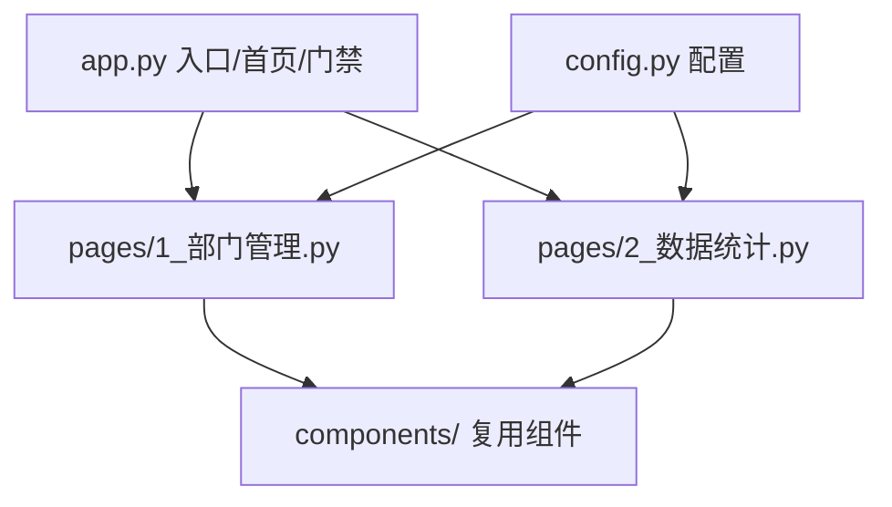

# 第 16 章 前端页面设计

> **节首信息条**｜对应课次 18 · 4 学时 · 实践｜前置：第 15 章的组件与表单；第 14 章的 session_state；基本的多页面概念

**已会**：第 15 章的输入、展示、交互组件，以及用表单与表格搭出的单个管理页。
**本章只加**：页面组织——用 `pages/` 组织多页面，规划区域与访问边界。
**关系**：第 15 章搭好一个页面；本章把若干页面组织成一套“不让人迷路”的界面。

上一章搭好了一个部门管理页。一个系统不会只有一个页面：部门、人员、统计，各自需要独立的入口。

## 本章要解决的问题

**一张页面怎样组织信息层级、导航与访问边界，才不让人迷路？**

功能都在页面上，读者却不知道从哪里开始：标题、筛选、表格、按钮挤在一起，找不到入口；导航名用代码里的叫法，点进去之前不知道会看到什么；直接输入子页面的地址，还能绕过登录。

本章从一个页面走到一套页面：用 `pages/` 目录组织多页面，让导航自动生成；给每个页面规划区域；再给子页面加一道登录守卫。

## 本章学习目标

读完第 16 章并完成实训后，你应该能：

1. 按“每个位置只干一件事”组织前端目录，并说明 `pages/` 自动导航的规则。
2. 规划一个页面的区域：标题、筛选、操作、内容、反馈各放哪里。
3. 实现页面访问守卫，未登录用户不能直接进入管理页。
4. 用比例与自动堆叠实现响应式布局，并说明为什么不用绝对定位。
5. 按信息层级优化页面，并让导航命名可预测。

## 16.1 信息层级

**信息层级**指页面上的信息按什么顺序被看到：用户先看到什么、再看到什么、哪些是主、哪些是次。层级失败时，信息都在，但读者不知道从哪里开始。

三个典型的层级失败：

| 现象 | 读者遇到的问题 | 根因 |
| --- | --- | --- |
| 所有功能堆在一页 | 找不到入口，滚动很久 | 没有按任务分区，也没有多页面 |
| 标题、筛选、表格、按钮紧挨着 | 不知道按钮作用于整张表还是某一行 | 区域之间没有边界与留白 |
| 导航名用代码语言 | 不知道点进去会看到什么 | 名称没有对应用户的任务 |

判断层级是否清楚，不看“好不好看”，看一个可观察的结果：**新用户第一次打开页面，能否在十秒内说出“我在哪、能查什么、下一步点哪”。** 能，层级成立；不能，先改区域与导航，再谈配色。

这是第 4 章“分层与职责”在前端的复现：页面也要按职责切分——入口、筛选、内容、操作各占一块，互不混在一起。

**基础版与美化版的差别**

基础版与美化版的差别，通常不在“颜色好不好看”，而在信息层级是否清楚。基础版可能把标题、筛选、表格、操作挤在一起；美化版用容器分组、留白、字号与颜色区分主次，让用户一眼看到“当前任务”。

评价一个页面，可以看四件事：用户能否一眼知道自己在哪；筛选与内容是否分区；操作是否放在该出现的位置；窄屏时是否仍然可用。配色只服务这四件事，不为装饰而装饰。

## 16.2 前端项目的目录结构

页面一多，代码放在哪里就成了问题。一个够用的前端目录如下：

**代码 16-1-1** · 示例（文本）

```text
duty_frontend/
├── app.py                  # 入口：首页 + 登录门禁
├── pages/
│   ├── 1_部门管理.py       # 子页面 1
│   └── 2_数据统计.py       # 子页面 2
├── components/
│   └── table.py            # 可复用表格/分页
├── config.py               # 后端地址、超时、分页大小
├── requirements.txt        # 依赖
└── .streamlit/
    └── config.toml         # 主题配置
```

| 位置 | 作用 | 谁负责 |
| --- | --- | --- |
| `app.py` | 入口、首页、登录门禁 | 每个项目一个 |
| `pages/` | 每个文件就是一个页面 | 按功能拆分 |
| `components/` | 跨页面复用的组件 | 第二次用到时再抽 |
| `config.py` | 配置集中管理 | 只改一处 |
| `requirements.txt` | 依赖清单 | 部署和换机时用 |

不要把页面代码全写进 `app.py`；不要每个页面各写一份后端地址；`components/` 不要提前造，出现重复再抽。



*图 16-1：前端项目的页面组织*

> 💡 **易错点**：把“分目录”理解成“目录越多越专业”。目录的判据是“每个位置只干一件事”；如果一个目录里只有一个空文件，或者两个目录职责重叠，说明分得不对。

## 16.3 多页面与侧边栏

`pages/` 下的每个 `.py` 文件自动成为一个页面；文件名前的数字决定顺序；去掉数字前缀后成为导航名称。不需要手写导航菜单。这就是**导航**：用户通过侧边栏知道有哪些页面、当前在哪一页。

**代码 16-1-2** · 示例代码（Python）

```python
# app.py
import streamlit as st

st.set_page_config(page_title="值班数据统计系统", page_icon="🗂️", layout="wide")
st.title("🗂️ 值班数据统计系统")
st.caption("请从左侧选择功能页面")
```

**代码 16-1-3** · 示例代码（Python）

```python
# pages/1_部门管理.py
import streamlit as st

st.set_page_config(page_title="部门管理", page_icon="🏢", layout="wide")
st.title("🏢 部门管理")
st.info("页面骨架：列表、搜索、新增尚未接入。")
```

三条规则：`st.set_page_config` 必须是页面里第一个 Streamlit 调用；文件名不要用空格和特殊符号；页码前缀用 `1_`、`2_`，不要用 `01-`，避免排序意外。

**导航命名的可预测性**

导航名称用用户的语言，不用代码语言。写“部门管理”而不是 `dept_crud`；写“数据统计”而不是 `analytics2`。名称要能预测页面内容：点“数据统计”应该看到指标与图表，而不是一个空白页。

命名还会影响层级：导航项太多时，用页面分组（例如“基础数据”“业务数据”“统计”）把同类功能放在一起；层级不要超过两层，再深用户就要靠记忆找路。

## 16.4 页面的区域与布局

一个管理页面通常分四个区域：标题区、筛选区、内容区、操作区。用户先看标题，知道“我在哪”；再看筛选，知道“能查什么”；然后看内容，知道“有什么”；最后看操作，知道“能做什么”。

**代码 16-1-4** · 示例（文本）

```text
部门管理页
┌────────────────────────────────────┐
│ 标题区：部门管理 + 一句话说明        │
├────────────────────────────────────┤
│ 筛选区：关键字 / 排序字段 / 排序方式  │
├────────────────────────────────────┤
│ 内容区：部门列表（表格 + 分页）       │
├────────────────────────────────────┤
│ 操作区：新增 / 编辑 / 删除            │
└────────────────────────────────────┘
```

同一类信息放在同一区域；操作区不要压在表格中间；筛选区不要和标题混在一起。页面地图（Page Map）先画在纸上，再写代码。

**响应式布局**

**代码 16-1-5** · 示例代码（Python）

```python
left, right = st.columns([2, 1])
with left:
    st.info("主内容区")
with right:
    st.info("辅助区")
```

列比例 `[2, 1]` 表示主区占 2 份、辅区占 1 份；窗口变窄时列会自动堆叠，不需要写媒体查询；表格、图表用 `width="stretch"` 填满所在容器。Streamlit 做不到像素级响应式，只能做“比例 + 自动堆叠”。

**分区细度与页面长度**

把每个区域都塞进独立容器、加大留白，层级会更清楚，但一屏能放的信息变少，用户要滚动。分区不是越细越好：标题、筛选、内容、操作四块已经够用；再往下拆，先问“拆出来的这块是否承担独立任务”，不是就先合并。

> 💡 **易错点**：只用绝对定位或固定像素宽度做布局。窗口一变窄，元素就重叠或溢出；Streamlit 的 `columns`、`container`、`width="stretch"` 已经能覆盖大多数管理页面，不需要自己算坐标。

## 16.5 页面访问守卫

多页面带来一个新问题：用户可以直接输入地址进入子页面，绕过登录。解决办法是“每个页面进门先查证件”。

**访问守卫**指在页面入口检查登录态（必要时检查角色），不满足就停止渲染。它不是后端权限的替代，而是让未登录用户看到清楚的提示，而不是一个报错页面。

**代码 16-1-6** · 示例代码（Python）

```python
import streamlit as st

def require_login():
    """未登录时提示并停止渲染当前页面。"""
    if "access_token" not in st.session_state:
        st.warning("请先登录后再访问该页面")
        st.stop()
```

在每个子页面顶部调用 `require_login()`。`st.stop()` 会立即停止当前脚本，后面的内容不再渲染；守卫必须写在页面最上面，不能写在表格后面。

前端守卫只是“体验”，真正的权限仍由后端校验；守卫不能只写在首页，每个子页面都要写。本章只检查“有没有令牌”，令牌是否有效由接口验证。

**守卫的前后端分工**

前端守卫能立刻给出提示、避免无谓的请求，但它挡不住直接调接口的人；后端权限能真正拦住越权，但用户要等请求返回才知道被拒绝。两者都要有：前端负责“体验”，后端负责“边界”。只做前端，等于把门锁画在门上；只做后端，用户会先看到一个空页面再看到错误。

> 💡 **易错点**：把守卫只写在 `app.py` 首页。`pages/` 下的每个文件都是独立脚本，用户可以直接访问；每个子页面顶部都要调用守卫。

## 示范例题

#### 例 16-1：搭一个部门管理页骨架【Bloom：应用】

**题目**：按“标题区、筛选区、内容区、操作区”搭一个部门管理页骨架，筛选区用三列，内容区与操作区先用占位提示。

**解**：

**代码 16-2-1** · 示例代码（Python）

```python
import streamlit as st

st.set_page_config(page_title="部门管理", page_icon="🏢", layout="wide")

st.title("🏢 部门管理")
st.caption("维护值班业务中的部门信息：查询、分页、新增、编辑与删除。")

with st.container(border=True):
    col1, col2, col3 = st.columns([2, 1, 1])
    with col1:
        st.text_input("部门名称", placeholder="输入关键字")
    with col2:
        st.selectbox("排序字段", ["dept_code", "full_name", "create_time"])
    with col3:
        st.selectbox("排序方式", ["desc", "asc"])

st.subheader("部门列表")
st.info("列表区域：接入后端后替换为真实数据。")

st.subheader("新增 / 编辑 / 删除")
st.info("操作区域：后续章节完成。")
```

四个区域按用户阅读顺序排列；筛选区用 `[2, 1, 1]` 分列；内容区与操作区分开，不把按钮塞进表格。

#### 例 16-2：对比基础版与美化版【Bloom：评价】

**题目**：基础版把标题、搜索框、表格、新增按钮从上到下紧挨着放；美化版把筛选放进带边框的容器，表格单独成区，操作放在表格下方。请从信息层级、可预测性、窄屏可用性三个维度评价两版，并说明美化版是否真的更好。

**解**：

1. **信息层级**：基础版所有元素权重相近，用户视线没有落点；美化版用容器与留白把“筛选—内容—操作”分开，主次更清楚。
2. **可预测性**：基础版按钮紧挨表格，用户可能误以为按钮只作用于当前行；美化版把操作区放在表格下方并加小标题，含义更明确。
3. **窄屏可用性**：基础版一列到底，窄屏仍可用但很长；美化版若用比例列，窄屏会自动堆叠，仍可用；若用固定像素宽度，则可能溢出。
4. 结论：美化版在信息层级与可预测性上更好，但前提是窄屏仍能堆叠；如果美化引入了固定宽度或过多颜色，反而降低可用性。评价应看“用户是否更快完成当前任务”，而不是“看起来更花哨”。

## 独立习题

#### 习题 16-1【Bloom：分析】

**题目**：某多页面应用出现三个问题：用户直接输入子页面地址可以绕过登录；新增按钮夹在筛选区与表格之间；窄屏时表格溢出。请分别分析原因并给出修正方法。

#### 习题 16-2【Bloom：评价】（开放题）

**题目**：下面两种部门页布局，你更推荐哪一种？请从信息层级、可预测性、窄屏可用性三个维度说明理由。

- 布局 A：标题、搜索框、表格、新增按钮从上到下紧挨着放。
- 布局 B：标题区、带边框的筛选区、表格区、独立操作区，筛选区用 `[2, 1, 1]` 分列。

## ◆ 实训 16-1：前端页面设计（对应课次 18 · 4 学时）

### 一、任务目标与验收

| 目标 | 验收标志 |
| --- | --- |
| 目录结构清楚 | 入口、页面、组件、工具各就各位 |
| 导航可用 | `pages/` 页面能被自动发现 |
| 守卫生效 | 未登录访问管理页被拦截 |
| 布局响应式 | 窄屏下自动堆叠 |
| 导航命名一致 | 名称能预测页面内容 |

### 二、课前准备

- 第 15 章的可用页面
- 至少两个角色的测试账号
- 一份页面区域草图

### 三、操作步骤

1. **整理目录**
   - 做什么：整理目录
   - 操作：把入口、页面、组件、工具分目录
   - 预期输出：→ 每个文件只承担一件事
   - 做错会看到什么：所有代码堆在入口文件；按职责拆分
2. **规划区域**
   - 做什么：规划区域
   - 操作：在纸上画出四个区域及优先级
   - 预期输出：→ 主操作在首屏可见
   - 做错会看到什么：区域过多；合并次要信息或移到次级页
3. **加页面守卫**
   - 做什么：加页面守卫
   - 操作：在管理页入口检查登录态与角色
   - 预期输出：→ 未登录被拦截并提示
   - 做错会看到什么：只在按钮上隐藏；守卫必须放在页面入口
4. **响应式与命名**
   - 做什么：响应式与命名
   - 操作：用比例列与自动堆叠改造，统一导航命名
   - 预期输出：→ 窄屏可用、名称可预测
   - 做错会看到什么：绝对定位导致错位；改用容器与列

### 四、排错清单

| 现象 | 先查什么 |
| --- | --- |
| 页面 404 | 文件是否在 `pages/`、命名是否正确 |
| 守卫被绕过 | 检查是否只在前端隐藏按钮 |
| 窄屏错位 | 绝对定位或固定宽度 |
| 导航名难懂 | 用“对象+动作”命名，避免缩写 |

### 五、提交与验收

提交页面目录与两种屏幕宽度的截图；验收按“结构”“守卫”“布局与命名”三项判定。

### 六、课后扩展

- 给页面加面包屑或标题层级
- 把可复用区域抽成组件
- 写一份页面区域规划说明
- **复习任务**：回看本章 16.3 与第 15 章 15.2，对照本章 16.1–16.5，说明组件、列比例与页面守卫分别在“一个页面”和“一套页面”里承担什么

## 本章小结

**核心结论**：

1. **信息层级**决定用户能否在十秒内说出“我在哪、能查什么、下一步点哪”；判断标准是任务效率，不是装饰。
2. 前端项目按职责分目录：`app.py` 入口与门禁、`pages/` 页面、`components/` 复用组件、`config.py` 配置、`requirements.txt` 依赖。
3. `pages/` 下每个 `.py` 文件自动成为页面，文件名数字决定顺序，去掉前缀成为**导航**名；导航名要能预测页面内容。
4. 页面按“标题—筛选—内容—操作”分区，先画页面地图再写代码；响应式用比例列与 `width="stretch"`，窄屏自动堆叠。
5. 每个子页面顶部加**访问守卫**；`st.stop()` 停止渲染；前端守卫只是体验，真正权限在后端。

把这章压缩成一句话：**多页面不是多写几个文件，而是让用户知道自己在哪、能去哪、下一步做什么。**

**本章不引入**：设计系统、无障碍标准全文、响应式框架。这些在后续课程或工程环境中按需了解。

**学完本章，你可以体会到**：页面设计的第一原则是“让用户知道自己在哪、下一步做什么”，美观是第二位的。

**自检**：回到章首的学习目标，逐条问自己做到了没有——

- [ ] 按“每个位置只干一件事”组织前端目录，并说明 `pages/` 自动导航的规则。
- [ ] 规划一个页面的区域：标题、筛选、操作、内容、反馈各放哪里。
- [ ] 实现页面访问守卫，未登录用户不能直接进入管理页。
- [ ] 用比例与自动堆叠实现响应式布局，并说明为什么不用绝对定位。
- [ ] 按信息层级优化页面，并让导航命名可预测。

**下一章预告**：页面骨架立住了，下一步把假数据换成真实接口。下一章用 `requests` 封装 API 客户端，完成登录、取数与错误处理。
