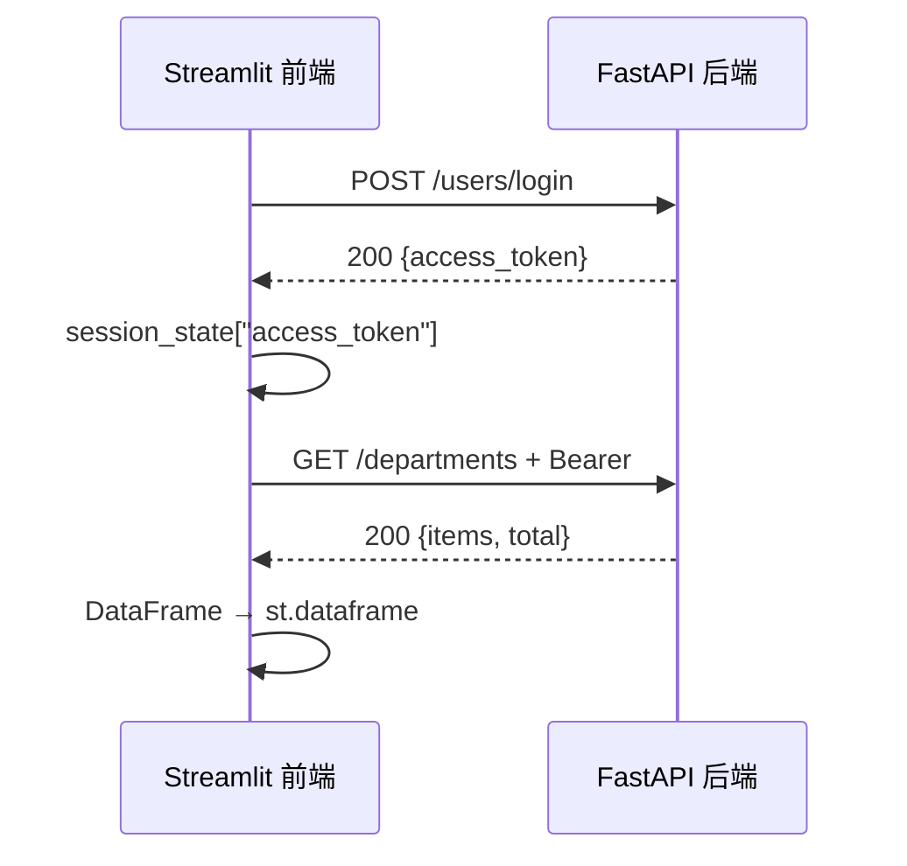

# 第 16 章 数据读取与展示

上一章用组件搭好了单位页，数据还是假的：刷新浏览器就恢复。真实数据在后端数据库，界面必须通过接口去取。

请求能发出去只是开始；返回之后怎样表达等待与失败，才决定页面是否可信。

## 本章要解决的问题

**前端怎样按契约取数，并把加载、空数据、错误三种状态都处理清楚？**

第一次写请求，常见的失败是：地址差一个前缀、令牌没有带上、返回的字段名与页面读的对不上。请求成功之后，还要面对“正在加载”“没有数据”“请求失败”三种状态；少处理一种，用户就分不清是没数据还是没连上。

本章关心的是：一次请求从页面发出到数据回到页面，中间哪些环节最容易断，以及加载、空与失败各自该由谁负责。

## 本章学习目标

读完第 16 章并完成实训后，应能：

1. 按契约发一次请求，说明 URL、方法、参数与请求头四要素。
2. 登录并保存令牌，在后续请求中携带。
3. 把重复的请求逻辑封装成 `api_client`，统一地址、超时、令牌与错误。
4. 从 `items` 中选字段展示列表，并处理加载态、空态与错误态。
5. 按“状态码 → detail → /docs → 代码”的顺序排查联调问题。

## 16.1 HTTP 请求要素与状态码

先不封装，也不接登录，只发一个最简单的请求。后端的 `/health` 不需要令牌，适合确认地址与联通性。

**代码 16-1-1** · 示例代码（Python）

```python
import requests

BASE_URL = "http://127.0.0.1:8000"

resp = requests.get(f"{BASE_URL}/health", timeout=10)
print(resp.status_code)
print(resp.json())
```

`status_code` 返回 200，说明地址与端口正确；`resp.json()` 返回 `{"status": "healthy"}`。这一步只验证一件事：请求发得出去、响应收得回来。`/health` 是服务级健康检查，不属于任何业务模块；业务接口挂在各自的模块路径下，例如 `/departments`。

**四要素与先读状态码**

一次 HTTP 调用包含四个要素（RFC 9110；requests 官方文档）：

| 要素 | 写法 | 说明 |
| --- | --- | --- |
| 地址 | `BASE_URL + 路径` | 端口不能漏，路径要与 `/docs` 一致 |
| 方法 | `requests.get/post` | 查用 GET，登录用 POST |
| 参数 | `params=` / `json=` | 查询参数用 `params`，请求体用 `json` |
| 请求头 | `headers={"Authorization": ...}` | 令牌放这里 |

先看 `status_code`，再看 `json()`。状态码不是 200，就不要急着读数据；错误信息通常在 `detail` 里。

## 16.2 登录与令牌

单位列表需要登录。先看 `/docs`：登录是 `POST /users/login`，请求体是用户名与密码，返回 `access_token`、`token_type` 与当前用户公开信息 `user`。

**登录之后带上令牌**

**代码 16-1-2** · 示例代码（Python）

```python
import streamlit as st
import requests

BASE_URL = "http://127.0.0.1:8000"

if "access_token" not in st.session_state:
    with st.form("login"):
        username = st.text_input("用户名", value="admin")
        password = st.text_input("密码", type="password")
        submitted = st.form_submit_button("登录")

    if submitted:
        resp = requests.post(
            f"{BASE_URL}/users/login",
            json={"username": username, "password": password},
            timeout=10,
        )
        if resp.status_code == 200:
            st.session_state["access_token"] = resp.json()["access_token"]
            st.rerun()
        else:
            st.error("用户名或密码错误")

    st.stop()
```

这段代码把第 15 章的表单与第 14 章的会话状态接了起来：表单收集用户名与密码；登录成功后把令牌存进 `st.session_state`，再 `st.rerun()` 让页面带着登录态重新执行；`st.stop()` 阻止未登录时继续渲染后面的内容。

拿到令牌后，列表请求把它放进 `Authorization` 头：

**代码 16-1-3** · 示例代码（Python）

```python
token = st.session_state["access_token"]

resp = requests.get(
    f"{BASE_URL}/departments",
    params={"page": 1, "page_size": 10},
    headers={"Authorization": f"Bearer {token}"},
    timeout=10,
)

data = resp.json()
print(data["total"])
for item in data["items"][:2]:
    print(item["full_name"])
```

令牌有三个动作：登录成功取出 `access_token` 存进 `session_state`；之后的请求由请求头自动带上；退出登录时清空 `session_state` 并 `st.rerun()`。密码输入框必须 `type="password"`，令牌不要打印到页面上。

## 16.3 请求封装与四项统一

上面两段代码都把地址、超时、请求头与错误处理写了一遍。页面一多，这些写法会不一致：有的页面处理 401，有的不处理；改一次端口，要改所有页面。

这一节一次给出完整的客户端代码，比前面的示例长。第一遍先看结构与 `get` / `post` 两个入口，不必逐行记住；`put` / `delete` 与 422 的压平留到写增删改页面时再回看。

**把请求收进一个客户端**

先把环境相关的值集中到一个文件：

**代码 16-1-4** · `config.py`（配置集中，Python）

```python
import os

API_BASE_URL = os.getenv("DUTY_API_BASE_URL", "http://127.0.0.1:8000").rstrip("/")
API_PREFIX = ""
REQUEST_TIMEOUT = 10
DEFAULT_PAGE_SIZE = 10
```

再把请求收进一个客户端：

**代码 16-1-5** · `api_client.py`（最小版，Python）

```python
import requests
import streamlit as st

from config import API_BASE_URL, API_PREFIX, REQUEST_TIMEOUT

class ApiError(Exception):
    def __init__(self, status_code: int, detail: str):
        self.status_code = status_code
        self.detail = detail
        super().__init__(detail)

def _url(path: str) -> str:
    return f"{API_BASE_URL}{API_PREFIX}{path}"

def _headers() -> dict:
    token = st.session_state.get("access_token")
    return {"Authorization": f"Bearer {token}"} if token else {}

def _request(method: str, path: str, **kwargs):
    try:
        resp = requests.request(method, _url(path), headers=_headers(), timeout=REQUEST_TIMEOUT, **kwargs)
    except requests.RequestException as exc:
        raise ApiError(0, f"无法连接后端服务：{exc}") from exc

    if resp.status_code == 401:
        st.session_state.pop("access_token", None)
        raise ApiError(401, "登录已过期，请重新登录")

    if not resp.ok:
        try:
            detail = resp.json().get("detail", resp.text)
        except ValueError:
            detail = resp.text
        if isinstance(detail, list):
            detail = "；".join(str(item.get("msg", item)) for item in detail)
        raise ApiError(resp.status_code, str(detail))

    return resp.json() if resp.content else None

def get(path: str, params: dict | None = None):
    return _request("GET", path, params=params)

def post(path: str, json: dict | None = None):
    return _request("POST", path, json=json)

def put(path: str, json: dict | None = None):
    return _request("PUT", path, json=json)

def delete(path: str):
    return _request("DELETE", path)
```

四个统一：**请求封装**的地址统一在 `config.py`；请求头统一由 `_headers` 带令牌，这一步通常称为**令牌注入**；超时统一；错误统一转成 `ApiError`。页面中写 `import api_client as api`，之后调用 `api.get(...)` / `api.post(...)`，只捕获 `ApiError`，不直接处理 `requests` 的异常。

阅读这段代码时，先看 `get` 与 `post` 两个入口；`put` 与 `delete` 的写法相同，写增删改页面时使用。`_request` 里的 401 与 422 是本节难点，先记住两条结论：401 要清除登录态，避免拿着过期令牌反复请求；FastAPI 的 422 `detail` 是一个列表，显示前要压平成一句话，否则页面会显示一串 Python 字典。

**只封装四件事**

封装的粒度也要控制：只封装“地址、超时、请求头、错误”四件事，够用且一眼能看懂；再往上加自动重试、缓存、并发，会把客户端变成一个小框架，调试时反而难定位。本课程只要求四个统一；重试与缓存作为课后扩展，按项目需要再加。

> 💡 **易错点**：每个页面各写一份完整 URL 与 `try/except`。改一次端口或错误格式，要改所有页面；页面之间还会出现“有的处理 401、有的不处理”的不一致。先把请求收进一个入口，再写页面。

## 16.4 数据展示的三种状态

列表页的取数与展示如下：

**代码 16-1-6** · 示例代码（Python）

```python
import pandas as pd
import api_client as api

try:
    with st.spinner("正在加载单位列表..."):
        data = api.get("/departments", params={"page": 1, "page_size": 10})
except api.ApiError as exc:
    st.error(exc.detail)
    st.stop()

items = data.get("items", [])
if not items:
    st.info("暂无单位数据")
else:
    df = pd.DataFrame(items)
    st.dataframe(df[["dept_code", "full_name", "address"]], width="stretch", hide_index=True)
    st.caption(f"共 {data.get('total', 0)} 条")
```

列表响应结构是 `{"items": [...], "total": ...}`，先取 `items`；表格只显示需要的字段，不要把整个 JSON 全铺出来；空数据要提示，不要显示一个空表格。

**加载、空与错误三种状态**

列表页通常有三种界面状态：

| 状态 | 触发 | 界面 |
| --- | --- | --- |
| **加载态** | 请求进行中 | `st.spinner("正在加载...")` |
| **空态** | 请求成功但 `items` 为空 | `st.info("暂无数据")` |
| 错误态 | 请求失败（网络、401、404、422、500） | `st.error(exc.detail)` + `st.stop()` |

错误后 `st.stop()`，避免后面的代码继续执行；否则页面可能在错误提示下面继续渲染空表或旧数据，用户会以为系统坏了。

**三种状态各自回答一个问题**

三种状态的提示各有分工：加载态的关键是“让用户知道还在等”，不是一定要转圈；空态的关键是“告诉用户为什么空、下一步做什么”，不是只写“无数据”；错误态的关键是“说清原因与下一步”，不是把堆栈贴给用户。三种状态各自回答一个问题，不能用一个 `st.info("无数据")` 包打天下。

> 💡 **易错点**：把空数据当成错误。`items=[]` 是正常的业务结果（该条件下确实没有记录），用 `st.info` 提示即可；用 `st.error` 或 `st.stop()` 会让用户以为系统出错。

## 16.5 联调排错顺序

联调失败通常断在三个地方：

| 断点 | 典型现象 | 先查什么 |
| --- | --- | --- |
| 地址 | 404、连不上 | 基地址、端口、路径拼写、资源名单复数 |
| 令牌 | 401、页面回到登录 | 是否登录、请求头是否 `Authorization: Bearer <token>`、令牌是否过期 |
| 字段 | 表格有行无值、空列 | 返回结构是否 `{"items": [...], "total": ...}`、字段名是否逐字一致 |

排查按“状态码 → detail → `/docs` → 代码”的顺序进行：

| 现象 | 先查什么 |
| --- | --- |
| 连不上 | 后端是否启动；地址与端口 |
| 404 | 路径是否与 `/docs` 一致；资源名是否复数、是否多写末尾斜杠 |
| 401 | 是否登录；请求头是否 `Bearer <token>`；令牌是否过期 |
| 422 | 请求体字段名、类型；查询参数格式 |
| 返回空列表 | 数据库是否有数据；分页参数是否超出范围 |
| 页面白屏 | 是否有未捕获异常；`st.stop()` 是否放对位置 |

不要一看到报错就改代码，先确认“请求发到哪、返回了什么”。在 `_request` 里临时打印 URL 与状态码，是最快的定位方法。



*图 16-1：登录、取令牌与读取列表的链路*

**从外到内的排查顺序**

排错顺序背后的逻辑是“从外到内”：状态码告诉你问题属于哪一类；`detail` 告诉你具体哪一项；`/docs` 告诉你契约原本怎么写；最后才看代码，确认是前端传错还是后端返回错。跳过前两步直接改代码，往往改错地方。

## 示范例题

#### 例 16-1：登录并读取单位列表

**题目**：用 `requests` 完成登录并读取单位列表：正确账号拿到令牌；带令牌请求列表，打印 `total` 与前两条单位名称。

**解**：

**代码 16-2-1** · 示例代码（Python）

```python
import requests

BASE = "http://127.0.0.1:8000"

login = requests.post(f"{BASE}/users/login", json={"username": "admin", "password": "admin123"}, timeout=10)
token = login.json()["access_token"]

resp = requests.get(
    f"{BASE}/departments",
    params={"page": 1, "page_size": 10},
    headers={"Authorization": f"Bearer {token}"},
    timeout=10,
)
data = resp.json()
print(data["total"])
for item in data["items"][:2]:
    print(item["full_name"])
```

顺序是“先登录拿令牌，再带令牌请求”。列表响应取 `items` 与 `total`，字段名以后端为准。

#### 例 16-2：处理 401、404 与 422

**题目**：说明不带令牌请求列表、路径写错、登录缺字段三种情况分别返回什么，并写出页面应如何提示。

**解**：

1. 不带令牌：后端返回 401，`detail` 为“登录已过期”；`api_client` 清除登录态并抛出 `ApiError(401, ...)`，页面提示“请重新登录”并回到登录页。
2. 路径写错：后端返回 404；`ApiError(404, ...)`，页面提示“接口不存在，请检查路径”，同时检查路径拼写、资源名复数和末尾斜杠。
3. 登录缺字段：后端返回 422，`detail` 是列表；`api_client` 把列表压平成一句话，页面提示“密码字段必填”之类的具体信息。

页面统一用 `try/except api.ApiError` 捕获，不让异常冒到页面顶层导致白屏。

## 独立习题

#### 习题 16-1

**题目**：说明一次“登录后读取单位列表”的完整流程：请求发到哪里、带什么、令牌从哪里来、响应如何取出数据。并解释为什么要统一封装 `api_client`，而不是每个页面直接 `requests.get`。

#### 习题 16-2

**题目**：联调时出现四个现象：连不上后端、列表 404、列表 401、页面白屏。请分别给出最可能的原因与排查步骤。

#### 习题 16-3

**题目**：依据下面这份“器材列表”接口文档，完成一个数据读取页面：`GET /devices`，查询参数 `page`、`page_size`、`status`（`in_stock` / `borrowed`），返回 `{"items": [{"device_code", "device_name", "status"}], "total": 12}`；未登录返回 401，参数非法返回 422。请写出 `api_client` 调用、表格字段选择与三态处理，并说明如果后端某天把 `status` 改名为 `device_status`，页面哪一处会先暴露问题。**不能照抄单位列表的字段与参数**：器材有状态，单位没有。

## ◆ 实训 16-1：数据读取与展示

### 一、任务目标与验收

| 目标 | 验收标志 |
| --- | --- |
| 接口调用正确 | 四要素与后端 `/docs` 一致 |
| 客户端统一 | 基地址、超时、错误、令牌四处统一 |
| 登录闭环 | 登录后令牌可用，过期有提示 |
| 三态齐全 | 加载、空、错误均有界面反馈 |
| 排错有据 | 至少记录一次按顺序定位的过程 |

### 二、课前准备

- 后端已启动，`/docs` 可访问
- 一个可登录的测试账号
- 第 15 章的单位页

### 三、操作步骤

1. **跑通一次请求**
   - 做什么：先用一个不需要令牌的接口确认联通
   - 操作：请求 `/health`，打印状态码与响应
   - 预期输出：状态码 200，响应为 `{"status": "healthy"}`
   - 做错会看到什么：连不上；先查后端是否启动、端口与地址
2. **接登录**
   - 做什么：调用登录接口并保存令牌
   - 操作：用表单收集用户名与密码；成功后把令牌存进 `session_state`
   - 预期输出：后续请求自动带 `Authorization: Bearer <token>`
   - 做错会看到什么：令牌放在普通变量里；改用 `session_state`
3. **封装客户端**
   - 做什么：把地址、超时、请求头与错误处理收进 `api_client`
   - 操作：页面只调用 `api.get` / `api.post`
   - 预期输出：页面代码不再散落完整 URL
   - 做错会看到什么：每个页面各写一份请求逻辑；收拢到客户端
4. **展示列表与三态**
   - 做什么：取 `items` 渲染表格，并补三种状态
   - 操作：加载用 `st.spinner`；空态用 `st.info`；错误用 `st.error` + `st.stop`
   - 预期输出：列表可读，三种情况都有明确提示
   - 做错会看到什么：错误只打印到控制台；用户界面要给可读提示
5. **排错**
   - 做什么：故意制造一次 404 或 401，按顺序定位
   - 操作：按“状态码 → detail → `/docs` → 代码”记录每一步
   - 预期输出：一份可复述的排错记录
   - 做错会看到什么：一看到报错就改代码；先确认请求与响应

### 四、排错清单

| 现象 | 先查什么 |
| --- | --- |
| 401 | 令牌是否携带、是否过期 |
| 404 | URL 前缀、尾斜杠、路径参数 |
| 422 | 请求体字段名与类型 |
| 页面空白 | 是否处理了空列表或异常 |

### 五、提交与验收

提交 `api_client`、页面代码与一次联调排错记录；验收按“契约一致”“三态处理”“排错过程”三项判定。

### 六、课后扩展

- 给客户端加重试与超时策略
- 把错误提示统一成组件
- 用 `/docs` 生成一份接口对照表
- **复习任务**：回看第 3 章 3.2 与第 8 章 8.2、8.4，对照本章 16.1–16.5，说明地址、令牌、字段、状态码四条线在联调中各自对应哪一步

## 本章小结

**核心结论**：

1. 请求要素与状态码：一次 HTTP 调用包含地址、方法、参数与请求头四要素；先看 `status_code`，再看 `json()`。
2. 登录成功后把令牌存进 `session_state`；后续请求把它放进 `Authorization: Bearer`；退出登录清空会话。
3. **请求封装**统一地址、请求头、超时与错误；**令牌注入**由 `_headers` 自动完成；401 清除登录态；422 的 `detail` 列表要压平后显示。
4. 列表响应先取 `items`，再选字段显示；**加载态**、**空态**、错误态分别处理，错误后 `st.stop()`。
5. 排错按“状态码 → detail → `/docs` → 代码”的顺序，先确认请求与响应，再改代码。

把这章压缩成一句话：**契约决定请求怎么发，封装决定错误怎么收，三态决定用户看到什么。**

**自检**：回到章首的学习目标，逐条问自己做到了没有——

- [ ] 按契约发一次请求，说明 URL、方法、参数与请求头四要素。
- [ ] 登录并保存令牌，在后续请求中携带。
- [ ] 把重复的请求逻辑封装成 `api_client`，统一地址、超时、令牌与错误。
- [ ] 从 `items` 中选字段展示列表，并处理加载态、空态与错误态。
- [ ] 按“状态码 → detail → /docs → 代码”的顺序排查联调问题。
