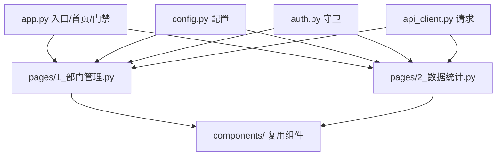

# 第 17 章 前端页面设计

> **节首信息条**｜对应课次 17 · 4 学时 · 实践｜前置：第 15 章的组件与表单；第 16 章的接口调用与三态；第 14 章的 session_state

第 15 章搭好了部门管理页，上一章把它接上了真实接口。现在系统有两个页面：部门页与数据页。一个系统还会继续增加页面：人员、统计、配置，各自需要独立的入口。

页面一多，四个问题随之出现：新页面放在哪里、目录怎样组织、一个页面内部怎样分区与排序、未登录用户能不能直接进入。本章先把两个页面扩成一套页面，再说明目录、区域、信息层级与访问守卫的组织方式。

## 本章要解决的问题

**一个页面怎样长成一套页面？多页面、目录、区域、信息层级与访问边界应该怎样组织？**

第 15 章的部门页与第 16 章的数据页各是一个脚本。继续增加页面时，如果仍把所有代码写进入口文件，改一处要翻很久；直接输入子页面地址还能绕过登录；页面内部标题、筛选、表格、按钮挤在一起，用户不知道从哪里开始。

本章先把两个页面组织成多页面应用，再说明目录、区域、信息层级与守卫的组织方式。

## 本章学习目标

读完第 17 章并完成实训后，应能：

1. 用 `pages/` 目录把一个页面扩成多页面应用，并说明自动导航规则。
2. 按职责组织前端目录，说明入口、页面、复用组件与配置的作用及设计目的。
3. 规划页面四个区域，用比例列实现窄屏可用。
4. 用信息层级的判据评价页面，指出层级失败并给出改法。
5. 在每个子页面实现访问守卫，并让导航命名可预测。

## 17.1 多页面与侧边栏

现在有两个页面：部门页与数据页。最直接的组织方式是各写一份脚本，再手写一份菜单；复制出来的页面各自维护，改一处要同步几份，菜单也会在页面增删后失配。

Streamlit 提供了 `pages/` 目录：把每个页面写成一个 `.py` 文件放进去，框架自动发现并生成侧边栏导航（Streamlit 官方文档）。文件名前的数字决定顺序；去掉数字前缀后成为导航名称。不需要手写菜单。

**代码 17-1-1** · 示例代码（Python）

```python
# app.py
import streamlit as st

st.set_page_config(page_title="值班数据统计系统", page_icon="🗂️", layout="wide")
st.title("🗂️ 值班数据统计系统")
st.caption("请从左侧选择功能页面")
```

**代码 17-1-2** · 示例代码（Python）

```python
# pages/1_部门管理.py
import streamlit as st

st.set_page_config(page_title="部门管理", page_icon="🏢", layout="wide")
st.title("🏢 部门管理")
st.info("页面骨架：列表、搜索、新增尚未接入。")
```

三条规则：`st.set_page_config` 必须是页面里第一个 Streamlit 调用；文件名不要用空格和特殊符号；页码前缀用 `1_`、`2_`，不要用 `01-`，避免排序意外。

导航名称要用用户的语言，不用代码语言。写“部门管理”而不是 `dept_crud`；写“数据统计”而不是 `analytics2`。名称要能预测页面内容：点“数据统计”应该看到指标与图表，而不是一个空白页。

命名还会影响层级：导航项太多时，用页面分组（例如“基础数据”“业务数据”“统计”）把同类功能放在一起；层级不要超过两层，再深用户就要靠记忆找路。

> 💡 **易错点**：把所有页面继续写在 `app.py` 里，再手写一份菜单。`pages/` 的价值是“新增页面等于新增文件”，导航与页面列表自动一致；手写菜单会在页面增删后失配。

## 17.2 前端项目的目录结构

17.1 建出了 `pages/`。页面一多，文件放在哪里、配置写在哪里、复用代码放在哪里，需要有稳定的约定。下面这份目录按运行时职责划分，不是按文件类型罗列：

**代码 17-1-3** · 示例（文本）

```text
duty_frontend/
├── app.py                  # 入口：首页 + 登录门禁
├── auth.py                 # 登录守卫与会话检查
├── api_client.py           # 请求封装与错误处理
├── pages/
│   ├── 1_部门管理.py       # 子页面 1
│   └── 2_数据统计.py       # 子页面 2
├── components/
│   └── table.py            # 跨页面复用的表格
├── config.py               # 后端地址、超时、分页大小
├── requirements.txt        # 依赖
└── .streamlit/
    └── config.toml         # 主题配置
```

| 位置 | 职责 | 设计目的 |
| --- | --- | --- |
| `app.py` | 应用外壳、首页、登录门禁入口 | 所有页面共享的入口只写一次 |
| `auth.py` | 登录检查与会话读写 | 守卫逻辑只写一次，各页面调用 |
| `api_client.py` | 请求封装与错误处理 | 页面不重复写地址、令牌与异常处理 |
| `pages/` | 每个文件一个页面 | 自动发现；新增页面等于新增文件，不用改导航 |
| `components/` | 跨页面复用的组件 | 同一段界面代码出现第二次再抽，避免复制 |
| `config.py` | 后端地址、超时、分页大小 | 环境相关值集中，换环境只改一处 |
| `requirements.txt` | 依赖清单 | 换机或部署时可复现 |
| `.streamlit/config.toml` | 主题与运行配置 | 主题与页面代码分离 |

这样分的目的可以归为四条：

1. **变更局部性**：改后端地址只动 `config.py`，改请求封装只动 `api_client.py`，改守卫只动 `auth.py`，改某个页面只动 `pages/` 下的一个文件。改一处时知道该改哪里，不会牵动整份脚本。
2. **职责分离**：入口负责装配与门禁，页面负责内容，`api_client.py` 负责请求，`components/` 负责复用，配置负责环境差异。每个位置只有一类变化原因。
3. **可预测性**：新增一个页面时，只需要在 `pages/` 下加一个文件；框架自动生成导航，不需要同步修改菜单。
4. **可交接性**：换一个人接手时，先看目录就知道从哪里开始；不需要读完整个 `app.py` 才能找到某个页面。

这也是第 4 章“分层与职责”在前端项目上的复现：分层不是把文件拆得越细越好，而是让每类改动只落在一个位置。若把所有代码写进 `app.py`，各类变化都挤在一个文件里，改一处要读完全部代码，页面之间还会互相影响。



*图 17-1：前端项目的页面组织*

> 💡 **易错点**：把“分目录”理解成“目录越多越专业”。目录的判据是“每个位置只干一件事”；如果一个目录里只有一个空文件，或者两个目录职责重叠，说明分得不对。

## 17.3 页面的区域与布局

一个管理页面通常分四个区域：标题区、筛选区、内容区、操作区。用户先看标题，知道“我在哪”；再看筛选，知道“能查什么”；然后看内容，知道“有什么”；最后看操作，知道“能做什么”。

**代码 17-1-4** · 示例（文本）

```text
部门管理页
┌────────────────────────────────────┐
│ 标题区：部门管理 + 一句话说明        │
├────────────────────────────────────┤
│ 筛选区：关键字 / 排序字段 / 排序方式  │
├────────────────────────────────────┤
│ 内容区：部门列表（表格 + 分页）       │
├────────────────────────────────────┤
│ 操作区：新增 / 编辑 / 删除            │
└────────────────────────────────────┘
```

同一类信息放在同一区域；操作区不要压在表格中间；筛选区不要和标题混在一起。这种先画出区域与跳转关系的草图通常称为**页面地图**（Page Map）：先画在纸上，再写代码。

区域排好后，还要保证窄屏可用。比例列是最常用的做法：

**代码 17-1-5** · 示例代码（Python）

```python
left, right = st.columns([2, 1])
with left:
    st.info("主内容区")
with right:
    st.info("辅助区")
```

列比例 `[2, 1]` 表示主区占 2 份、辅区占 1 份；窗口变窄时列会自动堆叠，不需要写媒体查询；表格、图表用 `width="stretch"` 填满所在容器。Streamlit 做不到像素级响应式，只能做“比例 + 自动堆叠”。

分区不是越细越好。把每个区域都塞进独立容器、加大留白，层级会更清楚，但一屏能放的信息变少，用户要滚动。标题、筛选、内容、操作四块已经够用；再往下拆，先问“拆出来的这块是否承担独立任务”，不是就先合并。

> 💡 **易错点**：只用绝对定位或固定像素宽度做布局。窗口一变窄，元素就重叠或溢出；Streamlit 的 `columns`、`container`、`width="stretch"` 已经能覆盖大多数管理页面，不需要自己算坐标。

## 17.4 信息层级

前几节先把页面搭了起来：多页面、目录、四个区域。页面能用了，但不一定好读：标题、筛选、表格、按钮都在，用户却不知道从哪里开始。本节给出一组判断页面是否好读的判据。

**信息层级**（visual hierarchy）指页面上的信息按什么顺序被看到：用户先看到什么、再看到什么、哪些是主、哪些是次。它的实质不是“加了多少颜色”，而是**页面的阅读顺序与用户的任务顺序是否一致**。用户打开页面通常带着一个任务：查一条记录、新增一条数据、看一个总数。页面的排列应当让这个任务的路径最短。

实现层级靠四个可观察的手段：

| 手段 | 作用 | 页面上的表现 |
| --- | --- | --- |
| 分组 | 把同一任务的元素放在一起 | 筛选条件在同一容器内，内容与操作分开 |
| 对齐 | 让同类元素共享边界 | 标题、筛选、表格左对齐；按钮成组 |
| 对比 | 拉开主次 | 主操作醒目，次要信息弱化；字号与颜色有层级 |
| 顺序 | 按用户动作的先后排列 | 先筛选、再看结果、最后操作 |

四个手段缺位时，信息都在，但读者不知道从哪里开始。三个典型的层级失败如下：

| 现象 | 读者遇到的问题 | 根因 |
| --- | --- | --- |
| 所有功能堆在一页 | 找不到入口，滚动很久 | 没有按任务分区，也没有多页面 |
| 标题、筛选、表格、按钮紧挨着 | 不知道按钮作用于整张表还是某一行 | 区域之间没有边界与留白 |
| 导航名用代码语言 | 不知道点进去会看到什么 | 名称没有对应用户的任务 |

判断层级是否清楚，不看“好不好看”，看一个可观察的结果：**新用户第一次打开页面，能否在十秒内说出“我在哪、能查什么、下一步点哪”。** 能，层级成立；不能，先改区域与导航，再谈配色。

这是第 4 章“分层与职责”在前端的复现：页面也要按职责切分——入口、筛选、内容、操作各占一块，互不混在一起。下面用同一张部门页对比两种组织方式。未分层方案把标题、搜索框、表格、新增按钮从上到下紧挨着放；分层方案把筛选放进带边框的容器，表格单独成区，操作放在表格下方。两种方案的功能相同，差别在四个手段是否到位：

| 手段 | 未分层方案 | 分层方案 |
| --- | --- | --- |
| 分组 | 所有元素在同一层级 | 筛选、内容、操作各自成组 |
| 对齐 | 控件宽度与边界不一致 | 同类元素共享边界 |
| 对比 | 标题与正文权重相近 | 标题、区标题、正文分层 |
| 顺序 | 按代码书写顺序排列 | 按“筛选—内容—操作”的任务顺序排列 |

这里的“分层”不是装饰：只加颜色与阴影、不改变分组与顺序，页面仍然难读；反过来，即使配色朴素，只要四个手段到位，层级就成立。评价一个页面，可以看四件事：用户能否一眼知道自己在哪；筛选与内容是否分区；操作是否放在该出现的位置；窄屏时是否仍然可用。配色只服务这四件事，不为装饰而装饰。

> 💡 **易错点**：把“美化”当成“层级”。加渐变、阴影、图标不会自动产生阅读顺序；先检查分组、对齐、对比与顺序，再考虑配色。

## 17.5 页面访问守卫

多页面带来一个新问题：用户可以直接输入地址进入子页面，绕过登录。解决办法是在每个页面入口先检查登录状态。

**访问守卫**（route guard）是前端路由中的常见机制；在 Streamlit 多页面中，本章用这个词指页面入口的登录检查：不满足就停止渲染。它不是后端权限的替代，而是让未登录用户看到清楚的提示，而不是一个报错页面。

守卫逻辑写在 `auth.py`，各页面只调用：

**代码 17-1-6** · 示例代码（Python）

```python
# auth.py
import streamlit as st

def require_login():
    """未登录时提示并停止渲染当前页面。"""
    if "access_token" not in st.session_state:
        st.warning("请先登录后再访问该页面")
        st.stop()
```

在每个子页面顶部写 `from auth import require_login`，再调用 `require_login()`。`st.stop()` 会立即停止当前脚本，后面的内容不再渲染；守卫必须写在页面最上面，不能写在表格后面。

前端守卫只是“体验”，真正的权限仍由后端校验；守卫不能只写在首页，每个子页面都要写。本章只检查“有没有令牌”，令牌是否有效由接口验证。

守卫只解决体验，边界仍要由后端负责。前端守卫能立刻给出提示、避免无谓的请求，但它挡不住直接调接口的人；后端权限能真正拦住越权，但用户要等请求返回才知道被拒绝。两者都要有：前端负责“体验”，后端负责“边界”。只做前端，访问控制形同虚设；只做后端，用户会先看到一个空页面再看到错误。

> 💡 **易错点**：把守卫只写在 `app.py` 首页。`pages/` 下的每个文件都是独立脚本，用户可以直接访问；每个子页面顶部都要调用守卫。

## 示范例题

#### 例 17-1：搭一个部门管理页骨架【Bloom：应用】

**题目**：按“标题区、筛选区、内容区、操作区”搭一个部门管理页骨架，筛选区用三列，内容区与操作区先用占位提示。

**解**：

**代码 17-2-1** · 示例代码（Python）

```python
import streamlit as st

st.set_page_config(page_title="部门管理", page_icon="🏢", layout="wide")

st.title("🏢 部门管理")
st.caption("维护值班业务中的部门信息：查询、分页、新增、编辑与删除。")

with st.container(border=True):
    col1, col2, col3 = st.columns([2, 1, 1])
    with col1:
        st.text_input("部门名称", placeholder="输入关键字")
    with col2:
        st.selectbox("排序字段", ["dept_code", "full_name", "create_time"])
    with col3:
        st.selectbox("排序方式", ["desc", "asc"])

st.subheader("部门列表")
st.info("列表区域：接入后端后替换为真实数据。")

st.subheader("新增 / 编辑 / 删除")
st.info("操作区域：后续章节完成。")
```

四个区域按用户阅读顺序排列；筛选区用 `[2, 1, 1]` 分列；内容区与操作区分开，不把按钮塞进表格。

#### 例 17-2：评价两种页面层级方案【Bloom：评价】

**题目**：方案 A 把标题、搜索框、表格、新增按钮从上到下紧挨着放；方案 B 把筛选放进带边框的容器，表格单独成区，操作放在表格下方。请从信息层级、可预测性、窄屏可用性三个维度评价两版，并说明方案 B 是否真的更好。

**解**：

1. **信息层级**：方案 A 的所有元素权重相近，分组、对比与顺序都不到位，用户视线没有落点；方案 B 用容器分组、留白与区标题建立顺序，主次更清楚。
2. **可预测性**：方案 A 的按钮紧挨表格，用户可能误以为按钮只作用于当前行；方案 B 把操作区放在表格下方并加小标题，含义更明确。
3. **窄屏可用性**：方案 A 一列到底，窄屏仍可用但很长；方案 B 若用比例列，窄屏会自动堆叠，仍可用；若用固定像素宽度，则可能溢出。
4. 结论：方案 B 在分组、对比与可预测性上更好，但前提是窄屏仍能堆叠；如果只是在方案 A 上加了颜色而没有改变分组与顺序，不算层级提升。评价应看“用户是否更快完成当前任务”，而不是“看起来更花哨”。

## 独立习题

#### 习题 17-1【Bloom：分析】

**题目**：某多页面应用出现三个问题：用户直接输入子页面地址可以绕过登录；新增按钮夹在筛选区与表格之间；窄屏时表格溢出。请分别分析原因并给出修正方法。

#### 习题 17-2【Bloom：评价】（开放题）

**题目**：下面两种部门页布局，你更推荐哪一种？请从信息层级、可预测性、窄屏可用性三个维度说明理由。

- 布局 A：标题、搜索框、表格、新增按钮从上到下紧挨着放。
- 布局 B：标题区、带边框的筛选区、表格区、独立操作区，筛选区用 `[2, 1, 1]` 分列。

## ◆ 实训 17-1：前端页面设计（对应课次 17 · 4 学时）

### 一、任务目标与验收

| 目标 | 验收标志 |
| --- | --- |
| 多页面可用 | `pages/` 下至少两个页面被自动发现 |
| 目录清楚 | 入口、页面、守卫、复用、配置各就各位 |
| 区域清楚 | 四个区域按任务顺序排列 |
| 层级可评价 | 十秒测试通过，或能指出失败点并给出改法 |
| 守卫生效 | 未登录访问管理页被拦截 |
| 命名一致 | 名称能预测页面内容 |

### 二、课前准备

- 第 15 章的部门页与第 16 章的数据页
- 至少两个角色的测试账号
- 一份页面区域草图

### 三、操作步骤

1. **建多页面骨架**
   - 做什么：把部门页与数据页移入 `pages/`
   - 操作：入口只留标题与说明；两个子页面各自写标题与内容
   - 预期输出：侧边栏自动出现两个页面，切换正常
   - 做错会看到什么：所有页面仍写在入口文件；按 `pages/` 拆开
2. **整理目录**
   - 做什么：把入口、守卫、请求、页面、复用组件、配置放到固定位置
   - 操作：新建 `auth.py`；把第 16 章的 `api_client.py` 与 `config.py` 放进项目；跨页面复用的表格放进 `components/`
   - 预期输出：每个文件只承担一类职责
   - 做错会看到什么：所有代码堆在入口文件；按职责拆分
3. **规划区域与响应式**
   - 做什么：在纸上画出四个区域及优先级，再写进页面
   - 操作：用 `st.columns` 的比例列排筛选区；表格用 `width="stretch"`
   - 预期输出：主操作在首屏可见；窄屏自动堆叠
   - 做错会看到什么：区域过多或绝对定位导致错位；合并次要信息，改用比例列
4. **评价并改一版层级**
   - 做什么：用十秒测试与四个手段检查自己搭的页面
   - 操作：记录“我在哪、能查什么、下一步点哪”是否说得出来；至少改一处分组、对齐、对比或顺序
   - 预期输出：改前与改后截图各一张，说明改的是哪个手段
   - 做错会看到什么：只改了颜色；回到分组与顺序
5. **加守卫与统一命名**
   - 做什么：让未登录用户不能进入管理页，并统一导航名称
   - 操作：在 `auth.py` 写 `require_login()`；每个子页面顶部调用；导航名用“对象+动作”
   - 预期输出：未登录被拦截并提示；名称能预测页面内容
   - 做错会看到什么：只在首页加守卫；每个子页面都要加

### 四、排错清单

| 现象 | 先查什么 |
| --- | --- |
| 页面 404 | 文件是否在 `pages/`、命名是否正确 |
| 守卫被绕过 | 是否只在前端隐藏按钮，或只在首页加了守卫 |
| 窄屏错位 | 绝对定位或固定宽度 |
| 导航名难懂 | 用“对象+动作”命名，避免缩写 |
| 层级仍不清楚 | 先查分组与顺序，再查配色；颜色不能代替分区 |

### 五、提交与验收

提交页面目录、两种屏幕宽度的截图与一版层级修改说明；验收按“多页面”“目录”“区域与层级”“守卫”“命名”五项判定。

### 六、课后扩展

- 给页面加面包屑或标题层级
- 把可复用区域抽成组件
- 写一份页面区域规划说明
- **复习任务**：回看本章 17.3、17.5 与第 15 章 15.5，对照本章 17.1–17.5，说明组件、列比例与页面守卫分别在“一个页面”和“一套页面”里承担什么

## 本章小结

**核心结论**：

1. **多页面**：`pages/` 下每个 `.py` 文件自动成为页面，文件名数字决定顺序，去掉前缀成为导航名；导航名要能预测页面内容。
2. **目录按运行时职责组织**：`app.py` 入口与门禁、`auth.py` 守卫、`api_client.py` 请求、`pages/` 页面、`components/` 复用组件、`config.py` 配置；目的是变更局部、职责分离、可预测与可交接。
3. **页面按四个区域组织**：标题、筛选、内容、操作；先画页面地图再写代码；响应式用比例列与 `width="stretch"`，窄屏自动堆叠。
4. **信息层级是阅读顺序与任务顺序的一致**：靠分组、对齐、对比、顺序四个手段实现；判断标准是十秒测试，不是装饰多少。
5. **每个子页面顶部加访问守卫**：守卫逻辑写在 `auth.py`，各页面调用；前端守卫只是体验，真正权限在后端。

把这章压缩成一句话：**多页面不是多写几个文件，而是让用户知道自己在哪、能去哪、下一步做什么；目录与层级都服务于这件事。**

**学完本章，你可以体会到**：页面设计的第一原则是“让用户知道自己在哪、下一步做什么”，美观是第二位的。

**自检**：回到章首的学习目标，逐条问自己做到了没有——

- [ ] 用 `pages/` 目录把一个页面扩成多页面应用，并说明自动导航规则。
- [ ] 按职责组织前端目录，说明入口、页面、复用组件与配置的作用及设计目的。
- [ ] 规划页面四个区域，用比例列实现窄屏可用。
- [ ] 用信息层级的判据评价页面，指出层级失败并给出改法。
- [ ] 在每个子页面实现访问守卫，并让导航命名可预测。

**下一章预告**：页面结构立住了，下一步处理写操作与页面状态：新增、编辑、删除、翻页与筛选条件怎样在重跑中保持。
