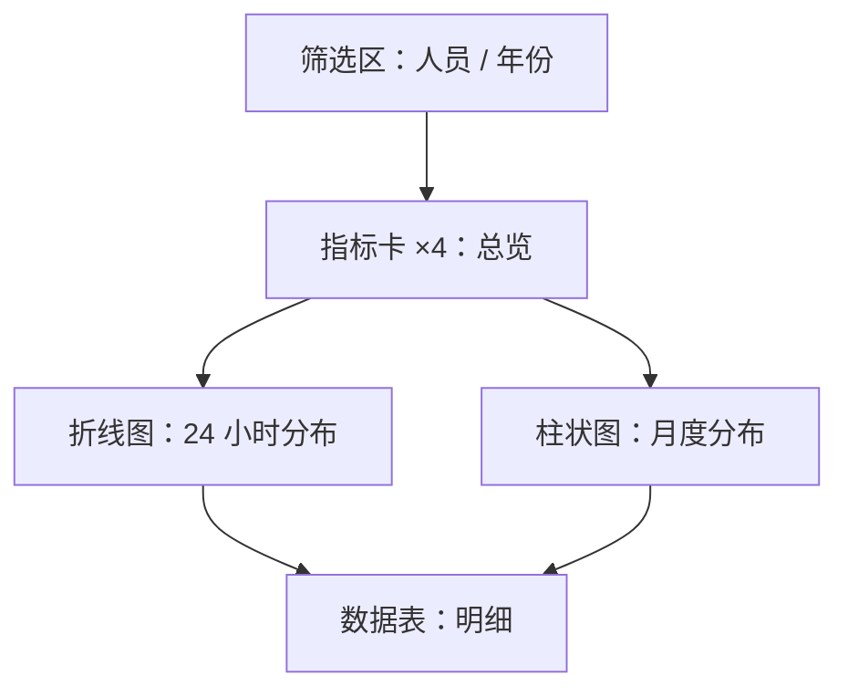

# 第 19 章 前端视觉优化与数据仪表盘

> **节首信息条**｜对应课次 21 · 4 学时 · 实践｜前置：第 15–18 章的组件、页面与状态；基本的数据可视化常识

同一份统计数据，可以做成两个完全不同的页面：优化前白底、表格直接铺开、按钮默认色；优化后统一主色、卡片分组、指标卡和图表。功能一样，后者却更容易看懂。

## 本章要解决的问题

**数据都在页面上，怎样让它更容易读懂、比较和决策？**

信息都在页面上，用户却要从第一张图开始逐张判断“这个月怎么样”；颜色、字号、分组各行其是，读者分不清哪些是一类、哪些是重点。问题不在装饰得够不够，而在信息有没有按阅读顺序排好。

本章只做四类改动：主题、卡片、指标卡、图表。不写新功能，不改接口，把现有页面变得更好读。

## 本章学习目标

读完第 19 章并完成实训后，你应该能：

1. 说明“美观是为了更好用”，并区分真提升与纯装饰。
2. 用主题配置统一主色，用卡片化组织同类内容。
3. 设计 3–5 个一眼可见的指标卡，并让数字有口径说明。
4. 按数据形状选择图表类型，并处理配色与可读性。
5. 按“概览—趋势—明细”三层组织仪表盘。

## 19.1 美化与装饰的分界

视觉优化的目标不是装饰，而是降低阅读成本；这是可用性设计的基本原则（Nielsen, 1994）。颜色统一，用户不用猜“这个按钮和那个按钮是不是一类”；内容分组，用户能快速找到筛选、列表与操作；关键数字突出，用户一眼看到重点；留白足够，信息不挤在一起。

**信息层级**是这一章的核心（定义见第 17 章 17.4）：它决定用户先看到什么、再看到什么，以及哪些信息只是背景。优化前后的差别，通常不在“颜色好不好看”，而在层级是否清楚：分组、对齐、对比、顺序四个手段是否到位。

| 改动 | 优化前 | 优化后 | 改善点 |
| --- | --- | --- | --- |
| 主题 | 默认色 | 青绿主色 + 浅灰底 | 统一、专业 |
| 分组 | 一长串 | 卡片 + tabs | 好找、不累 |
| 表头 | 英文 | 中文 + 日期格式 | 看得懂 |
| 指标 | 无 | 4 个指标卡 | 一眼看到重点 |
| 图表 | 无 | 折线 + 柱状 | 看出趋势 |
| 反馈 | 无 | toast | 操作有回应 |

真提升是分组、中文表头、指标卡、图表、操作反馈；纯装饰是过多渐变、花哨图标、无意义动画。判断标准仍是“是否帮助用户更快完成任务”。

判断一处改动是否值得，问一句：**它是否帮助用户更快完成任务？** 帮助了，是提升；只是好看，是装饰。

> 💡 **易错点**：把“美化”理解成“加颜色、加动画”。颜色和动画不承担信息功能时，只会增加阅读负担；先问“这处改动让用户少看哪一眼、少做哪一步”，答不出来就先不改。

## 19.2 主题与配色

**主题**指一组全局生效的视觉参数（主色、底色、正文色、字体），配置一次，所有页面共用（Streamlit 官方文档）。在 `.streamlit/config.toml` 中配置：

**代码 19-1-1** · 示例（文本）

```toml
[theme]
primaryColor = "#0F766E"
backgroundColor = "#F8FAFC"
secondaryBackgroundColor = "#FFFFFF"
textColor = "#0F172A"
font = "sans serif"

[browser]
gatherUsageStats = false
```

| 配置 | 作用 | 本课取值 |
| --- | --- | --- |
| `primaryColor` | 按钮、链接、选中态 | 青绿 `#0F766E` |
| `backgroundColor` | 页面底色 | 浅灰白 `#F8FAFC` |
| `secondaryBackgroundColor` | 卡片、侧边栏底色 | 纯白 `#FFFFFF` |
| `textColor` | 正文颜色 | 深蓝黑 `#0F172A` |

三条原则：一个主色，按钮、选中态、图表都用它或邻近色；底色与卡片分开，页面浅灰、卡片纯白，层次自然出来；对比度够，正文与背景不能“浅灰字配白底”。正文对比度可参照 WCAG 2.1 AA 的要求（普通文本与背景的对比度至少 4.5:1）。

改完 `config.toml` 要重启 Streamlit 才生效。主题能解决大部分视觉问题，不需要一上来写 CSS。

主题之外，再考虑 CSS。主题配置能统一主色、底色与字体，覆盖大多数管理页面；只有主题表达不了的细节（比如某个组件内部的特殊间距）才考虑 CSS。自己写 CSS 的代价是：升级框架时可能失效，且每个页面都要维护一套样式。**先用主题，再考虑 CSS，最后才做像素级定制。**

## 19.3 指标展示与图表选型

**指标卡**把“总体怎么样”压缩成一两个数字，放在首屏最显眼的位置。一个页面通常选 3–5 个“一眼要看到”的数字，每个都要有明确口径。

**代码 19-1-2** · 示例代码（Python）

```python
m1, m2, m3, m4 = st.columns(4)
m1.metric("总值班天数", 18, icon="📅", border=True)
m2.metric("总值班时长（小时）", 30.0, icon="⏱️", border=True, format="%.1f")
m3.metric("部门排名", 1, icon="🏅", border=True)
m4.metric("贡献度", "71.48%", icon="📈", border=True)
```

| 参数 | 作用 |
| --- | --- |
| 第一个位置参数 | 指标名称 |
| 第二个位置参数 | 指标值 |
| `icon` | 图标，帮助快速识别 |
| `border=True` | 加卡片边框 |
| `format` | 数字格式，如 `%d`、`%.1f` |
| `delta` | 与上期对比（可选） |

天数用整数，时长保留一位小数，百分比带 `%`；格式统一，读者才不用每次换算。指标卡的数必须来自统计接口，不能手填——手填的数字与后端对不上，是仪表盘最常见的事故。

指标卡下面是图表。图表类型应与数据形状匹配，这是数据可视化的基本经验（Cleveland & McGill, 1984）。常见选型如下：

| 目的 | 图表 | 例子 |
| --- | --- | --- |
| 比大小 | 柱状图 | 每月值班天数 |
| 看趋势 | 折线图 | 24 小时值班分布 |
| 看占比 | 饼图或条形图 | 部门贡献度 |
| 看分布 | 直方图 | 值班时长分布 |

选错图表，数据再准也读不出来。例如用饼图比较 12 个月的天数，读者很难看出差异；用折线图看“部门排名”也不合适。

图表的数据入口是表格，配色只用一个主色。先看代码：

**代码 19-1-3** · 示例代码（Python）

```python
time_rows = distribution["time_distribution"]
df_time = pd.DataFrame(time_rows).set_index("hour")
df_time.index.name = "小时"
st.line_chart(df_time, y="count", color="#0D9488", height=260)

month_rows = yearly["duty_by_month"]
df_month = pd.DataFrame(month_rows).set_index("month")
df_month.index.name = "月份"
st.bar_chart(df_month, y="days", color="#0D9488", height=260)
```

`st.line_chart` 与 `st.bar_chart` 要的是“表格”：把 JSON 列表转成 `DataFrame`，用 `set_index` 把小时或月份设为横轴，用 `y=` 指定纵轴列。图表色用主色的邻近色，同一页面只用一个图表色；颜色是为了看清，不是为了好看。

图表必须配标题和口径说明，例如“按值班开始时间的小时统计”。空数据要提示，不要画一张空图；图表下方提供“查看数据表”，方便读屏与核对。

> 💡 **易错点**：图表类型按“好看”选，而不是按“要回答的问题”选。先写下这张图要回答的一句话（比大小、看趋势、看占比、看分布），再选图表；写不出来，说明这张图不该放。

## 19.4 仪表盘的信息层级

**仪表盘**把多个指标与图表组织成一个页面。按“总览 → 趋势 → 明细”三层排列，是仪表盘设计的常见做法（Few, 2006）；本章按这三层组织信息。



*图 19-1：数据仪表盘的信息层级*

第一眼是 4 个指标卡，回答“总体怎么样”；第二眼是两张图，回答“分布和趋势怎么样”；需要时展开数据表，回答“具体是多少”。信息从上到下：总览 → 趋势 → 明细。

不要堆十几张图，一屏放不下就失去“仪表盘”的意义；两张图并排时，纵轴口径要写清楚；空数据、加载失败都要有提示。

仪表盘的每个区域可以用卡片分组：

**代码 19-1-4** · 示例代码（Python）

```python
with st.container(border=True):
    st.subheader("筛选条件")
    col1, col2, col3 = st.columns([2, 1, 1])
    ...
```

卡片把“一类内容”装进一个框，视觉上形成分组，卡片之间留白，信息不再挤在一起。不需要写 CSS，`border=True` 就有边框与内边距。

分组的粒度通常是：筛选区一张卡片、列表区一张卡片、操作区一张卡片；并列的三块内容可以用 `st.tabs`。卡片不是越多越好，一屏 3–4 张就够；同类内容才放同一张卡片；卡片里不要再套卡片，层次会乱。

首屏放多少信息，需要权衡。把所有指标都放首屏，用户一眼看到全部，但注意力被分散；只放 3–5 个关键指标，结论更清楚，代价是次要信息要下钻。选择取决于页面用途：用于日常监控，首屏放关键指标；用于分析复盘，允许多一层下钻。关键是**首屏只回答一个问题**，其余信息放到下一层。

常见问题如下表：

| 现象 | 原因 |
| --- | --- |
| 页面很“花” | 主色不止一个，或图表色与主题不一致 |
| 图表读不出来 | 图表类型与数据不匹配，或缺口径说明 |
| 指标卡数字对不上 | 指标值手填，没有来自统计接口 |
| 空数据画了一张空图 | 没判断 `items` 是否为空 |
| 窄屏图表溢出 | 用了固定宽度，没有用比例列与 `width="stretch"` |

> 💡 **易错点**：把指标卡的数字手填成固定值。页面上看起来完整，但后端数据一变就对不上；指标卡必须从统计接口读，口径与第 11 章一致。

## 示范例题

#### 例 19-1：配置一套主题【Bloom：应用】

**题目**：写出 `.streamlit/config.toml`，要求青绿主色、浅灰白页面底色、纯白卡片底色、深蓝黑正文；说明改完后如何生效。

**解**：

**代码 19-2-1** · 示例（文本）

```toml
[theme]
primaryColor = "#0F766E"
backgroundColor = "#F8FAFC"
secondaryBackgroundColor = "#FFFFFF"
textColor = "#0F172A"
font = "sans serif"

[browser]
gatherUsageStats = false
```

改完要重启 Streamlit 才生效。四个颜色分工明确：主色用于按钮与选中态，页面底色浅灰，卡片纯白，正文深色保证对比度。

#### 例 19-2：评价两个仪表盘的信息层级【Bloom：评价】

**题目**：仪表盘 A 把 12 张图从上到下排成一列；仪表盘 B 先放 4 个指标卡，再并排放两张图，最后提供数据表。请从信息层级、可读性、任务效率三个维度评价两版。

**解**：

1. **信息层级**：A 没有总览，读者要从第一张图开始逐张判断；B 先给总览（指标卡），再给趋势（两张图），最后给明细（数据表），层级清楚。
2. **可读性**：A 图太多，读者不知道哪张最重要；B 每屏只回答一个问题，图表有口径说明，读者能快速定位。
3. **任务效率**：A 需要滚动与比较十几张图，完成“这个月怎么样”的判断很慢；B 先看指标卡就能得到结论，需要时再展开明细。
4. 结论：B 更好，但前提是指标卡数字来自统计接口、图表口径写清、空数据有提示；如果 B 堆了过多颜色或装饰，也会抵消优势。

## 独立习题

#### 习题 19-1【Bloom：分析】

**题目**：某统计页出现三个可读性问题：主色有四种、图表没有口径说明、空数据时画了一张空图。请分别分析影响并给出修正方法。

#### 习题 19-2【Bloom：评价】（开放题）

**题目**：有人主张“仪表盘图越多越显得专业”，也有人主张“一屏只放最关键的 4 个指标和 2 张图”。请评价两种观点，并给出你的仪表盘设计原则。

## ◆ 实训 19-1：前端视觉优化与数据仪表盘（对应课次 21 · 4 学时）

### 一、任务目标与验收

| 目标 | 验收标志 |
| --- | --- |
| 主题统一 | 主色与字体全站一致 |
| 指标卡可读 | 3–5 个关键数字带口径 |
| 图表匹配 | 图表类型与数据形状相符 |
| 仪表盘分层 | 概览、趋势、明细三层清楚 |
| 改进有依据 | 能说出至少两处真提升 |

### 二、课前准备

- 第 17–18 章可用的数据页面
- 一组真实形状的数据（时间序列、分类、占比）
- 改进前截图

### 三、操作步骤

1. **定主题**
   - 做什么：定主题
   - 操作：配置主色与基础样式
   - 预期输出：→ 全站颜色统一
   - 做错会看到什么：每个组件各配一种颜色；收拢到主题
2. **做指标卡**
   - 做什么：做指标卡
   - 操作：选 3–5 个关键指标，标口径
   - 预期输出：→ 数字一眼可见、口径可查
   - 做错会看到什么：把十几个数字都堆上去；按“决策需要”筛选
3. **选图表**
   - 做什么：选图表
   - 操作：按数据形状选折线/柱状/饼图
   - 预期输出：→ 类型与问题匹配
   - 做错会看到什么：用饼图展示时间趋势；改折线
4. **分层与对比**
   - 做什么：分层与对比
   - 操作：按概览—趋势—明细排布，保留改进前后截图
   - 预期输出：→ 三层清楚、改进可说明
   - 做错会看到什么：只放装饰性元素；删除无信息量的图表

### 四、排错清单

| 现象 | 先查什么 |
| --- | --- |
| 颜色过多 | 主色超过三种，收拢 |
| 指标口径不明 | 补口径说明与统计时间 |
| 图表难读 | 标签重叠、颜色对比不足 |
| 页面过长 | 把明细下钻到次级页 |

### 五、提交与验收

提交仪表盘页面、改进前后截图与两处改进说明；验收按“主题与指标”“图表匹配”“分层与论证”三项判定。

### 六、课后扩展

- 给指标卡加同比/环比
- 为图表加空数据与加载态
- 写一份配色与图表选择说明
- **复习任务**：回看第 17 章 17.4（信息层级）与第 11 章 11.1（统计口径），对照本章 19.1–19.4，说明“页面层级”和“统计口径”分别影响用户的哪一步判断

## 本章小结

**核心结论**：

1. 视觉优化服务于任务效率；判断标准是“是否帮助用户更快完成任务”，不是“是否更花哨”。
2. **主题**配置一个主色、页面与卡片底色分开、正文对比度够；改完要重启 Streamlit。
3. 卡片把同类内容分组，一屏 3–4 张；**指标卡**选 3–5 个一眼要看到的数字，口径明确、格式统一、数字来自接口。
4. **图表**类型要与数据匹配：比较用柱状、趋势用折线、占比用饼图；图表要有标题、口径说明与数据表。
5. 仪表盘按“指标卡总览 → 图表趋势 → 数据表明细”组织；**信息层级**的核心是首屏只回答一个问题，其余下钻。

把这章压缩成一句话：**视觉优化不是让页面更花，而是让用户少看几眼、少想一步。**

**学完本章，你可以体会到**：仪表盘的价值不是“信息多”，而是让人在十秒内看出该做什么决定。

**自检**：回到章首的学习目标，逐条问自己做到了没有——

- [ ] 说明“美观是为了更好用”，并区分真提升与纯装饰。
- [ ] 用主题配置统一主色，用卡片化组织同类内容。
- [ ] 设计 3–5 个一眼可见的指标卡，并让数字有口径说明。
- [ ] 按数据形状选择图表类型，并处理配色与可读性。
- [ ] 按“概览—趋势—明细”三层组织仪表盘。

**下一章预告**：前端功能与视觉都完成了，下一章做前端综合实践：整合页面、联调接口、排查错误，并整理可交付的成果。
