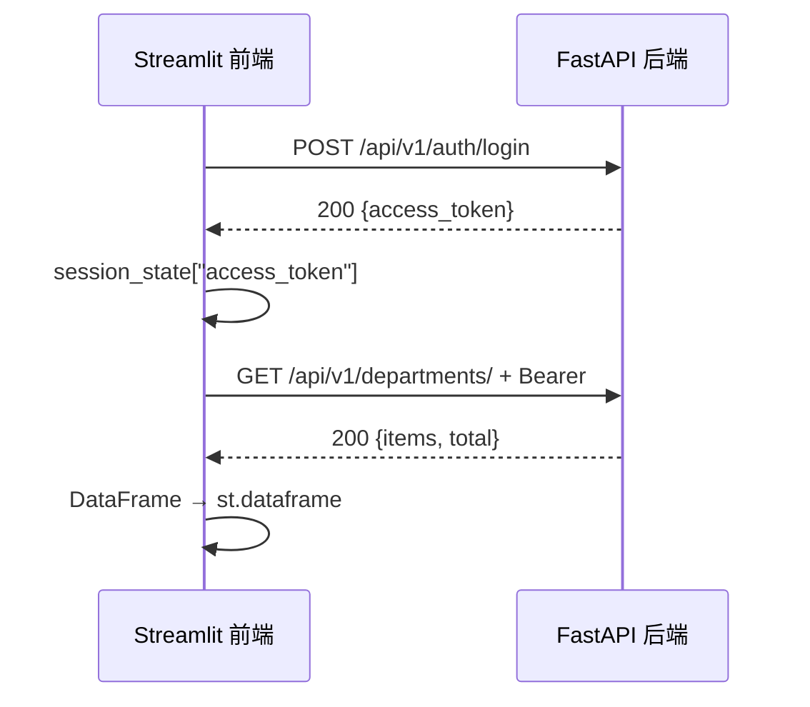

# 第 19 章 数据读取与展示

> **节首信息条**｜对应课次 19 · 4 学时 · 实践｜前置：第 4 章的接口契约；第 8 章的令牌；第 17–18 章的页面与组件

上一章的部门页用的是假数据，刷新浏览器就恢复。真实系统里，数据在后端数据库，前端要通过接口去取。这一章第一次把前后端接起来：登录拿令牌，带着令牌调部门列表，把返回的 JSON 显示成表格，并处理加载、空数据与错误。

联调最容易卡在三个地方：地址不对、令牌没带、字段对不上。本章把请求封装成一个统一的 `api_client`，让页面只关心“调哪个接口、传什么参数”，而不是每个页面各写一套 URL 与错误处理。

## 本章学习目标

读完第 19 章并完成实训后，你应该能：

1. 按契约调用后端接口，说明 URL、方法、请求头与请求体四要素。
2. 封装 `api_client`，统一基地址、超时、错误处理与令牌注入。
3. 实现登录与令牌保存，并在后续请求中自动携带。
4. 从 `items` 中选字段展示列表，并处理加载态（Loading State）、空态（Empty State）与错误态（Error State）。
5. 按“状态码 → detail → /docs → 代码”的顺序排查前后端联调问题。

## 前置知识卡

| # | 已有知识 | 回看位置 |
| --- | --- | --- |
| 1 | 本章依赖的前置内容 | 第 4 章的接口契约；第 8 章的令牌；第 17–18 章的页面与组件 |
| 2 | 上一章的核心结论 | 见上一章「本章小结」 |
| 3 | 本章实训/案例所需的环境与数据 | 见本章实训「二、课前准备」或章首导入 |

> 卡住时先回看，不必从头重读。

## 19.1 概念讲解

### 19.1.1 前后端按契约对接

前端调用后端，靠的是接口契约：URL、方法、参数、请求头、返回结构。契约写在 `/docs` 里，也写在代码里；前端要按契约发请求，后端要按契约返回。

联调不是“猜后端怎么返回”，而是先看 `/docs` 或实际代码，确认字段名、分页结构、错误格式，再写调用。字段名差一个下划线，页面就会显示空列。

### 19.1.2 requests 的四要素

**代码 19-1-1** · 示例代码（Python）

```python
import requests

BASE_URL = "http://127.0.0.1:8000"
PREFIX = "/api/v1"

resp = requests.post(
    f"{BASE_URL}{PREFIX}/auth/login",
    json={"username": "admin", "password": "admin123"},
    timeout=10,
)
token = resp.json()["access_token"]

resp = requests.get(
    f"{BASE_URL}{PREFIX}/departments/",
    params={"page": 1, "page_size": 10},
    headers={"Authorization": f"Bearer {token}"},
    timeout=10,
)
```

| 要素 | 写法 | 说明 |
| --- | --- | --- |
| 地址 | `BASE_URL + PREFIX + path` | 端口、前缀不能漏 |
| 方法 | `requests.get/post` | 查用 GET，登录用 POST |
| 参数 | `params=` / `json=` | 查询参数用 `params`，请求体用 `json` |
| 请求头 | `headers={"Authorization": ...}` | 令牌放这里 |

先看 `status_code`，再看 `json()`。状态码不是 200，就不要急着读数据；错误信息通常在 `detail` 里。

### 19.1.3 封装 api_client：四个统一

如果每个页面都写一遍 URL、超时、请求头与错误处理，迟早会不一致。统一封装成一个入口：

**代码 19-1-3** · 示例代码（Python）

```python
# config.py
import os

API_BASE_URL = os.getenv("DUTY_API_BASE_URL", "http://127.0.0.1:8000").rstrip("/")
API_PREFIX = "/api/v1"
REQUEST_TIMEOUT = 10
DEFAULT_PAGE_SIZE = 10
```

**代码 19-1-5** · 示例代码（Python）

```python
# api_client.py（最小版）
import requests
import streamlit as st

from config import API_BASE_URL, API_PREFIX, REQUEST_TIMEOUT

class ApiError(Exception):
    def __init__(self, status_code: int, detail: str):
        self.status_code = status_code
        self.detail = detail
        super().__init__(detail)

def _url(path: str) -> str:
    return f"{API_BASE_URL}{API_PREFIX}{path}"

def _headers() -> dict:
    token = st.session_state.get("access_token")
    return {"Authorization": f"Bearer {token}"} if token else {}

def _request(method: str, path: str, **kwargs):
    try:
        resp = requests.request(method, _url(path), headers=_headers(), timeout=REQUEST_TIMEOUT, **kwargs)
    except requests.RequestException as exc:
        raise ApiError(0, f"无法连接后端服务：{exc}") from exc

    if resp.status_code == 401:
        st.session_state.pop("access_token", None)
        raise ApiError(401, "登录已过期，请重新登录")

    if not resp.ok:
        try:
            detail = resp.json().get("detail", resp.text)
        except ValueError:
            detail = resp.text
        if isinstance(detail, list):
            detail = "；".join(str(item.get("msg", item)) for item in detail)
        raise ApiError(resp.status_code, str(detail))

    return resp.json() if resp.content else None

def get(path: str, params: dict | None = None):
    return _request("GET", path, params=params)

def post(path: str, json: dict | None = None):
    return _request("POST", path, json=json)
```

四个统一：地址统一在 `config.py`；请求头统一由 `_headers` 带令牌；超时统一；错误统一转成 `ApiError`。页面只捕获 `ApiError`，不直接处理 `requests` 的异常。

401 要清除登录态，避免拿着过期令牌反复请求。FastAPI 的 422 `detail` 是一个列表，显示前要压平成一句话，否则页面会显示一串 Python 字典。

### 19.1.4 登录与令牌

**代码 19-1-7** · 示例代码（Python）

```python
if "access_token" not in st.session_state:
    st.title("🗂️ 值班数据统计系统")
    with st.form("login_form"):
        username = st.text_input("用户名", value="admin")
        password = st.text_input("密码", type="password")
        submitted = st.form_submit_button("登录")

    if submitted:
        if not username or not password:
            st.error("请输入用户名和密码")
        else:
            try:
                with st.spinner("正在登录..."):
                    data = api.post("/auth/login", json={"username": username, "password": password})
            except api.ApiError as exc:
                st.error(exc.detail)
            else:
                st.session_state["access_token"] = data["access_token"]
                st.session_state["current_user"] = data["user"]
                st.rerun()

    st.stop()
```

令牌的三个动作：登录成功取出 `access_token` 存进 `session_state`；之后的请求由 `_headers` 自动带上；退出登录清空 `session_state` 并 `st.rerun()`。密码输入框必须 `type="password"`，令牌不要打印到页面上。

### 19.1.5 列表展示：先取 items，再选字段

**代码 19-1-9** · 示例代码（Python）

```python
try:
    with st.spinner("正在加载部门列表..."):
        data = api.get("/departments/", params={"page": 1, "page_size": 10})
except api.ApiError as exc:
    st.error(exc.detail)
    st.stop()

items = data.get("items", [])
if not items:
    st.info("暂无部门数据")
else:
    df = pd.DataFrame(items)
    st.dataframe(df[["dept_code", "full_name", "address"]], width="stretch", hide_index=True)
    st.caption(f"共 {data.get('total', 0)} 条")
```

列表响应结构是 `{"items": [...], "total": ...}`，先取 `items`；表格只显示需要的字段，不要把整个 JSON 全铺出来；空数据要提示，不要显示一个空表格。

### 19.1.6 加载态、空态、错误态

三种状态要分别处理：

| 状态 | 触发 | 界面 |
| --- | --- | --- |
| 加载态 | 请求进行中 | `st.spinner("正在加载...")` |
| 空态 | 请求成功但 `items` 为空 | `st.info("暂无数据")` |
| 错误态 | 请求失败（网络、401、404、422、500） | `st.error(exc.detail)` + `st.stop()` |

错误后 `st.stop()`，避免后面的代码继续执行；否则页面可能在错误提示下面继续渲染空表或旧数据，用户会以为系统坏了。

### 19.1.7 排错顺序：状态码 → detail → /docs → 代码

| 现象 | 先查什么 |
| --- | --- |
| 连不上 | 后端是否启动；地址与端口 |
| 404 | 路径前缀 `/api/v1`；资源名是否复数 |
| 401 | 是否登录；请求头是否 `Bearer <token>`；令牌是否过期 |
| 422 | 请求体字段名、类型；查询参数格式 |
| 返回空列表 | 数据库是否有数据；分页参数是否超出范围 |
| 页面白屏 | 是否有未捕获异常；`st.stop()` 是否放对位置 |

不要一看到报错就改代码，先确认“请求发到哪、返回了什么”。在 `_request` 里临时打印 URL 与状态码，是最快的定位方法。



*图 19-1：登录、取令牌与读取列表的链路*

## 19.2 示范例题

#### 例 19-1：登录并读取部门列表【Bloom：应用】

**题目**：用 `requests` 完成登录并读取部门列表：正确账号拿到令牌；带令牌请求列表，打印 `total` 与前两条部门名称。

**解**：

**代码 19-2-1** · 示例代码（Python）

```python
import requests

BASE = "http://127.0.0.1:8000/api/v1"

login = requests.post(f"{BASE}/auth/login", json={"username": "admin", "password": "admin123"}, timeout=10)
token = login.json()["access_token"]

resp = requests.get(
    f"{BASE}/departments/",
    params={"page": 1, "page_size": 10},
    headers={"Authorization": f"Bearer {token}"},
    timeout=10,
)
data = resp.json()
print(data["total"])
for item in data["items"][:2]:
    print(item["full_name"])
```

顺序是“先登录拿令牌，再带令牌请求”。列表响应取 `items` 与 `total`，字段名以后端为准。

#### 例 19-2：处理 401、404 与 422【Bloom：应用】

**题目**：说明不带令牌请求列表、路径写错、登录缺字段三种情况分别返回什么，并写出页面应如何提示。

**解**：

1. 不带令牌：后端返回 401，`detail` 为“登录已过期”；`api_client` 清除登录态并抛出 `ApiError(401, ...)`，页面提示“请重新登录”并回到登录页。
2. 路径写错：后端返回 404；`ApiError(404, ...)`，页面提示“接口不存在，请检查路径”，同时检查 `/api/v1` 前缀与资源名复数。
3. 登录缺字段：后端返回 422，`detail` 是列表；`api_client` 把列表压平成一句话，页面提示“密码字段必填”之类的具体信息。

页面统一用 `try/except api.ApiError` 捕获，不让异常冒到页面顶层导致白屏。

## 19.3 引导练习

#### 例 19-3（引导练习）：处理空列表【Bloom：应用】

**题目**：部门列表接口返回 `{"items": [], "total": 0}`。请写出页面的处理逻辑，并说明为什么不能直接 `st.dataframe(pd.DataFrame([]))`。

#### 例 19-4（引导练习）：加加载状态【Bloom：应用】

**题目**：请求部门列表时显示“正在加载部门列表...”，请求结束后提示消失。请写出代码，并说明 `st.spinner` 应该包住哪一段。

## 19.4 独立习题

#### 习题 19-1【Bloom：理解】

**题目**：说明一次“登录后读取部门列表”的完整流程：请求发到哪里、带什么、令牌从哪里来、响应如何取出数据。并解释为什么要统一封装 `api_client`，而不是每个页面直接 `requests.get`。

#### 习题 19-2【Bloom：应用】

**题目**：用 `api_client` 实现部门列表读取与展示：带 `page`、`page_size` 参数；请求时显示加载状态；成功时显示表格与总数；失败时显示错误并停止渲染。

#### 习题 19-3【Bloom：应用】

**题目**：为 `api_client` 补上 `put` 与 `delete` 方法，并说明 401、404、422 三类错误在页面层如何分别提示。

#### 习题 19-4【Bloom：分析】

**题目**：联调时出现四个现象：连不上后端、列表 404、列表 401、页面白屏。请分别给出最可能的原因与排查步骤。

## ◆ 实训 19-1：数据读取与展示（对应课次 19 · 4 学时）

### 一、任务目标与验收

| 目标 | 验收标志 |
| --- | --- |
| 接口调用正确 | 四要素与后端 `/docs` 一致 |
| 客户端统一 | 基地址、超时、错误、令牌四处统一 |
| 登录闭环 | 登录后令牌可用，过期有提示 |
| 三态齐全 | 加载、空、错误均有界面反馈 |
| 排错有据 | 至少记录一次按顺序定位的过程 |

### 二、课前准备

- 后端已启动，`/docs` 可访问
- 一个可登录的测试账号
- 第 18 章的页面骨架

### 三、操作步骤

1. **封装客户端**
   - 做什么：封装客户端
   - 操作：写 `api_client`，统一基地址与超时
   - 预期输出：→ 页面代码不再散落完整 URL
   - 做错会看到什么：每个页面各写一份请求逻辑；收拢到客户端
2. **接登录**
   - 做什么：接登录
   - 操作：`调用登录接口，保存令牌`
   - 预期输出：→ 后续请求自动带 `Authorization`
   - 做错会看到什么：令牌放在普通变量里；改用 session_state
3. **展示列表**
   - 做什么：展示列表
   - 操作：取 `items`，选字段渲染表格
   - 预期输出：→ 列表可读、字段与后端一致
   - 做错会看到什么：直接渲染整个响应；先取 `items` 再选字段
4. **补三态与排错**
   - 做什么：补三态与排错
   - 操作：`加载、空、错误各加一个界面状态`
   - 预期输出：→ 三种情况都有明确提示
   - 做错会看到什么：错误只打印到控制台；用户界面要给可读提示

### 四、排错清单

| 现象 | 先查什么 |
| --- | --- |
| 401 | 令牌是否携带、是否过期 |
| 404 | URL 前缀、尾斜杠、路径参数 |
| 422 | 请求体字段名与类型 |
| 页面空白 | 是否处理了空列表或异常 |

### 五、提交与验收

提交 `api_client`、页面代码与一次联调排错记录；验收按“契约一致”“三态处理”“排错过程”三项判定。

### 六、课后扩展

- 给客户端加重试与超时策略
- 把错误提示统一成组件
- 用 `/docs` 生成一份接口对照表

### 七、回链

- 第 4 章 4.1.4–4.1.6；第 8 章令牌；第 18 章页面；本章 19.1.1–19.1.7

## 本章小结

**核心结论**：

1. 前后端按契约对接：先看 `/docs` 或代码，确认 URL、方法、参数、字段与错误格式，再写调用。
2. `requests` 的四要素是地址、方法、参数与请求头；查询参数用 `params`，请求体用 `json`，令牌放 `Authorization: Bearer`。
3. `api_client` 统一地址、请求头、超时与错误；401 清除登录态；422 的 `detail` 列表要压平后显示。
4. 登录成功后把令牌存进 `session_state` 并 `st.rerun()`；列表响应先取 `items`，再选字段显示。
5. 加载态、空态、错误态分别处理；错误后 `st.stop()`；排错按“状态码 → detail → /docs → 代码”的顺序。

**学完本章，你可以体会到**：前后端联调不是“接口能通”，而是契约、令牌、异常三条线都能对上。
**自检**：回到章首的学习目标，逐条问自己做到了没有——

- [ ] 按契约调用后端接口，说明 URL、方法、请求头与请求体四要素。 → 回看 19.1.1–19.1.2，自测：习题 19-1
- [ ] 封装 `api_client`，统一基地址、超时、错误处理与令牌注入。 → 回看 19.1.3，自测：习题 19-1
- [ ] 实现登录与令牌保存，并在后续请求中自动携带。 → 回看 19.1.4，自测：习题 19-1
- [ ] 从 `items` 中选字段展示列表，并处理加载态、空态与错误态。 → 回看 19.1.5–19.1.6，自测：习题 19-1
- [ ] 按“状态码 → detail → /docs → 代码”的顺序排查前后端联调问题。 → 回看 19.1.7，自测：习题 19-1

**下一章预告**：数据能看之后，下一步是能改。下一章用表单提交新增、编辑与删除，并处理提交后的页面刷新与会话状态。

