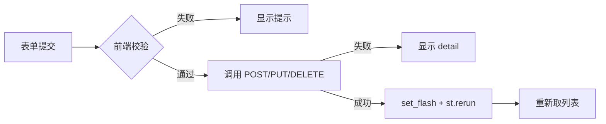

# 第 20 章 数据编辑与页面状态

> **节首信息条**｜对应课次 20 · 4 学时 · 实践｜前置：第 19 章的接口调用与三态；第 17 章的表单；第 16 章的 session_state

上一章把列表接上了真实接口，用户能看数据了。但“能看”只是半步：部门改名、新增人员、删除错误记录，都需要“能改”。写操作比读多三件事：提交后要刷新列表；翻页和筛选条件不能被重置；危险操作要二次确认（Confirmation）。

本章在上一章的列表上补齐新增、编辑、删除，并把页码、筛选条件、登录态放进 `session_state`。重点是三个坑：提交后不手动改列表、编辑表单的 `key` 要跟着对象变、成功提示要先暂存再重跑。

## 本章学习目标

读完第 20 章并完成实训后，你应该能：

1. 按“校验—提交—刷新”三步实现新增、编辑与删除操作。
2. 说明取数为什幺要放在操作之前，以及页码与筛选状态如何保持。
3. 实现新增与编辑表单，正确处理回填（Prefill）、`key` 与重复提交。
4. 为删除加二次确认，并用会话状态保存操作反馈（Operation Feedback）。
5. 解释 session_state 的生命周期，并排查状态错乱的常见原因。

## 前置知识卡

| # | 已有知识 | 回看位置 |
| --- | --- | --- |
| 1 | 本章依赖的前置内容 | 第 19 章的接口调用与三态；第 17 章的表单；第 16 章的 session_state |
| 2 | 上一章的核心结论 | 见上一章「本章小结」 |
| 3 | 本章实训/案例所需的环境与数据 | 见本章实训「二、课前准备」或章首导入 |

> 卡住时先回看，不必从头重读。

## 20.1 概念讲解

### 20.1.1 写操作的三步



*图 20-1：一次写操作的流程*

前端校验只是第一道关：必填项为空时不发请求，减少无效调用。真正的规则仍由后端判断；后端返回 400/422 时，页面显示 `detail`。成功后不要手动修改列表，而是 `st.rerun()` 让脚本重新取一遍数据。

### 20.1.2 列表刷新：取数放在操作之前

Streamlit 每次交互都会重跑脚本。只要“取列表”的代码在脚本靠前的位置，操作成功后调用 `st.rerun()`，列表自然重新取一遍。

不要手动 `append` 到列表：前端内存里的列表与后端数据库可能不一致，手改只能骗过当前页面，刷新或换页就露馅。让后端返回最新数据，是唯一可靠的做法。

### 20.1.3 页码与筛选状态

页码、每页条数、筛选条件要放进 `session_state`：

**代码 20-1-2** · 示例代码（Python）

```python
if "dept_page" not in st.session_state:
    st.session_state.dept_page = 1
if "dept_page_size" not in st.session_state:
    st.session_state.dept_page_size = 10

params = {
    "page": st.session_state.dept_page,
    "page_size": st.session_state.dept_page_size,
    "sort_by": "create_time",
    "sort_order": "desc",
}
```

翻页时修改页码并 `st.rerun()`：

**代码 20-1-4** · 示例代码（Python）

```python
left, middle, right = st.columns([1, 2, 1])
with left:
    if st.button("上一页", disabled=st.session_state.dept_page <= 1):
        st.session_state.dept_page -= 1
        st.rerun()
with right:
    if st.button("下一页"):
        st.session_state.dept_page += 1
        st.rerun()
```

三条规则：状态初始化用 `if "key" not in st.session_state`，不要每次重跑都覆盖；切换筛选条件时把页码重置为 1，否则可能停在一个不存在的页；删除当前页最后一条后，如果当前页空了，页码要回退一页。

### 20.1.4 新增表单

**代码 20-1-6** · 示例代码（Python）

```python
with st.form("create_dept", clear_on_submit=True):
    col1, col2 = st.columns(2)
    with col1:
        dept_code = st.text_input("部门编码 *", placeholder="例如 1001")
    with col2:
        full_name = st.text_input("部门名称 *")
    address = st.text_input("地址")
    submitted = st.form_submit_button("提交", type="primary")

if submitted:
    if not dept_code.strip() or not full_name.strip():
        st.error("部门编码和部门名称不能为空")
    else:
        try:
            api.post("/departments/", json={
                "dept_code": dept_code.strip(),
                "full_name": full_name.strip(),
                "address": address.strip() or None,
            })
        except api.ApiError as exc:
            st.error(exc.detail)
        else:
            st.session_state["_flash"] = "部门新增成功"
            st.rerun()
```

`clear_on_submit=True` 避免重复提交同一份数据；成功后不手动改列表，交给重跑。

### 20.1.5 编辑表单：回填与 key

编辑表单要解决两个问题：把当前值填进输入框；切换编辑对象时，输入框要跟着换值。

**代码 20-1-8** · 示例代码（Python）

```python
options = {f"{d['dept_code']} - {d['full_name']}": d for d in items}
selected_label = st.selectbox("选择部门", list(options.keys()))
selected = options[selected_label]

with st.form("edit_dept"):
    st.text_input("部门编码", value=selected["dept_code"], disabled=True)
    full_name = st.text_input("部门名称", value=selected.get("full_name", ""), key=f"edit_full_name_{selected['dept_code']}")
    address = st.text_input("地址", value=selected.get("address") or "", key=f"edit_address_{selected['dept_code']}")
    save = st.form_submit_button("保存修改", type="primary")
```

三个坑：`value=` 只在组件第一次创建时生效，之后用户输入会覆盖它；从部门 A 切到部门 B 时，如果 `key` 不变，组件会沿用 A 的输入；解决办法是让 `key` 带上当前对象的唯一标识，切换时相当于新建组件，值会重新取 `value`。

部门编码通常不可改：它是主键或业务唯一键，改了会牵连人员、父部门等关联。本课程约定编码创建后不可改，只改名称、地址等字段，所以输入框 `disabled=True`。

### 20.1.6 删除与二次确认

**代码 20-1-10** · 示例代码（Python）

```python
with st.expander("删除部门（危险操作）"):
    st.caption(f"将删除：{selected['dept_code']} - {selected['full_name']}")
    confirm = st.checkbox("我确认要删除该部门", key=f"dept_delete_confirm_{selected['dept_code']}")
    if st.button("删除", type="primary", disabled=not confirm):
        try:
            api.delete(f"/departments/{selected['dept_code']}")
        except api.ApiError as exc:
            st.error(exc.detail)
        else:
            st.session_state["_flash"] = "部门删除成功"
            st.rerun()
```

删除放在 `expander` 里，默认收起，减少误触；必须勾选确认才启用按钮；删除失败要显示原因（404 已被删除、400 有关联数据不能删）。

### 20.1.7 操作反馈：先把消息存起来

**代码 20-1-12** · 示例代码（Python）

```python
def set_flash(message: str) -> None:
    st.session_state["_flash"] = message

def show_flash() -> None:
    message = st.session_state.pop("_flash", None)
    if message:
        st.toast(message, icon="✅")
```

页面顶部调用一次 `show_flash()`。为什么不能直接 `st.success` 再 `st.rerun()`？因为 `st.success` 画在当前这次渲染上，紧接着的重跑会丢掉这次渲染；先把消息存进 `session_state`，重跑后再显示，提示才不会消失。

### 20.1.8 session_state 的生命周期

| 阶段 | 做法 |
| --- | --- |
| 初始化 | `if "dept_page" not in st.session_state: ...` |
| 读取 | 请求参数、当前用户从 `session_state` 取 |
| 修改 | 翻页、筛选、登录时写入 |
| 清理 | 退出登录时 `st.session_state.clear()` |

只把“跨重跑需要保留”的东西放进去：页码、每页条数、筛选条件、登录态、当前用户。临时输入（正在编辑但还没提交的文本）不要放，否则状态会越来越乱。退出登录必须清空，避免下一个用户看到上一个用户的状态。

### 20.1.9 登录态守卫

子页面顶部调用 `require_login()`：

**代码 20-1-14** · 示例代码（Python）

```python
def require_login():
    if "access_token" not in st.session_state:
        st.warning("请先登录后再访问该页面")
        st.stop()
```

守卫只检查“有没有令牌”，令牌是否有效由接口验证。前端守卫是体验，真正的权限在后端。

### 20.1.10 状态错乱的常见原因

| 现象 | 原因 |
| --- | --- |
| 翻页后回到第 1 页 | 页码没放 `session_state`，或被初始化覆盖 |
| 切换部门后表单还是旧值 | 编辑组件的 `key` 没带对象标识 |
| 成功提示一闪而过 | 直接 `st.success` 后 `st.rerun()`，没走 flash |
| 换账号后看到上一个账号的数据 | 退出登录没清空 `session_state` |
| 在第 2 页新增后列表为空 | 新增后页码未重置，或列表取数在操作之后 |

## 20.2 示范例题

#### 例 20-1：让翻页与筛选状态保持【Bloom：应用】

**题目**：实现翻页：页码放在 `session_state`；上一页在第 1 页时禁用；切换筛选条件时把页码重置为 1。

**解**：

**代码 20-2-1** · 示例代码（Python）

```python
if "dept_page" not in st.session_state:
    st.session_state.dept_page = 1

left, middle, right = st.columns([1, 2, 1])
with left:
    if st.button("上一页", disabled=st.session_state.dept_page <= 1):
        st.session_state.dept_page -= 1
        st.rerun()
with right:
    if st.button("下一页"):
        st.session_state.dept_page += 1
        st.rerun()

keyword = st.text_input("部门名称")
if keyword != st.session_state.get("dept_keyword"):
    st.session_state.dept_keyword = keyword
    st.session_state.dept_page = 1
```

页码只在初始化时赋值，之后由按钮修改；筛选变化时重置页码，避免停在不存在的页。

#### 例 20-2：诊断“切换部门后表单还是旧值”【Bloom：分析】

**题目**：编辑表单从部门 A 切到部门 B 后，名称输入框仍显示 A 的名称。请分析原因并给出修正。

**解**：

1. `value=` 只在组件第一次创建时生效；之后组件的状态由用户输入维护。
2. 如果两个部门的输入框使用同一个 `key`，Streamlit 认为它们是同一个组件，沿用 A 的输入值。
3. 修正：给 `key` 加上当前对象的唯一标识，如 `key=f"edit_full_name_{selected['dept_code']}"`。切换部门时 key 变化，相当于新建组件，值重新从 `value` 取。

## 20.3 独立习题

#### 习题 20-1【Bloom：理解】

**题目**：说明 `st.session_state` 的作用与生命周期（初始化、读取、修改、清理），并解释为什么临时输入通常不放进 `session_state`。

#### 习题 20-2【Bloom：分析】

**题目**：某页面出现三个状态问题：翻页后总是回到第 1 页；切换部门后表单仍显示上一个部门的值；退出登录后换账号还能看到上一个账号的页码。请分别分析原因并给出修正。

## ◆ 实训 20-1：数据编辑与页面状态（对应课次 20 · 4 学时）

### 一、任务目标与验收

| 目标 | 验收标志 |
| --- | --- |
| 写操作三步 | 新增、编辑、删除均有校验—提交—刷新 |
| 表单可用 | 新增与编辑回填正确、无重复提交 |
| 删除安全 | 二次确认后执行 |
| 状态保持 | 翻页与筛选不丢失 |
| 反馈可见 | 成功/失败提示能显示一次且不重复 |

### 二、课前准备

- 第 19 章可用的列表页
- 后端写接口可用
- 一份状态清单：页码、筛选、表单、提示

### 三、操作步骤

1. **实现新增**
   - 做什么：实现新增
   - 操作：`表单校验后提交，成功后清空并刷新`
   - 预期输出：→ 列表出现新记录
   - 做错会看到什么：提交两次；按钮加禁用或提交标记
2. **实现编辑**
   - 做什么：实现编辑
   - 操作：`回填当前行，保存后刷新`
   - 预期输出：→ 回填正确、无串行
   - 做错会看到什么：`key` 冲突导致回填到错误行；按记录 id 设 key
3. **实现删除**
   - 做什么：实现删除
   - 操作：`二次确认后调用删除接口`
   - 预期输出：→ 取消不执行、确认才执行
   - 做错会看到什么：只弹提示未等待确认；用确认对话框
4. **保持状态**
   - 做什么：保持状态
   - 操作：`把页码与筛选放进 session_state`
   - 预期输出：→ 操作后仍在原页原条件
   - 做错会看到什么：刷新后回到第一页；先保存再取数

### 四、排错清单

| 现象 | 先查什么 |
| --- | --- |
| 重复提交 | 按钮未禁用、提交标记未清 |
| 编辑串行 | `key` 未按记录区分 |
| 提示不消失 | 反馈状态未在消费后清除 |
| 翻页丢失 | 页码存在局部变量里，改用 session_state |

### 五、提交与验收

提交写操作代码与状态清单；验收按“三步完整”“状态保持”“反馈与确认”三项判定。

### 六、课后扩展

- 加乐观更新与失败回滚
- 为表单加脏数据离开提示
- 把提示反馈抽成统一组件

### 七、回链

- 第 19 章三态；第 17 章表单；第 16 章 16.1.6；本章 20.1.1–20.1.10

## 本章小结

**核心结论**：

1. 写操作三步：前端校验 → 调接口 → 成功 `st.rerun()` / 失败显示 `detail`；成功后不要手动改列表。
2. 页码、每页条数、筛选条件放 `session_state`；筛选变化时页码重置为 1；删除当前页最后一条后页码要回退。
3. 编辑表单用 `value` 回填，`key` 加对象唯一标识；编码通常不可改。
4. 删除要二次确认：`expander` + 勾选 + 禁用按钮；失败要显示原因。
5. 操作反馈用 flash：先存 `session_state`，重跑后再显示；退出登录清空会话状态。

**学完本章，你可以体会到**：页面状态（Page State）乱，通常不是框架的问题，而是“谁在什么时候改了什么”没有写清楚。
**自检**：回到章首的学习目标，逐条问自己做到了没有——

- [ ] 按“校验—提交—刷新”三步实现新增、编辑与删除操作。 → 回看 20.1.1–20.1.2，自测：习题 20-1
- [ ] 说明取数为什幺要放在操作之前，以及页码与筛选状态如何保持。 → 回看 20.1.3–20.1.4，自测：习题 20-1
- [ ] 实现新增与编辑表单，正确处理回填、`key` 与重复提交。 → 回看 20.1.5–20.1.6，自测：习题 20-1
- [ ] 为删除加二次确认，并用会话状态保存操作反馈。 → 回看 20.1.7–20.1.8，自测：习题 20-1
- [ ] 解释 session_state 的生命周期，并排查状态错乱的常见原因。 → 回看 20.1.9–20.1.10，自测：习题 20-1

**下一章预告**：功能能用了，下一步让它更好看、更好读。下一章用主题、配色与图表做视觉优化，并把关键指标组织成数据仪表盘。

