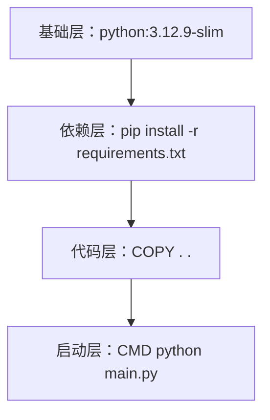

# 第 21 章 Docker 基础

> **节首信息条**｜对应课次 23 · 2 学时 · 理论讲授｜前置：第 4 章的目录结构；第 5 章的依赖清单与配置；第 20 章的可运行前后端；基本命令行操作

**已会**：第 4 章的目录结构、第 5 章的依赖清单与配置，以及第 20 章能在开发机跑起来的前后端。
**本章只加**：可复现与交付——把代码、依赖、配置与启动方式打成镜像，让目标环境也能按同样的方式运行。
**关系**：第 20 章证明“在这台机器上能跑”；本章回答“换一台机器怎样也能跑”。

上一章把前后端都跑通了，但只在开发机上跑通过。本章回答：怎样让同一份代码在目标环境也跑得起来。

> 环境提示：本章的 `docker` 命令需要 Docker 守护进程运行。如果 `docker version` 报“无法连接”，先启动 Docker Desktop 或 Docker Engine，再执行命令。

## 本章要解决的问题

**怎样把“在我的机器上能跑”变成“在目标环境也能跑”？**

同一份代码，换一台机器就表现不同：解释器版本对不上、依赖没装全、路径换了、启动命令忘了。每次都要重新配一遍环境，每次配出来的还不完全一样。代码一直被管理着，运行环境却往往只是“当时恰好装成那样”。

本章先讲清为什么打包、打成什么、怎么描述，动手构建放到下一章。

## 本章学习目标

读完第 21 章，你应该能：

1. 说明容器化要解决的“环境不一致”问题，以及它与虚拟机的区别。
2. 区分镜像、容器与仓库（Registry），并解释镜像分层（Image Layer）与构建缓存（Build Cache）。
3. 读懂 Dockerfile 的七类常用指令，写出一个最小可用文件。
4. 说明 `.dockerignore` 的作用，以及 `EXPOSE` 与 `-p`、`RUN` 与 `CMD` 的区别。
5. 描述“代码 → 镜像 → 容器 → 上线”的完整链路。

## 21.1 可复现交付

先看三种具体的环境差异：

| 差异 | 现象 | 根因 |
| --- | --- | --- |
| 依赖版本 | 本机装的 `fastapi 0.110`，服务器上是 `0.95`，某个参数行为不同 | 依赖没有随代码一起交付 |
| 运行配置 | 数据库地址写死成 `localhost`，换台机器连不上 | 配置没有从代码里拿出来 |
| 启动方式 | 忘了先激活虚拟环境、忘了在哪个目录启动 | 启动步骤只存在开发者脑子里 |

三类差异的共同点是：**代码交出去了，运行代码所需的环境没有交出去。** 一个能运行的系统至少依赖四样东西：代码、依赖、配置、启动方式。开发机上这四样往往靠“手工装过一遍”维持；换一台机器，版本、路径、环境变量都要重新对一遍，迟早不一致。

**可复现与交付**是本章的核心：它指“换一台机器，按同一份说明仍能得到相同运行结果”的能力。容器化把这四样写进一个可复现的交付物：依赖由镜像固定，配置由环境变量注入，启动方式写在镜像里。交付时交付镜像，而不是交付一台“装好环境的电脑”。

## 21.2 容器的基本概念

| 概念 | 是什么 | 类比 | 查看命令 |
| --- | --- | --- | --- |
| 镜像 image | 只读模板，包含文件系统与启动命令 | 类 / 安装包 | `docker images` |
| 容器 container | 镜像的运行实例 | 对象 / 进程 | `docker ps` |
| 仓库 registry | 存放和分发镜像的地方 | 应用商店 | `docker pull` |

三句话：一个镜像可以跑出多个容器，容器删了镜像还在；容器内的修改默认随容器删除而丢失，要保留就挂载卷；`docker run` 做了三件事——找镜像（没有就拉）、创建容器、启动进程。

**镜像与容器的分工**

镜像回答“里面有什么”：文件系统、依赖、启动命令。容器回答“现在跑到哪一步”：进程、端口、运行时状态。调试时要分清是在改镜像（构建）还是在改容器（运行）：改代码要重新构建镜像；改环境变量、端口映射只需重新运行容器。

> 💡 **易错点**：在容器里改代码或装依赖，然后以为镜像也变了。容器内的修改只存在于这个容器；容器删除就没了，下一次 `docker run` 仍然从原镜像启动。要持久化，必须改进 Dockerfile 并重新构建。

**容器与虚拟机的区别**

| 对比项 | 虚拟机 | 容器 |
| --- | --- | --- |
| 隔离层次 | 硬件虚拟化，每个 VM 带一套完整操作系统 | 进程级隔离，共享宿主机内核 |
| 启动速度 | 分钟级 | 秒级 |
| 资源开销 | 大（完整 OS、驱动） | 小（只含应用与依赖） |
| 隔离强度 | 强 | 较弱（同内核，靠配置约束） |
| 典型用途 | 需要不同操作系统的场景 | 应用打包与交付 |

类比：虚拟机像“每户一套房子”，水电地基都自己带；容器像“标准集装箱”，港口、吊机、公路是共用的，箱子只装货。容器没有自己的内核，所以启动快、开销小；也正因为共享内核，隔离强度不如虚拟机。

**容器适合的场景**

需要强隔离（例如运行不可信代码、需要不同操作系统内核）时，虚拟机更合适；只需要“把应用和依赖打包带走”时，容器更轻。选择标准是隔离强度与交付成本，不是“容器更新”。

> 💡 **易错点**：把容器当成“轻量级虚拟机”，于是往容器里装 systemd、装整套系统工具。容器是“一个进程 + 它的依赖”，不是一台小电脑；装得越多，镜像越大、启动越慢，也偏离了容器的用途。

## 21.3 镜像分层



*图 21-1：后端镜像的分层结构*

三条规则：Dockerfile 里每条 `RUN`、`COPY`、`ADD` 都会生成一层；层是只读的，上层叠在下层上，多个镜像可以共享下层；某一层变了，它和它上面的所有层都要重建，下面的层命中缓存。

| 改动 | 重建的层 | 命中缓存的层 |
| --- | --- | --- |
| 业务代码 | 代码层及其上层 | 基础层、依赖层 |
| `requirements.txt` | 依赖层及其上层 | 基础层 |
| 基础镜像 | 全部 | 无 |

所以 `duty/Dockerfile` 先 `COPY requirements.txt .` 并安装依赖，最后才 `COPY . .`。改业务代码时，依赖层不动，只重建代码层。镜像体积是各层之和——带进镜像的东西越多，镜像越大。

## 21.4 镜像构建文件与忽略规则

**Dockerfile 的七条指令**

**代码 21-1-1** · Dockerfile 片段

```dockerfile
FROM swr.cn-north-4.myhuaweicloud.com/ddn-k8s/docker.io/python:3.12.9-slim
WORKDIR /app
RUN pip config set global.index-url https://pypi.tuna.tsinghua.edu.cn/simple
COPY requirements.txt .
RUN pip install --no-cache-dir -r requirements.txt
COPY . .
ENV PYTHONDONTWRITEBYTECODE=1 \
    PYTHONUNBUFFERED=1
EXPOSE 8000
CMD ["python", "main.py"]
```

| 指令 | 作用 | 在 duty 中的写法 |
| --- | --- | --- |
| `FROM` | 指定基础镜像，一切从它开始 | `python:3.12.9-slim` |
| `WORKDIR` | 设置容器内工作目录 | `/app` |
| `RUN` | 构建时执行命令，结果写进镜像层 | 配 pip 源、装依赖 |
| `COPY` | 把构建上下文中的文件复制进镜像 | 先 `requirements.txt`，后 `.` |
| `ENV` | 设置运行时环境变量 | 不生成 `.pyc`；日志立即输出 |
| `EXPOSE` | 声明容器打算用哪个端口 | `8000` |
| `CMD` | 容器启动时执行的命令 | `python main.py` |

**RUN 与 CMD 的区别**

`RUN` 在构建时执行，结果留在镜像层里，例如安装依赖；`CMD` 在容器启动时执行，每次启动都可以不同。把 `pip install` 写进 `CMD`，每次启动都会重新安装，既慢又不可复现；把启动命令写进 `RUN`，构建完就结束，容器不会常驻。

**`.dockerignore` 的作用**

**代码 21-1-2** · 示例（文本）

```text
__pycache__
*.pyc
.venv
venv
env
.env
*.log
*.sqlite3
.git
```

作用有两个：构建上下文（Build Context）更小、构建更快；避免把密钥、本机数据库、日志打进镜像。`.env` 绝不能进镜像，它含密钥；数据库文件与日志属于运行产物，应该挂载或重建。

> 💡 **易错点**：只写 `.dockerignore`，却不检查 `COPY . .` 的范围。忽略规则写错一个路径，`venv/` 或 `.env` 仍会进镜像；构建后用 `docker run ... ls` 或镜像体积对比确认一次。

**镜像内容的选择**

把调试工具、测试依赖、编辑器全打进镜像，构建时方便，但镜像变大、攻击面变宽；只放运行所需，镜像干净，但调试时要另开容器或用 `docker exec`。生产镜像取后者，开发镜像可以取前者；关键是**同一类镜像用同一套规则**，不要一半干净一半臃肿。

## 21.5 端口映射

**EXPOSE 与 -p 的区别**

`EXPOSE 8000` 只是声明“容器打算用 8000 端口”，它不会把端口发布到宿主机。真正对外发布端口靠运行时参数：

**代码 21-1-3** · 命令（Bash）

```bash
docker run -p 8000:8000 duty-backend
```

左边是宿主机端口，右边是容器端口。只写 `EXPOSE` 而不写 `-p`，宿主机仍然访问不到。**端口映射**就是把“容器内的端口”接到“宿主机（或外部网络）的端口”上。

## 21.6 容器的运行与上线

**从代码到上线的流程**

```mermaid
flowchart LR
    A[写代码] --> B[docker build]
    B --> C[镜像]
    C --> D[推送仓库]
    D --> E[docker pull]
    E --> F[docker run]
    F --> G[/health + 日志]
```

三个环境各由不同东西保证一致：开发环境靠开发者本机；构建环境靠 Dockerfile 与基础镜像；运行环境靠环境变量与挂载。数据库地址、密钥、数据目录按环境注入，不能写死在镜像里。

**常用命令**

| 目的 | 命令 |
| --- | --- |
| 查看本地镜像 | `docker images` |
| 查看运行中的容器 | `docker ps` |
| 查看所有容器 | `docker ps -a` |
| 构建镜像 | `docker build -t duty-backend .` |
| 运行并映射端口 | `docker run -p 8000:8000 duty-backend` |
| 查看容器日志 | `docker logs <容器名>` |

部署上线不是终点。镜像跑起来只是开始，还要能看健康状态、看日志、能回滚。

> 💡 **易错点**：把数据库地址、密钥写进 Dockerfile 的 `ENV`。镜像一旦推送到仓库，密钥就跟着镜像走；这些值应该在运行时用 `-e`、`.env` 或 Compose 注入，镜像里只留示例。

## 示范例题

#### 例 21-1：解释镜像、容器与分层【Bloom：理解】

**题目**：用自己的话说明镜像与容器的关系，以及“先 COPY requirements.txt、后 COPY . .”为什么能减少重建。

**解**：

1. 镜像是只读模板，容器是镜像的运行实例；一个镜像可以跑出多个容器，容器删除后镜像仍在。
2. 每条 `RUN`、`COPY` 生成一层；某一层变化时，它和它上面的层都要重建，下面的层命中缓存。
3. `requirements.txt` 变化频率低，先复制并安装依赖，依赖层就能长期命中缓存；业务代码变化频繁，放在最后复制，改代码时只重建代码层。

#### 例 21-2：运行一个现成镜像【Bloom：应用】

**题目**：写出运行 `hello-world` 镜像、查看所有容器、查看本地镜像的三条命令，并说明 `docker run` 做了哪三件事。

**解**：

**代码 21-2-1** · 命令（Bash）

```bash
docker run --rm hello-world
docker ps -a
docker images
```

`docker run` 做三件事：找镜像（本地没有就从仓库拉取）、创建容器、启动进程。`--rm` 表示容器退出后自动删除；`docker ps -a` 查看所有容器（包括已停止的）；`docker images` 查看本地镜像。

## 独立习题

#### 习题 21-1【Bloom：记忆】

**题目**：写出下列 Docker 操作的命令：查看本地镜像、查看运行中的容器、查看所有容器、构建镜像、运行容器并映射端口、查看容器日志。

#### 习题 21-2【Bloom：理解】

**题目**：解释镜像分层与构建缓存：为什么改业务代码时依赖层不用重装？为什么 `.dockerignore` 能减小镜像体积？

#### 习题 21-3【Bloom：分析】

**题目**：容器启动后立刻退出，`docker ps` 看不到它。请给出至少三条可能原因与排查步骤。

#### 习题 21-4【Bloom：理解】（概念辨析）

**题目**：容器常被说成“轻量级虚拟机”，这个说法哪里不准确？请从共享内核与隔离层次两方面说明。

## ◇ 课堂活动块（课次 23 · 理论讲授）

**听讲要点**：

1. 容器把应用与依赖打包成一致的环境。
2. 镜像是模板，容器是运行实例，仓库是分发点。
3. 分层与缓存决定构建速度。
4. `EXPOSE` 是声明，`-p` 才是映射；`RUN` 构建时执行，`CMD` 启动时执行。
5. 容器化不等于自动化部署。

**讨论·演示**：

1. （讨论）“我本机能跑”与“服务器上跑不起来”，容器分别解决了哪一部分？
2. （演示）改一行代码，观察哪些镜像层复用、哪些重建。

**课后自测**：完成独立习题 21-1、23-2（答案见书末 98-参考答案），作为课次 23 的书面检查。

**目标对应**：本章目标与习题逐条对应，见章末「本章小结与自检」。

## 本章小结

**核心结论**：

1. 环境差异通常来自依赖、配置与启动方式；容器化把代码、依赖、配置与启动方式打成可复现的镜像，解决“本机能跑、服务器跑不起来”。
2. 容器共享宿主机内核，启动快、开销小，但不是“小虚拟机”，隔离强度较弱。
3. 镜像是只读模板，容器是运行实例，仓库用于分发镜像；一个镜像可以跑出多个容器。
4. 镜像分层构建，变化少的放前面；`COPY requirements.txt` 在 `COPY . .` 之前；`.dockerignore` 排除密钥、虚拟环境、数据库与日志。
5. `EXPOSE` 只是声明，`-p` 才发布端口；`RUN` 在构建时执行，`CMD` 在启动时执行；部署流程是 build → push/pull → run → 健康检查 → 日志。

把这章压缩成一句话：**镜像把“能跑所需的一切”固定下来，容器让同一份镜像在任何机器上按同样方式运行。**

**本章不引入**：Kubernetes、Swarm、镜像仓库高级配置、多阶段构建。这些在后续课程或工程环境中按需了解。

**学完本章，你可以体会到**：容器化不是为了“时髦”，而是把“环境差异”这个最常见的上线事故源提前消掉。

**自检**：回到章首的学习目标，逐条问自己做到了没有——

- [ ] 说明容器化要解决的“环境不一致”问题，以及它与虚拟机的区别。
- [ ] 区分镜像、容器与仓库，并解释镜像分层与构建缓存。
- [ ] 读懂 Dockerfile 的七类常用指令，写出一个最小可用文件。
- [ ] 说明 `.dockerignore` 的作用，以及 `EXPOSE` 与 `-p`、`RUN` 与 `CMD` 的区别。
- [ ] 描述“代码 → 镜像 → 容器 → 上线”的完整链路。

**下一章预告**：知道了 Dockerfile 怎么写，下一章真正构建后端与前端镜像，诊断构建失败与镜像体积问题。
