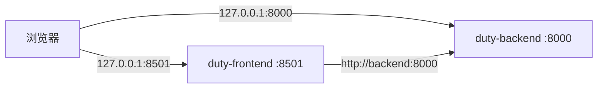

# 第 23 章 前后端服务部署

上一章两个镜像都构建好了，容器也能各自运行，但前端连不上后端。

## 本章要解决的问题

**两个容器怎样在目标环境里互相找到，并带着正确的配置运行？**

两个服务各自都能启动，健康检查也通，合起来却连不上：一方用的是开发机上的本机地址，另一方在容器里监听自己的端口。部署之后多了一层容器网络，浏览器、前端容器、后端容器各有各的“地址”，同一串地址在其中一处成立，在另一处就不成立。

本章关心的是：部署之后多出一层容器网络，各方眼中的“地址”为什么不再一致，以及配置与数据怎样在换环境时保持可替换、不丢失。

## 本章学习目标

读完第 23 章并完成实训后，你应该能：

1. 画出两种部署拓扑，说明前端、后端与数据库的访问路径。
2. 正确配置端口映射与环境变量，做到“同一镜像、不同环境”。
3. 用自定义网络让容器按服务名互相访问，并用卷持久化数据。
4. 用 Compose 固定多容器部署配置，并守住敏感配置的三条红线。
5. 按验证清单与排错四步完成一次部署验收。

## 23.1 部署拓扑

第 22 章两个镜像各自能跑，但前端连不上后端。要解决“连不上”，得先回答一个更基本的问题：**部署之后，到底有几套“地址”在同时起作用？**

**三种地址，三个视角**

部署之前，前端、后端都跑在你的开发机上，地址就是那一个 `127.0.0.1`。部署之后，浏览器、前端容器、后端容器各在一个位置上，它们看到的“对方地址”不再是同一套：

| 谁在访问谁 | 应该用哪种地址 | 走哪条通道 |
| --- | --- | --- |
| 浏览器 → 前端 | `http://127.0.0.1:8501` | 宿主机映射端口 |
| 浏览器 → 后端 | `http://127.0.0.1:8000` | 宿主机映射端口 |
| 前端容器 → 后端容器 | `http://backend:8000` | 容器网络，用容器端口 |

三种地址背后是三个视角：浏览器站在**宿主机**上，访问的是宿主机的映射端口；前端容器和后端容器各自站在**容器网络**里，互相用容器名/别名加容器端口访问。同一个服务，在不同视角下有不同地址——这正是“部署后连不上”的根源：拿开发机的地址去套容器的场景。

**执勤电子年鉴的部署拓扑**

把上面三种地址套到执勤电子年鉴系统上，得到本章要实现的拓扑：



*图 23-1：浏览器与容器之间的访问路径*

容器之间通信不使用宿主机的映射端口；`-p 8000:8000` 是给宿主机用的，不是给另一个容器用的。**部署也是契约**：前端必须按后端在容器网络里的名字去找它，而不是按开发机上的 `127.0.0.1`。

> 💡 **易错点**：在容器里用 `127.0.0.1` 访问另一个容器。每个容器有自己独立的回环地址，`127.0.0.1` 永远指向“自己”；跨容器要用容器名/网络别名或宿主机地址。

拓扑清楚后，接下来要决定用什么方式部署。两个容器时，手写两条 `docker run` 也能跑；但参数一多（网络、卷、环境变量、健康检查），漏一个就出问题，换台机器还要重新敲一遍。Compose 把这些参数写成文件，可版本控制、可复现；代价是多学一份 YAML 语法。文件里的每个字段，都能在 23.2、23.3 的手工命令里找到对应。

## 23.2 端口映射与环境变量

`-p 8000:8000` 左边是宿主机端口，右边是容器端口。`EXPOSE 8000` 只是声明，不负责对外发布。前端容器访问后端时，用的是后端容器的 8000 端口，不是宿主机的映射端口。这些在第 21、22 章已经讲过，本章要解决的是它们背后的一个共同目标：**让同一份镜像，跑在不同环境里。**

**为什么需要“同一镜像、不同环境”**

第 22 章构建出来的 `duty-backend:1.0` 是固定的——代码、依赖、启动方式都写死在镜像里。但开发环境和部署环境注定不同：开发时用本地数据库、开调试；部署时用部署目录的数据库、关调试。如果这些差别也写进镜像，就得为每个环境各构建一个镜像，镜像一多，反而回到“环境不一致”的老问题。

正确的做法是：**镜像只包含“与环境无关”的部分（代码、依赖、启动方式），“随环境变化”的部分（数据库地址、密钥、调试开关）在运行时注入。** 注入的手段就是环境变量。

**环境变量管配置**

先看最小的一条：给容器注入一个环境变量。

**代码 23-1-1** · 命令（Bash）

```bash
docker run -d --name duty-backend -p 8000:8000 \
  -e DATABASE_URL="sqlite:///./duty.db" \
  duty-backend:1.0
```

`-e 键=值` 注入环境变量，容器里的程序用 `os.getenv("DATABASE_URL")` 就能读到。就这一条，已经实现了“同一镜像、不同环境”：开发时用默认值 `sqlite:///./duty.db`，部署时注入 `-e DATABASE_URL="sqlite:///./data/duty.db"`，镜像一个字都不用改。

再加上网络与别名，就得到一条完整的启动命令：

**代码 23-1-2** · 命令（Bash）

```bash
docker run -d --name duty-backend \
  --network duty-net \
  --network-alias backend \
  -p 8000:8000 \
  -e DATABASE_URL="sqlite:///./duty.db" \
  duty-backend:1.0
```

| 参数 | 作用 |
| --- | --- |
| `--network duty-net` | 加入自定义网络 |
| `--network-alias backend` | 给容器起网络别名，前端可用 `backend` 访问 |
| `-p 8000:8000` | 宿主机 8000 → 容器 8000 |
| `-e KEY=VALUE` | 注入环境变量 |

镜像不变，变的只是启动时注入的**环境变量**。这就是配置外置的原则（12-Factor App）。

**敏感配置不进 Compose**

环境变量里最敏感的是口令类值：数据库连接串里的账号密码、第三方服务的访问密钥。管理有三条红线（OWASP Secrets Management Cheat Sheet；12-Factor App）：这类值不写进 Dockerfile、不提交到 Git；生产环境用安全的注入方式，不用课堂示例值；`.env` 文件本身也要加入 `.gitignore`。三条红线的共同理由：镜像会被推送、复制、缓存，写进镜像的口令等于公开。

> 💡 **易错点**：把口令写进 Compose 的 `environment` 明文。Compose 文件通常进 Git，口令会随仓库扩散；用 `.env` 文件或部署平台的密钥管理注入，Compose 只引用变量名。

## 23.3 容器网络与数据持久化

环境变量解决了“配置怎么随环境变”，但两个容器要互相找到对方、数据要活过容器，还差两个机制：网络与卷。

**按服务名互访**

前端容器要用 `http://backend:8000` 找到后端，这个 `backend` 是谁？它不是一个 IP，而是后端容器在某个网络里的**名字**。这里有个关键背景：Docker 默认的 `bridge` 网络只给容器分配 IP，**不保证**用容器名互相解析——也就是说，两个容器在默认网络里，只能靠 IP 访问，而 IP 在容器重建后就会变。要“按名字找对方”，就得创建自定义网络，它自带 DNS（Docker 官方文档），同一网络里的容器可以用容器名或网络别名互相访问：

**代码 23-1-3** · 命令（Bash）

```bash
docker network create duty-net
docker network inspect duty-net
docker inspect -f "{{json .NetworkSettings.Networks}}" duty-backend
```

**容器网络**解决“怎么找到对方”：同一网络内，服务名就是地址。前端容器用 `http://backend:8000`，后端用 `--network-alias backend` 声明这个名字；不用记 IP，容器重建后地址变了也不影响。

**卷让数据活过容器**

网络解决“找得到”，卷解决“留得住”。为什么数据会“留不住”？第 21 章讲过，容器的可写层随容器删除而丢弃——数据库文件、日志写在容器里，`docker rm` 之后全没了。部署环境里这是不能接受的：删个容器就把业务数据删了。所以要把这些“要长期存在”的数据放到容器之外——挂载到宿主机目录或命名卷：

**代码 23-1-4** · 命令（Bash）

```bash
mkdir -p data logs
cp duty.db data/duty.db

docker run -d --name duty-backend \
  --network duty-net \
  --network-alias backend \
  -p 8000:8000 \
  -v "$(pwd)/data:/app/data" \
  -v "$(pwd)/logs:/app/logs" \
  -e DATABASE_URL="sqlite:///./data/duty.db" \
  duty-backend:1.0
```

| 方式 | 写法 | 特点 |
| --- | --- | --- |
| 绑定挂载 bind mount | `-v 宿主机路径:容器路径` | 宿主机能直接看到文件，课堂推荐 |
| 数据卷 volume | `-v 卷名:容器路径` | 由 Docker 管理，便于迁移 |

**数据卷**解决“容器删了数据还在”：数据库文件、日志写到宿主机目录或命名卷，重建容器后按原路径挂载回来。验证方法：新建一个单位，删除后端容器，用同样命令重建，单位还在；宿主机的 `data/`、`logs/` 目录里文件仍在。

前端容器要访问后端，启动时把后端地址注入进去：

**代码 23-1-5** · 命令（Bash）

```bash
docker run -d --name duty-frontend \
  --network duty-net \
  -p 8501:8501 \
  -e DUTY_API_BASE_URL="http://backend:8000" \
  duty-frontend:1.0
```

| 写法 | 谁在用 | 结果 |
| --- | --- | --- |
| `http://127.0.0.1:8000` | 前端容器内 | 指向前端自己，失败 |
| `http://duty-backend:8000` | 同一自定义网络内 | 用容器名解析，成功 |
| `http://backend:8000` | 同一自定义网络内 | 用网络别名解析，成功 |

网络不通时，先进入前端容器用 Python 或 curl 测，不要只看浏览器：

**代码 23-1-6** · 命令（Bash）

```bash
docker exec -it duty-frontend sh
python -c "import urllib.request; print(urllib.request.urlopen('http://backend:8000/health').read())"
```

> 💡 **易错点**：用 `docker inspect` 看到的容器 IP 写进配置。容器重建后 IP 会变；用容器名或网络别名，才是稳定的地址。

## 23.4 多服务编排

**Compose 把命令写成文件**

23.2、23.3 手写了两条 `docker run`，每条都拖着网络、别名、端口、环境变量、挂载一大串参数。这还没到真正复杂的程度，但已经能看出问题：参数多一个、漏一个都察觉不到，换台机器还要把这一长串重新敲一遍。**手工命令的问题不是“跑不通”，而是“不可复现、不可版本化”。**

Compose 就是针对这个问题的答案：把那些 `docker run` 参数写成一份 YAML 文件，文件进 Git，部署就从“敲一长串命令”变成“提交一份文件”（Docker Compose 官方文档）：

**代码 23-1-7** · 配置（YAML）

```yaml
name: duty-system
services:
  backend:
    build: ./duty
    ports:
      - "8000:8000"
    environment:
      DATABASE_URL: sqlite:///./duty.db
    volumes:
      - ./duty/logs:/app/logs
    healthcheck:
      test: ["CMD", "python", "-c", "import urllib.request; urllib.request.urlopen('http://127.0.0.1:8000/health')"]
      interval: 10s
      timeout: 5s
      retries: 5
      start_period: 20s

  frontend:
    build: ./duty_frontend
    ports:
      - "8501:8501"
    environment:
      DUTY_API_BASE_URL: http://backend:8000
    depends_on:
      backend:
        condition: service_healthy
```

这份文件里每一段都能在 23.2、23.3 的手工命令里找到对应：`services` 定义两个服务；`build` 指定构建上下文（代替 `docker build`）；`ports` 做端口映射（对应 `-p`）；`environment` 注入配置（对应 `-e`）；`volumes` 挂载日志（对应 `-v`）；`healthcheck` 判断后端是否可用；`depends_on` 让前端等后端健康后再启动。

**depends_on 只保证先启动**

两种启动条件要分清。只写 `depends_on`，Compose 只保证“先启动后端容器”，不保证“后端已经能处理请求”（Docker Compose 官方文档）；前端可能在后端还没就绪时启动，第一次请求失败。为什么会有这个差别？因为“容器启动了”和“服务能处理请求了”是两件事：容器启动只说明进程跑起来了，服务还要完成加载、连上数据库、监听端口，才能响应。加上 `healthcheck` 与 `condition: service_healthy`，才把“启动顺序”升级为“就绪顺序”。

**部署完成怎么验收**

部署完成后，按“浏览器能打开 8501、管理员能登录、列表有数据、新建后刷新仍在、重建容器后数据仍在、未登录访问接口返回 401”逐项验证。验证不通过时，按“`docker compose ps` → `docker compose logs 服务名` → 容器内测网络 → 检查环境变量”四步排查：先确认容器与端口，再看日志，再测网络，最后查配置。

## 示范例题

#### 例 23-1：写一份双服务 Compose 配置

**题目**：写一份 Compose 配置：后端构建 `./duty`、映射 8000、注入数据库地址；前端构建 `./duty_frontend`、映射 8501、把后端地址配成 `http://backend:8000`；前端等后端健康后再启动。

**解**：即代码 23-1-7。关键点：前端用服务名 `backend` 访问后端，不用 `127.0.0.1`；`depends_on` 配合 `healthcheck`，避免前端在后端未就绪时启动。

#### 例 23-2：诊断“前端连不上后端”

**题目**：前端容器与后端容器都在运行，浏览器能打开 8501，但登录提示无法连接后端。请按四步排查，并说明最可能的原因。

**解**：

1. `docker ps`：两个容器是否都在运行，8000/8501 是否映射。
2. `docker logs duty-frontend`：前端是否报连接错误；`docker logs duty-backend`：后端是否正常启动。
3. `docker exec -it duty-frontend sh`，用 Python 访问 `http://backend:8000/health`：如果失败，说明两个容器不在同一网络，或后端没有 `backend` 别名。
4. 检查环境变量：`docker exec duty-frontend env | grep DUTY_API_BASE_URL`。如果是 `http://127.0.0.1:8000`，前端在找自己，必然失败。

最可能原因：`DUTY_API_BASE_URL` 仍指向 `127.0.0.1`，或两个容器不在同一自定义网络。修正：把前端加入 `duty-net`，设置 `DUTY_API_BASE_URL=http://backend:8000`，后端加 `--network-alias backend`。

## 独立习题

#### 习题 23-1

**题目**：说明 `depends_on` 与 `healthcheck` 各自解决什么问题，为什么只写 `depends_on` 不够。

#### 习题 23-2

**题目**：部署后出现四个现象：前端提示无法连接、后端容器启动即退出、登录返回 401、重建容器后数据丢失。请分别给出最可能的原因与排查步骤。

## ◆ 实训 23-1：前后端服务部署

### 一、任务目标与验收

| 目标 | 验收标志 |
| --- | --- |
| 拓扑清楚 | 前端/后端/数据库访问路径可画出 |
| 端口与环境变量正确 | 宿主机可访问、配置不写死 |
| 网络与卷可用 | 服务名可解析、重启后数据仍在 |
| Compose 可复现 | 一条命令启动全部服务 |
| 验证与排错 | 清单逐项通过、能按四步定位 |

### 二、课前准备

- 第 22 章的两个镜像
- 一份部署拓扑草图
- `.env` 与 `.env.example`

### 三、操作步骤

1. **定拓扑与端口**
   - 做什么：定拓扑与端口
   - 操作：画拓扑，确定宿主机端口与容器端口
   - 预期输出：→ 访问路径清楚
   - 做错会看到什么：混淆 `EXPOSE` 与 `-p`；映射以 `-p`/compose ports 为准
2. **配环境变量**
   - 做什么：配环境变量
   - 操作：把数据库地址、密钥放进 `.env`
   - 预期输出：→ 代码中无硬编码
   - 做错会看到什么：密钥写进 compose 明文；改用环境变量并限制权限
3. **建网络与卷**
   - 做什么：建网络与卷
   - 操作：用自定义网络与命名卷
   - 预期输出：→ 服务名可解析、数据持久
   - 做错会看到什么：用 IP 直连；改用服务名
4. **Compose 与验收**
   - 做什么：Compose 与验收
   - 操作：写 compose 文件，一条命令启动，并按下面六项逐项验证
   - 预期输出：→ 全部服务健康、重启数据仍在
   - 做错会看到什么：容器名冲突或依赖顺序错；加 healthcheck 与 depends_on

验收至少覆盖六项：浏览器能打开 8501；管理员账号能登录；单位列表能显示数据；新建一个单位后刷新仍在；删除后端容器再重建，数据仍在；未登录直接访问接口返回 401。

### 四、排错清单

排错按四步进行：`docker compose ps` 看容器是否在跑、端口是否映射 → `docker compose logs 服务名` 看启动是否报错 → 进入容器用 python/curl 测网络 → 检查环境变量中的地址、数据库路径与口令类配置。

| 现象 | 先查什么 |
| --- | --- |
| 宿主机访问不到 | 端口映射、绑定地址 0.0.0.0 |
| 容器间访问失败 | 网络、服务名、端口；前端先查 `DUTY_API_BASE_URL` 是否为 `http://backend:8000` |
| 登录返回 401 | 用户名、密码；令牌是否已失效（后端重启过） |
| 数据库为空 | `DATABASE_URL` 与挂载路径 |
| 重启数据丢失 | 未使用卷或卷路径错 |
| 口令泄露 | compose/镜像/仓库中的明文配置 |

> 💡 **易错点**：只改 Compose 文件，不重建容器。`docker compose up` 会按新配置重建；如果只用 `docker restart`，环境变量、网络、卷都不会更新。

### 五、提交与验收

提交 compose 文件、拓扑图与验收记录；验收按“拓扑与网络”“配置安全”“可复现部署”三项判定。

### 六、课后扩展

- 加 healthcheck 与自动重启策略
- 把 compose 拆成 base + override
- 写一份部署手册与回滚步骤
- **复习任务**：回看第 22 章 22.5（容器里的 `127.0.0.1`）与第 5 章 5.6（环境变量），对照本章 23.1–23.4，说明“同一镜像、不同环境”靠什么实现、哪些值绝不能进镜像

## 本章小结

**核心结论**：

1. 浏览器走宿主机映射端口，容器之间走容器网络与容器端口；容器里的 `127.0.0.1` 指容器自己。
2. 同一镜像通过**环境变量**适配不同环境；密钥、数据库地址不写进镜像，也不进 Git。
3. 自定义网络提供容器名/别名解析；后端加 `--network-alias backend`，前端用 `http://backend:8000`。
4. 数据与日志挂载到**数据卷**或宿主机目录；容器可删，卷要留。
5. **Compose** 把手工命令写成一份文件；`depends_on` 配合 `healthcheck` 控制启动顺序；排错按“ps → logs → exec 测网络 → 环境变量”四步。

把这章压缩成一句话：**部署不是把容器跑起来，而是让地址、配置与数据在目标环境里各有确定的位置。**

**自检**：回到章首的学习目标，逐条问自己做到了没有——

- [ ] 画出两种部署拓扑，说明前端、后端与数据库的访问路径。
- [ ] 正确配置端口映射与环境变量，做到“同一镜像、不同环境”。
- [ ] 用自定义网络让容器按服务名互相访问，并用卷持久化数据。
- [ ] 用 Compose 固定多容器部署配置，并守住敏感配置的三条红线。
- [ ] 按验证清单与排错四步完成一次部署验收。
