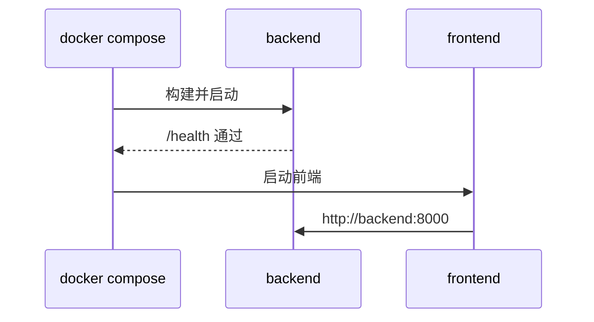

# 第 24 章 软件部署综合实践

上一章用一长串容器启动命令把前后端连起来了。命令能跑，但换一台机器、换一个人，参数少一个就可能失败。

## 本章要解决的问题

**怎样完成一次可验收的交付，并在故障发生时留下可复现的证据链？**

一长串手工命令能跑通，却经不起换机器、换人：参数少一个就可能失败，两个人部署出来的环境不一样，出了问题也复现不了。服务“起来了”不等于“可交付”，还要能看健康状态、能查日志、能备份与回滚。

本章关心的是：一串手工命令怎样变成一次可重复的交付，以及故障发生时，手上有哪些证据可以复现和回退。

## 本章学习目标

读完第 24 章并完成实训后，你应该能：

1. 读懂并写出一个可用的 `docker-compose.yml`，说明各段的作用。
2. 用常用命令完成启动、停止、重建与日志查看。
3. 按三个故障演练（端口、网络、数据）定位并恢复服务。
4. 用日志、健康检查与响应头判断服务是否真的可用。
5. 写出部署文档要素，并按验收（Acceptance）清单完成一次交付。

## 24.1 交付清单与编排操作

上一章的手工部署包含网络、端口、环境变量、挂载、启动顺序。Compose 把这些写进一份 YAML，文件进 Git，部署就变得可复现。

**一次交付要交四样**

**交付**不只是“容器在跑”。一次可验收的部署交付至少包括四件事（参照 ISO/IEC/IEEE 12207 的转移与运行过程）：**可运行**（一条命令启动）、**可配置**（环境变量能替换）、**可验证**（健康检查与验收清单）、**可排查**（日志与故障记录）。四件事缺一件，接手的人就要靠猜。

| Compose 配置 | 对应手工操作 |
| --- | --- |
| `services.backend` | `--name duty-backend` |
| `build.context: ./duty` | `docker build -t duty-backend:1.0 ./duty` |
| `ports: 8000:8000` | `-p 8000:8000` |
| `environment` | `-e KEY=VALUE` |
| `volumes: ./duty/logs:/app/logs` | `-v "$(pwd)/logs:/app/logs"` |
| `healthcheck` | 手工 `curl /health` |
| `frontend.environment.DUTY_API_BASE_URL` | `-e DUTY_API_BASE_URL=...` |
| `depends_on: condition: service_healthy` | 手工“先等后端起来，再起前端” |
| 服务名 `backend` / `frontend` | `--network-alias backend` |

**一份编排文件的结构**

先看这份文件的结构：

**代码 24-1-1** · 配置（YAML）

```yaml
name: duty-system
services:
  backend:
    build: ./duty
    ports:
      - "8000:8000"
    environment:
      DATABASE_URL: sqlite:///./duty.db
    volumes:
      - ./duty/logs:/app/logs
    healthcheck:
      test: ["CMD", "python", "-c", "import urllib.request; urllib.request.urlopen('http://127.0.0.1:8000/health')"]
      interval: 10s
      timeout: 5s
      retries: 5
      start_period: 20s
  frontend:
    build: ./duty_frontend
    ports:
      - "8501:8501"
    environment:
      DUTY_API_BASE_URL: http://backend:8000
    depends_on:
      backend:
        condition: service_healthy
```

三件事要讲清：服务名就是网络地址，`frontend` 里写 `http://backend:8000`，Compose 自动创建网络并把 `backend` 解析到后端容器；`healthcheck` 是“活着”的标准，每 10 秒访问一次 `/health`，连续失败 5 次判定不健康；`depends_on` 默认只等容器启动，加上 `condition: service_healthy` 才等健康检查通过。

**常用命令**

常用命令如下：

| 命令 | 作用 |
| --- | --- |
| `docker compose up -d --build` | 构建并后台启动 |
| `docker compose ps` | 查看服务状态 |
| `docker compose logs -f 服务名` | 跟踪日志 |
| `docker compose restart 服务名` | 重启单个服务 |
| `docker compose exec 服务名 sh` | 进入容器 |
| `docker compose down` | 停止并删除容器与网络 |

`down` 删除容器，但不会删除镜像；本项目的数据库在容器层，`down` 后新建的数据会丢。

> 💡 **易错点**：把 Compose 文件当成“命令备忘录”，只写服务与端口，不写环境变量、卷与健康检查。文件能启动，但换一台机器数据丢了、服务没起来前端先请求、密钥写死——这些都不是“部署成功”。

## 24.2 健康检查与启动顺序

先看一次带健康检查的启动：



*图 24-1：带健康检查的启动顺序*

**容器 up 不等于可用**

**健康检查**回答“服务什么时候算可用”，不是“容器什么时候启动”。容器 running 只说明进程还在；`/health` 通过才说明服务能处理请求。**启动顺序**由 `depends_on` 表达，但只有配合 `healthcheck` 才能从“先启动”升级为“先就绪”。

> 💡 **易错点**：看到 `docker compose ps` 显示 `Up` 就认为服务可用。容器 up 只说明进程在；健康检查、登录、列表查询都要逐项验证，否则“假可用”会在验收时暴露。

## 24.3 日志与根因定位

可观测性指系统把“内部发生了什么”暴露出来的能力；在软件运维中，通常指由日志、指标与追踪三类信号推断系统内部状态。部署后要能回答“服务是否可用、慢在哪里、出过错没有”，需要三类证据：

| 证据 | 位置 | 说明 |
| --- | --- | --- |
| 健康检查 | `GET /health` | 返回 `{"status":"healthy"}` |
| 响应时间 | 响应头 `X-Process-Time` | 由后端中间件计算并写入，用来判断慢请求；要获得这一证据，需在后端补一个中间件 |
| 应用日志 | `duty/logs/app.log`、`error.log` | 由后端写文件日志产生；日志目录挂载到宿主机后，容器删除日志仍在，需在后端配置日志写入 |

**代码 24-1-2** · 命令（Bash）

```bash
ls duty/logs
tail -n 20 duty/logs/app.log
```

**日志异常先看哪里**

日志出现异常时，按固定顺序排查。

> 💡 **易错点**：只看容器状态，不看日志。容器反复重启时 `docker ps` 可能显示 `Restarting`，真正的原因只在 `docker compose logs backend` 的最后几行；先看日志，再改配置。

## 24.4 故障演练与验收

先做三个故障演练：

| 故障 | 现象 | 排查与修复 |
| --- | --- | --- |
| 端口被占用 | `port is already allocated`，后端起不来 | 停掉占用 8000 的本机服务，再 `up` |
| 前端地址写成 `localhost` | 页面能开，登录失败 | 进前端容器访问 `http://localhost:8000/health`，确认指向自己；改回 `http://backend:8000` |
| 数据库路径写错 | 后端反复重启或退出 | `docker compose logs backend` 看路径错误；改回有效路径并确保目录可写 |

排查顺序固定：`docker compose ps` → `docker compose logs 服务名` → 容器内测网络 → 检查环境变量。三个故障分别对应端口、网络与地址、文件与配置三层，不要一上来就改代码。

**编排的两处不足**

演练之后，还要看清当前编排的不足。当前 `docker-compose.yml` 只挂载了日志，没有挂载数据库。数据库文件在容器层，`docker compose down` 后新增数据会丢。改进方式：给后端加数据目录挂载，并把 `DATABASE_URL` 指到挂载目录。

这个不足值得在交付时明确写出来：交付不是“没有问题”，而是“问题说清楚”。

**部署文档写几节**

交付时还要写部署文档，至少包含下面几节：

| 章节 | 内容 |
| --- | --- |
| 服务清单 | backend / frontend，镜像与版本 |
| 端口 | 8000、8501，宿主机 → 容器 |
| 环境变量 | 名称、作用、是否敏感（含口令的连接串必须标注） |
| 数据与日志 | 宿主机目录 → 容器目录 |
| 启动与停止 | `up -d --build`、`down` |
| 健康检查 | `/health` 与 Compose healthcheck |
| 备份与回滚 | 备份数据库文件；回滚到上一个镜像版本 |
| 常见问题 | 端口占用、地址错误、数据目录权限 |

部署文档不是“命令备忘录”，它要能让一个没参与开发的人把系统跑起来。

最后按清单逐项验收：

- [ ] `docker compose up -d --build` 一次成功；
- [ ] `docker compose ps` 两个服务都在运行；
- [ ] 登录成功，单位列表有数据；
- [ ] 能说出 `healthcheck` 与 `depends_on` 的作用；
- [ ] 完成一个故障演练并记录；
- [ ] 部署文档包含环境变量、数据与日志、备份与回滚；
- [ ] 能说出当前编排在数据持久化（Data Persistence）上的不足。

**验收清单的粒度**

验收清单的粒度要合适。清单太短（“服务能启动”）无法证明可用；太长（每个命令一行）会拖慢验收。一个够用的粒度是：**主流程一行、健康证据一行、故障演练一行、已知不足一行**。主流程证明“能用”，健康证据证明“真可用”，故障演练证明“坏了能查”，已知不足证明“边界说清楚”。

> 💡 **易错点**：把“部署完成”当成“验收通过”。验收要按清单逐项执行，并留下记录；只看一眼页面能打开，漏掉的往往是数据持久化、权限与回滚。

## 示范例题

#### 例 24-1：用 Compose 一键启动并验证

**题目**：写出构建并后台启动、查看服务状态、跟踪后端日志、停止整套服务的命令，并说明启动顺序由什么控制。

**解**：

**代码 24-2-1** · 命令（Bash）

```bash
cd 项目参考
docker compose up -d --build
docker compose ps
docker compose logs -f backend
docker compose down
```

启动顺序由 `depends_on` 与 `healthcheck` 控制：后端先启动，健康检查访问 `/health` 通过后，前端才开始启动。`Ctrl + C` 只退出日志跟踪，不会停止服务。

#### 例 24-2：按固定顺序排查启动失败

**题目**：`docker compose up -d` 后前端页面能打开，但登录失败。请按“ps → logs → 容器内测网络 → 环境变量”的顺序说明排查过程。

**解**：

1. `docker compose ps`：确认后端与前端都在运行，端口映射存在。
2. `docker compose logs frontend`：看前端是否报连接错误；`docker compose logs backend`：看后端是否正常启动。
3. `docker compose exec frontend sh`，执行 `python -c "import urllib.request; print(urllib.request.urlopen('http://backend:8000/health').read())"`：成功说明网络通，失败说明不在同一网络或服务名解析失败。
4. 检查环境变量：`docker compose exec frontend env | grep DUTY_API_BASE_URL`。若为 `http://localhost:8000`，容器里的 `localhost` 指前端自己，必然失败。

修正：把 `DUTY_API_BASE_URL` 改为 `http://backend:8000`，重新 `docker compose up -d`。

## 独立习题

#### 习题 24-1

**题目**：部署后出现三个现象：后端反复重启；前端能打开但所有请求 401；`docker compose down` 后新建数据丢失。请分别分析原因并给出修正。

#### 习题 24-2

**题目**：下面是一份部署文档的目录：启动命令、停止命令、端口。请按部署文档要素评价它的完整性，并列出至少四项缺失内容。

#### 习题 24-3

**题目**：当前 Compose 只挂载了日志，没有挂载数据库。请提出一套改进方案：如何让数据在 `down` 后仍保留，如何备份与回滚，如何验证改进有效。给出配置片段与验证步骤。

## ◆ 实训 24-1：软件部署综合实践

### 一、任务目标与验收

| 目标 | 验收标志 |
| --- | --- |
| Compose 可用 | 一条命令启动全部服务 |
| 命令熟练 | 启停、重建、日志、状态可操作 |
| 故障可恢复 | 三个演练均能定位并恢复 |
| 健康判断 | 日志+健康检查+响应头三项证据 |
| 交付完整 | 部署文档与验收清单齐全 |

### 二、课前准备

- 第 23 章的 compose 配置
- 三个故障场景（端口占用、网络断开、数据卷缺失）
- 部署文档模板

### 三、操作步骤

1. **读 compose**
   - 做什么：读 compose
   - 操作：逐段说明 `services`、`ports`、`volumes`、`environment`
   - 预期输出：→ 能预测启动结果
   - 做错会看到什么：只看服务名不看依赖；补 `depends_on`/`healthcheck`
2. **常用命令演练**
   - 做什么：常用命令演练
   - 操作：`start/stop/up/down/ps/logs` 各执行一次
   - 预期输出：→ 能说清每条命令的影响范围
   - 做错会看到什么：`down -v` 误删数据；先确认卷
3. **故障演练**
   - 做什么：故障演练
   - 操作：依次制造端口、网络、数据故障并恢复
   - 预期输出：→ 每次有定位证据与恢复步骤
   - 做错会看到什么：直接重建容器；先看日志与状态
4. **健康与交付**
   - 做什么：健康与交付
   - 操作：用健康检查与响应头验证，补部署文档
   - 预期输出：→ 三项证据齐全
   - 做错会看到什么：只看到容器 running 就当成功；补应用层验证

### 四、排错清单

| 现象 | 先查什么 |
| --- | --- |
| 端口冲突 | `docker ps` 与宿主机端口占用 |
| 服务互相访问失败 | 网络、服务名、环境变量 |
| 数据丢失 | 卷是否删除、挂载路径正确 |
| 健康检查失败 | 检查路径、启动时间、依赖服务 |

### 五、提交与验收

提交 compose 文件、三次故障记录、部署文档与验收清单；验收按“Compose 与命令”“故障恢复”“交付文档”三项判定。

### 六、课后扩展

- 为服务加自动重启与健康检查
- 写一份上线/回滚检查表
- 把部署文档交给另一位同学按文档复现一次
- **复习任务**：回看第 23 章 23.4（Compose 与 healthcheck）与第 13 章 13.6（交付清单），对照本章 24.1–24.4，说明“后端交付清单”与“部署交付清单”各自还缺什么

## 本章小结

**核心结论**：

1. **交付清单**包含可运行、可配置、可验证、可排查四件事；Compose 把手工命令写成一份文件，服务、构建、端口、环境变量、挂载、健康检查、启动依赖都可复现。
2. 服务名就是网络地址；前端用 `http://backend:8000`，不用 `localhost`。
3. **健康检查**判断服务是否可用，`depends_on: condition: service_healthy` 让前端等后端健康后再启动。
4. **可观测性**至少有三项证据：健康检查、响应时间、应用日志；排查按“ps → logs → 容器内测网络 → 环境变量”的顺序；三个高频故障是端口占用、地址写成 `localhost`、数据库路径错误。
5. 部署文档要包含服务、端口、环境变量、数据与日志、启动停止、健康检查、备份与回滚；当前编排的数据库未挂载，是明确的已知不足。

把这章压缩成一句话：**交付不是“容器在跑”，而是别人能按文档复现、出问题能定位、数据不会丢。**

**自检**：回到章首的学习目标，逐条问自己做到了没有——

- [ ] 读懂并写出一个可用的 `docker-compose.yml`，说明各段的作用。
- [ ] 用常用命令完成启动、停止、重建与日志查看。
- [ ] 按三个故障演练（端口、网络、数据）定位并恢复服务。
- [ ] 用日志、健康检查与响应头判断服务是否真的可用。
- [ ] 写出部署文档要素，并按验收清单完成一次交付。

## 参考文献

本专题引用的标准与文档如下，正文中的行内括注与此表对应。工具文档的版本以书中所用为准。

- Docker 官方文档（Dockerfile、构建上下文与缓存、镜像分层、网络、卷、端口映射、Compose、healthcheck）。
- Streamlit 官方文档（前端容器启动参数与端口配置）。
- Open Container Initiative. *OCI Runtime Specification*.
- OWASP. *Docker Security Cheat Sheet*；*Secrets Management Cheat Sheet*.
- ISO/IEC/IEEE 12207:2017. *Systems and software engineering — Software life cycle processes*.
- Wiggins, A. *The Twelve-Factor App*. 2011.
- Sridharan, C. *Distributed Systems Observability*. O'Reilly, 2018.
