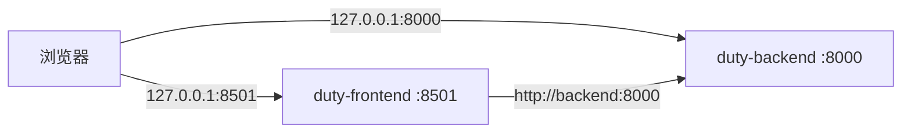

# 第 25 章 前后端服务部署

> **节首信息条**｜对应课次 25 · 4 学时 · 实践｜前置：第 24 章的可运行镜像；第 7 章的环境变量；基本的网络与端口概念

上一章两个镜像都构建好了，容器也能各自运行。但前端页面虽然能打开，登录却失败了。后端容器明明在跑，`/health` 也能访问，为什么前端说连不上？

原因在上一章已经埋下：前端容器里的 `127.0.0.1` 指的是前端容器自己，不是宿主机，也不是后端容器。本章解决三件事：让前端找到后端、让配置可替换、让数据不丢。最后用一份 Compose 文件把这些手工命令固定下来。

> 环境提示：本章的 `docker run`、`docker compose up` 需要 Docker 守护进程运行。教材编写环境的 Docker Desktop 未启动，实际启动容器的步骤标注为待核；Compose 文件已用 `docker compose config` 校验通过。

## 本章学习目标

读完第 25 章并完成实训后，你应该能：

1. 画出两种部署拓扑（Deployment Topology），说明前端、后端与数据库的访问路径。
2. 正确配置端口映射与环境变量，做到“同一镜像、不同环境”。
3. 用自定义网络让容器按服务名互相访问，并用卷持久化数据。
4. 用 Compose 固定多容器部署配置，并守住敏感配置的三条红线。
5. 按验证清单与排错四步完成一次部署验收。

## 前置知识卡

| # | 已有知识 | 回看位置 |
| --- | --- | --- |
| 1 | 本章依赖的前置内容 | 第 24 章的可运行镜像；第 7 章的环境变量；基本的网络与端口概念 |
| 2 | 上一章的核心结论 | 见上一章「本章小结」 |
| 3 | 本章实训/案例所需的环境与数据 | 见本章实训「二、课前准备」或章首导入 |

> 卡住时先回看，不必从头重读。

## 25.1 概念讲解

### 25.1.1 部署拓扑：两种访问路径



*图 25-1：浏览器与容器之间的访问路径*

| 访问方 | 应该用 | 原因 |
| --- | --- | --- |
| 浏览器 | `http://127.0.0.1:8501` / `:8000` | 走宿主机映射端口 |
| 前端容器访问后端 | `http://backend:8000` | 走容器网络，用容器端口 |

容器之间通信不使用宿主机的映射端口；`-p 8000:8000` 是给宿主机用的，不是给另一个容器用的。

### 25.1.2 端口映射与容器端口

`-p 8000:8000` 左边是宿主机端口，右边是容器端口。`EXPOSE 8000` 只是声明，不负责对外发布。前端容器访问后端时，用的是后端容器的 8000 端口，不是宿主机的映射端口。

### 25.1.3 环境变量：同一镜像，不同环境

**代码 25-1-2** · 命令（Bash）

```bash
docker run -d --name duty-backend \
  --network duty-net \
  --network-alias backend \
  -p 8000:8000 \
  -e DATABASE_URL="sqlite:///./duty.db" \
  -e SECRET_KEY="classroom-demo-key" \
  -e ALGORITHM="HS256" \
  -e DEBUG="False" \
  duty-backend:1.0
```

| 参数 | 作用 |
| --- | --- |
| `--network duty-net` | 加入自定义网络 |
| `--network-alias backend` | 给容器起网络别名，前端可用 `backend` 访问 |
| `-p 8000:8000` | 宿主机 8000 → 容器 8000 |
| `-e KEY=VALUE` | 注入环境变量 |

同一个镜像，开发环境可以 `DEBUG=True`、用本地数据库；部署环境用 `DEBUG=False`、用部署目录的数据库。镜像不变，变的只是启动时注入的环境变量。

### 25.1.4 自定义网络：容器名可以互相解析

Docker 默认的 `bridge` 网络只提供 IP，不保证用容器名互相解析。自定义网络自带 DNS：同一网络里的容器可以用容器名或网络别名（Network Alias）访问。

**代码 25-1-4** · 命令（Bash）

```bash
docker network create duty-net
docker network inspect duty-net
docker inspect -f "{{json .NetworkSettings.Networks}}" duty-backend
```

### 25.1.5 数据持久化：容器可删，卷要留

容器层的数据会随容器删除而丢失。数据库文件与日志要挂载到宿主机：

**代码 25-1-6** · 命令（Bash）

```bash
mkdir -p data logs
cp duty.db data/duty.db

docker run -d --name duty-backend \
  --network duty-net \
  --network-alias backend \
  -p 8000:8000 \
  -v "$(pwd)/data:/app/data" \
  -v "$(pwd)/logs:/app/logs" \
  -e DATABASE_URL="sqlite:///./data/duty.db" \
  -e SECRET_KEY="classroom-demo-key" \
  -e ALGORITHM="HS256" \
  -e DEBUG="False" \
  duty-backend:1.0
```

| 方式 | 写法 | 特点 |
| --- | --- | --- |
| 绑定挂载 bind mount | `-v 宿主机路径:容器路径` | 宿主机能直接看到文件，课堂推荐 |
| 数据卷 volume | `-v 卷名:容器路径` | 由 Docker 管理，便于迁移 |

验证：新建一个部门，删除后端容器，用同样命令重建，部门还在；`logs/app.log` 在宿主机能看到。数据库文件、日志不要打进镜像；容器是“一次性的”，需要保留的东西必须放在卷里。

### 25.1.6 前端指向后端

**代码 25-1-8** · 命令（Bash）

```bash
docker run -d --name duty-frontend \
  --network duty-net \
  -p 8501:8501 \
  -e DUTY_API_BASE_URL="http://backend:8000" \
  duty-frontend:1.0
```

| 写法 | 谁在用 | 结果 |
| --- | --- | --- |
| `http://127.0.0.1:8000` | 前端容器内 | 指向前端自己，失败 |
| `http://duty-backend:8000` | 同一自定义网络内 | 用容器名解析，成功 |
| `http://backend:8000` | 同一自定义网络内 | 用网络别名解析，成功 |

网络不通时，先进入前端容器用 Python 或 curl 测，不要只看浏览器：

**代码 25-1-10** · 命令（Bash）

```bash
docker exec -it duty-frontend sh
python -c "import urllib.request; print(urllib.request.urlopen('http://backend:8000/health').read())"
```

### 25.1.7 用 Compose 固定部署配置

手写一长串 `docker run` 容易漏参数。Compose 把这些命令写成一份文件：

**代码 25-1-12** · 配置（YAML）

```yaml
name: duty-system
services:
  backend:
    build: ./duty
    ports:
      - "8000:8000"
    environment:
      DATABASE_URL: sqlite:///./duty.db
      SECRET_KEY: change-me-in-production
      ALGORITHM: HS256
      DEBUG: "False"
    volumes:
      - ./duty/logs:/app/logs
    healthcheck:
      test: ["CMD", "python", "-c", "import urllib.request; urllib.request.urlopen('http://127.0.0.1:8000/health')"]
      interval: 10s
      timeout: 5s
      retries: 5
      start_period: 20s

  frontend:
    build: ./duty_frontend
    ports:
      - "8501:8501"
    environment:
      DUTY_API_BASE_URL: http://backend:8000
    depends_on:
      backend:
        condition: service_healthy
```

`services` 定义两个服务；`build` 指定构建上下文；`ports` 做端口映射；`environment` 注入配置；`volumes` 挂载日志；`healthcheck` 判断后端是否可用；`depends_on` 让前端等后端健康后再启动。

### 25.1.8 敏感配置的三条红线

`SECRET_KEY` 不写进 Dockerfile、不提交到 Git；生产环境用安全的密钥注入方式，不用课堂示例值；`.env` 文件本身也要加入 `.gitignore`。

### 25.1.9 部署验证清单

- [ ] 浏览器能打开 8501；
- [ ] 管理员账号能登录；
- [ ] 部门列表能显示数据；
- [ ] 新建一个部门后刷新仍在；
- [ ] 删除后端容器再重建，数据仍在；
- [ ] 未登录直接访问接口返回 401。

### 25.1.10 排错四步

**代码 25-1-14** · 示例（文本）

```text
docker ps → 容器是否在跑、端口是否映射
docker logs 服务名 → 启动是否报错
docker exec ... python/curl → 容器内网络是否通
环境变量 → 地址、数据库路径、密钥是否正确
```

常见问题：前端提示无法连接，先查 `DUTY_API_BASE_URL` 是否是 `http://backend:8000`；连不上后端，查两个容器是否在同一网络、别名是否存在；401 查用户与 `SECRET_KEY`；数据库空查 `DATABASE_URL` 与挂载路径；容器重启后数据丢失，查是否挂载了 `data/`。

## 25.2 示范例题

#### 例 25-1：写一份双服务 Compose 配置【Bloom：应用】

**题目**：写一份 Compose 配置：后端构建 `./duty`、映射 8000、注入数据库地址与密钥；前端构建 `./duty_frontend`、映射 8501、把后端地址配成 `http://backend:8000`；前端等后端健康后再启动。

**解**：

**代码 25-2-1** · 配置（YAML）

```yaml
name: duty-system
services:
  backend:
    build: ./duty
    ports:
      - "8000:8000"
    environment:
      DATABASE_URL: sqlite:///./duty.db
      SECRET_KEY: change-me-in-production
      ALGORITHM: HS256
      DEBUG: "False"
    healthcheck:
      test: ["CMD", "python", "-c", "import urllib.request; urllib.request.urlopen('http://127.0.0.1:8000/health')"]
      interval: 10s
      timeout: 5s
      retries: 5
      start_period: 20s

  frontend:
    build: ./duty_frontend
    ports:
      - "8501:8501"
    environment:
      DUTY_API_BASE_URL: http://backend:8000
    depends_on:
      backend:
        condition: service_healthy
```

关键点：前端用服务名 `backend` 访问后端，不用 `127.0.0.1`；`depends_on` 配合 `healthcheck`，避免前端在后端未就绪时启动。

#### 例 25-2：诊断“前端连不上后端”【Bloom：分析】

**题目**：前端容器与后端容器都在运行，浏览器能打开 8501，但登录提示无法连接后端。请按四步排查，并说明最可能的原因。

**解**：

1. `docker ps`：两个容器是否都在运行，8000/8501 是否映射。
2. `docker logs duty-frontend`：前端是否报连接错误；`docker logs duty-backend`：后端是否正常启动。
3. `docker exec -it duty-frontend sh`，用 Python 访问 `http://backend:8000/health`：如果失败，说明两个容器不在同一网络，或后端没有 `backend` 别名。
4. 检查环境变量：`docker exec duty-frontend env | grep DUTY_API_BASE_URL`。如果是 `http://127.0.0.1:8000`，前端在找自己，必然失败。

最可能原因：`DUTY_API_BASE_URL` 仍指向 `127.0.0.1`，或两个容器不在同一自定义网络。修正：把前端加入 `duty-net`，设置 `DUTY_API_BASE_URL=http://backend:8000`，后端加 `--network-alias backend`。

## 25.3 引导练习

#### 例 25-3（引导练习）：手工启动前后端并连通【Bloom：应用】

**题目**：写出创建网络、启动后端（别名 `backend`）、启动前端（指向 `http://backend:8000`）的命令序列，并给出容器内验证连通性的方法。

#### 例 25-4（引导练习）：用环境变量切换配置【Bloom：应用】

**题目**：同一个后端镜像，开发环境要 `DEBUG=True`，部署环境要 `DEBUG=False`。请写出两种启动方式的 `-e` 参数，并说明镜像是否变化。

## 25.4 独立习题

#### 习题 25-1【Bloom：理解】

**题目**：说明 `depends_on` 与 `healthcheck` 各自解决什么问题，为什么只写 `depends_on` 不够。

#### 习题 25-2【Bloom：应用】

**题目**：为后端与前端写一份 Compose 配置：后端映射 8000、注入 `DATABASE_URL` 与 `SECRET_KEY`、挂载日志；前端映射 8501、设置 `DUTY_API_BASE_URL=http://backend:8000`；前端依赖后端健康状态。

#### 习题 25-3【Bloom：应用】

**题目**：前端容器内要访问后端，下面三个地址哪些可用、哪些不可用？说明原因：`http://127.0.0.1:8000`、`http://duty-backend:8000`、`http://backend:8000`。

#### 习题 25-4【Bloom：分析】

**题目**：部署后出现四个现象：前端提示无法连接、后端容器启动即退出、登录返回 401、重建容器后数据丢失。请分别给出最可能的原因与排查步骤。

## ◆ 实训 25-1：前后端服务部署（对应课次 25 · 4 学时）

### 一、任务目标与验收

| 目标 | 验收标志 |
| --- | --- |
| 拓扑清楚 | 前端/后端/数据库访问路径可画出 |
| 端口与环境变量正确 | 宿主机可访问、配置不写死 |
| 网络与卷可用 | 服务名可解析、重启后数据仍在 |
| Compose 可复现 | 一条命令启动全部服务 |
| 验证与排错 | 清单逐项通过、能按四步定位 |

### 二、课前准备

- 第 24 章的两个镜像
- 一份部署拓扑草图
- `.env` 与 `.env.example`

### 三、操作步骤

1. **定拓扑与端口**
   - 做什么：定拓扑与端口
   - 操作：`画拓扑，确定宿主机端口与容器端口`
   - 预期输出：→ 访问路径清楚
   - 做错会看到什么：混淆 `EXPOSE` 与 `-p`；映射以 `-p`/compose ports 为准
2. **配环境变量**
   - 做什么：配环境变量
   - 操作：把数据库地址、密钥放进 `.env`
   - 预期输出：→ 代码中无硬编码
   - 做错会看到什么：密钥写进 compose 明文；改用环境变量并限制权限
3. **建网络与卷**
   - 做什么：建网络与卷
   - 操作：`用自定义网络与命名卷`
   - 预期输出：→ 服务名可解析、数据持久
   - 做错会看到什么：用 IP 直连；改用服务名
4. **Compose 与验收**
   - 做什么：Compose 与验收
   - 操作：`写 compose 文件，一条命令启动并逐项验证`
   - 预期输出：→ 全部服务健康、重启数据仍在
   - 做错会看到什么：容器名冲突或依赖顺序错；加 healthcheck 与 depends_on

### 四、排错清单

| 现象 | 先查什么 |
| --- | --- |
| 宿主机访问不到 | 端口映射、绑定地址 0.0.0.0 |
| 容器间访问失败 | 网络、服务名、端口 |
| 重启数据丢失 | 未使用卷或卷路径错 |
| 密钥泄露 | compose/镜像/仓库中的明文配置 |

### 五、提交与验收

提交 compose 文件、拓扑图与验收记录；验收按“拓扑与网络”“配置安全”“可复现部署”三项判定。

### 六、课后扩展

- 加 healthcheck 与自动重启策略
- 把 compose 拆成 base + override
- 写一份部署手册与回滚步骤

### 七、回链

- 第 24 章镜像；第 7 章环境变量；本章 25.1.1–25.1.10

## 本章小结

**核心结论**：

1. 浏览器走宿主机映射端口，容器之间走容器网络与容器端口；容器里的 `127.0.0.1` 指容器自己。
2. 同一镜像通过环境变量适配不同环境；密钥、数据库地址不写进镜像，也不进 Git。
3. 自定义网络提供容器名/别名解析；后端加 `--network-alias backend`，前端用 `http://backend:8000`。
4. 数据与日志挂载到宿主机；容器可删，卷要留。
5. Compose 把手工命令写成一份文件；`depends_on` 配合 `healthcheck` 控制启动顺序；排错按“ps → logs → exec 测网络 → 环境变量”四步。

**学完本章，你可以体会到**：部署不是“把容器跑起来”，而是让环境、网络、配置与数据都能被复现和回滚。
**自检**：回到章首的学习目标，逐条问自己做到了没有——

- [ ] 画出两种部署拓扑，说明前端、后端与数据库的访问路径。 → 回看 25.1.1–25.1.2，自测：习题 25-1
- [ ] 正确配置端口映射与环境变量，做到“同一镜像、不同环境”。 → 回看 25.1.3–25.1.4，自测：习题 25-1
- [ ] 用自定义网络让容器按服务名互相访问，并用卷持久化数据。 → 回看 25.1.5–25.1.6，自测：习题 25-1
- [ ] 用 Compose 固定多容器部署配置，并守住敏感配置的三条红线。 → 回看 25.1.7–25.1.8，自测：习题 25-1
- [ ] 按验证清单与排错四步完成一次部署验收。 → 回看 25.1.9–25.1.10，自测：习题 25-1

**下一章预告**：前后端已经能联通。下一章做部署综合实践：用一份 Compose 文件从零启动整套系统，用日志与健康检查排查故障，并完成交付验收。

